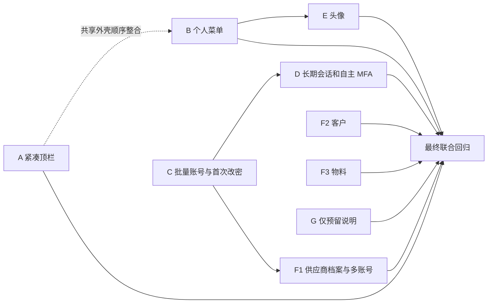

# QMS P0/P1 分单元实施总计划

> 面向执行代理：依项目 `qms-superpowers-zh` 路由执行 `subagent-driven-development`、TDD、规格审查、质量审查与主代理验证。每个任务使用独立实现上下文，共享文件和 Git 由主代理串行整合。

**目标：** 按前期 A～G 分组交付 REQ-0013～0016，逐需求保留验收和关闭条件。

**架构：** 复用身份、账号治理、附件生命周期、工作标签及供应商/客户领域服务；F 细分为 F1 供应商、F2 客户、F3 物料；G 仅为预留说明。按可独立验证和回退的目标建立事项，不按前后端分拆 PR。

**技术栈：** NestJS、Prisma/PostgreSQL、React/Ant Design、现有 ExcelJS、对象存储/ClamAV/Worker、生成 contracts；不新增实现框架。

## 当前摘要（2026-10-17，实施接单，Asia/Taipei）

- 当前授权：负责人明确“继续推进，涉及到Issue/PR你按项目既定规则来做就行”，接续本计划获准实施范围、建 Issue、验证审查后提交/推送和建 PR；合并发布、Issue 关闭与飞书写入仍分别核对，不重复询问已批准开工。
- 基线：本地/远端 main 均为 `0d484041403fafca59721bd7f18821aee6c04ad1`（V0.0.6）；既有本线程文档改动保留，活动功能分支 `codex/p0p1-a-shell`。首次查重远端无开放 Issue/PR。
- 飞书回查：四条实际 record_id 的状态/方案未变化，revision 206，均为开发中；本次会话对计划和密码/MFA/供应商等范围的直接确认作为实际授权来源，不把机器人方案中的旧“临时密码不可回显”限制覆盖本次确认。
- Issue 已建立：A [#20](https://github.com/JasonShu0722/QMS-2.0/issues/20)、B [#21](https://github.com/JasonShu0722/QMS-2.0/issues/21)、C [#22](https://github.com/JasonShu0722/QMS-2.0/issues/22)、D [#23](https://github.com/JasonShu0722/QMS-2.0/issues/23)、E [#24](https://github.com/JasonShu0722/QMS-2.0/issues/24)、F1 [#25](https://github.com/JasonShu0722/QMS-2.0/issues/25)、F2 [#26](https://github.com/JasonShu0722/QMS-2.0/issues/26)、F3 [#27](https://github.com/JasonShu0722/QMS-2.0/issues/27)。G 纯预留文档免单独建单。
- 版本预留：本次核对远端 main、全部开放事项、最近 PR 与本地提交后依次登记 A=V0.0.7、B=V0.0.8、C=V0.0.9、D=V0.0.10、E=V0.0.11、F1=V0.0.12、F2=V0.0.13、F3=V0.0.14；提交前仍须检查并发占用，不改包版本或建 tag。
- 当前工程：A 已完成相关原有 Web 基线 2 文件/21 测试（标签及导航）PASS，独立实现上下文开始 A 红绿；C 使用另一独立上下文准备账号链路。全量 Web 初始基线因耗时中断，仅首个 admin 套件 15 项通过，不能记全量 PASS。
- 真实资源：已启动一次性 PostgreSQL 18 容器 `qms-p0p1-20261017-pg`，loopback 55517；迁移及本地随机账号 seed 通过。凭据与密钥仅存 Git 外 `D:/WorkSpace/QMS-2.0-local/p0p1-test-env-20261017.ps1`，未连接保留预览 55440。
- 分别状态：Issue 已创建；A/C 实施中；PR/部署/最终验收/关闭/飞书回填/提交推送尚未执行。下一动作是 A 独立规格和质量审查、当前源码验证后提 PR，并接 B；C 按独立文件范围继续。
- A 当前证据：实现上下文 `implement_a`，规格审查 `review_a_spec` PASS，质量审查 `review_a_quality` PASS；主代理修正测试不兼容选项和浏览器重挂载/抽屉精确定位后，27 项 Web 定向测试 PASS，lint/build PASS（构建保留现有大包提示），真实浏览器 `p0p1-a-browser-r7.log` 双门户 2/2 PASS（45.7s）。三档尺寸、六主题、英文切换、反馈试点击和未保存关闭均覆盖；专注在真实不存在对象的工作空间错误态验证外壳，不扩写业务对象主链。原失败/断连日志保留。提交前再核对相关快照，C/B 的正在编写文件不能混入 A。

## 历史摘要（2026-10-17，计划编制，UTC+08:00）

| 项目 | 当前事实 |
| --- | --- |
| 本轮授权 | 负责人要求“继续推进计划制定，注意参照前期你策划过的交付单元拆分”；授权完成可评审的实施计划和必要规格纠偏，尚未执行业务实现或外部建单 |
| 基线 | `main` / `0d484041403fafca59721bd7f18821aee6c04ad1`；本轮开始已有本线程的术语、导航、策划及三份规格本地改动，全部保留；部署 SHA 未查 |
| REQ | 0013=`rec28mipZSRu6t`；0014=`reczz28OHZTVnF2H`；0015=`reczz28OHe4q2CDK`；0016=`reczz28OHgapBJZb`；最近一次飞书 revision 206 是历史读取，本轮未重新查询 |
| 分别状态 | 计划已编制，业务代码/迁移/契约未执行；Issue/PR/部署/验收/关闭/飞书回填/Git 提交推送均未执行 |
| 版本 | 本次不分配或预留发布号；实际接单及提交前按交付流程查远端、开放事项及本地预留后统一分配 |
| 证据 | 本次只执行文档/治理检查，实际结果补至末节；无业务 PASS，不因计划中有命令就当作执行过 |
| 下一动作 | 计划评审后按获准单元进入建单与实现；A/B 可先启动，C/F1 的具体决策在下表明确，不能阻塞独立单元 |

来源：[已确认业务决定](2026-10-17-qms-p0-p1-development-planning.md)、[身份规格](../specs/2026-10-17-qms-p0-p1-identity-account-design.md)、[基础数据规格](../specs/2026-10-17-qms-p0-p1-master-data-design.md)、[外壳规格](../specs/2026-10-17-qms-p0-p1-shell-design.md)。交付检查点依[交付流程](../../../qms-2.0/docs/DELIVERY-MAINTENANCE-PROCESS.md)，证据与门禁依[开发治理](../../../qms-2.0/docs/DEVELOPMENT-GOVERNANCE.md)。

## 1. 保留 A～G，固定实施归属

| 单元 | 需求 | Issue 目标草案 / 拟用分支 | 依赖与独立交付 | 执行计划 |
| --- | --- | --- | --- | --- |
| A | 0016 | 压缩共享顶栏并保留工作标签行为 / `codex/p0p1-a-shell` | 可独立验收；B 共享顶栏顺序整合，不把 B 当 A 完成条件 | [A/B/E](2026-10-17-qms-p0-p1-web.md) |
| B | 0013 菜单 | 个人菜单、修改密码定位与退出确认 / `codex/p0p1-b-account-menu` | 使用已有账号 API；A 先入则在其基线上落菜单，也可独立适配现有顶栏 | [A/B/E](2026-10-17-qms-p0-p1-web.md) |
| C | 0014 | 批量账号、首次改密、有效临时密码及直接重置 / `codex/p0p1-c-account-batch` | 后端状态/批量/Web 是一个可使用目标，内部任务分步，默认一个 Issue/PR | [C/D](2026-10-17-qms-p0-p1-identity.md) |
| D | 0013 会话/MFA | 记住登录与管理员自主 MFA / `codex/p0p1-d-session-mfa` | 接续 C 的首次改密状态，联合验证所有认证路径；身份共享源码串行 | [C/D](2026-10-17-qms-p0-p1-identity.md) |
| E | 0013 头像 | 本人头像上传、更换、移除和显示 / `codex/p0p1-e-avatar` | B 提供显示位置；头像读写可先独立实现，最终与 B 集成；真实存储/扫描是必需条件 | [A/B/E](2026-10-17-qms-p0-p1-web.md) |
| F1 | 0015 供应商 | 独立供应商档案、批量新增及管理员开通多账号 / `codex/p0p1-f1-supplier-master` | C 提供临时密码和账号创建公开入口；档案可先做但完整 F1 要验隔离及历史升级 | [F1/F2/F3/G](2026-10-17-qms-p0-p1-master-data.md) |
| F2 | 0015 客户 | 平台管理复用客户档案并支持批量新增 / `codex/p0p1-f2-customer-master` | 复用 D1 客户服务，可与 C/D 独立准备 | [F1/F2/F3/G](2026-10-17-qms-p0-p1-master-data.md) |
| F3 | 0015 物料 | 物料编码/名称维护与批量新增 / `codex/p0p1-f3-material-master` | 独立领域，可与 F2 并行准备；注册/权限/迁移由主代理协调 | [F1/F2/F3/G](2026-10-17-qms-p0-p1-master-data.md) |
| G | 0015 预留 | 外部接收边界与未启用契约说明 | 纯文档免独立 Issue/PR；与 F 文档同步，保持需求验收项 | [F1/F2/F3/G](2026-10-17-qms-p0-p1-master-data.md) |

计划基准为 **8 个功能单元的 Issue/PR + G 纯文档任务**；实际执行先查重，已有同目标事项就复用。分支名是草案，不能当作已经存在。一个单元合并前持续更新同一 PR；后续发现独立目标才调整分组并说明理由。C/D 一份子计划不代表合成一个 PR；A/B 共享文件也不是合并理由。

### 需求验收与关闭映射

| REQ | 必须完成的单元 | 可单独报告的阶段事实 | 整条结束条件 |
| --- | --- | --- | --- |
| 0013 | B、D、E | 菜单完成、长期会话完成、头像完成分别报告 | 三单元及与 A/C 的受影响联合项在最终部署版本通过，相关 Issue 按授权关闭并完成回填 |
| 0014 | C | API、Web、真实 PG、浏览器分别记证据 | 批量、临时密码交付/清除、首登改密、直接重置全部通过 |
| 0015 | F1、F2、F3、G | 每类清单独立验收；G 仅证明预留 | 三清单、供应商多账号/隔离和无外部接收暴露共同通过，不把其中一项通过写成整条结束 |
| 0016 | A | 可早于 B/D/E 完成自己的工程交付 | 单行顶栏及标签回归通过，并完成受后续顶栏变化影响的最终复验 |

## 2. 实施顺序和文件所有权

建议启动批次：A/B 的外壳任务与 C 的账号任务先行；F2/F3 在不同文件上独立准备；C 的状态完成后接 D 与 F1；E 在存储扫描前置具备后接入。没有固定“全部 P0 结束才能做 A”的限制，A 是 B 的公共布局工作。

| 共享位置（相对 `qms-2.0/`） | 归属与顺序 |
| --- | --- |
| `apps/web/src/layouts/ShellHeader.tsx`、`shell.css`、双布局 | A 改结构，B 加菜单，E 接头像；每步读取前一步内容，禁止三份实现覆盖 |
| `apps/api/src/modules/identity/`、`common/security/session-security.ts` | C 先固定首次改密和密文状态，D 再接会话/MFA；F1 只调用公开账号服务 |
| `apps/api/prisma/schema.prisma`、新迁移 | C → D → E/F1/F3 按实际合入顺序串行建增量迁移，不预先抢时间戳、不改历史迁移 |
| `permission-catalog.ts`、`app.module.ts`、`governance/module-boundaries.json` | 主代理整合 F1/F3/E 的注册与最小公开依赖，不交给并行任务分别全文件重写 |
| `packages/contracts/src/generated/api.ts`、`apps/web/src/api/client.ts`、`App.tsx`、导航/语言文件 | 主代理在对应 PR 快照上串行生成/整合；每个 PR 独立可构建，不能靠另一个未声明 PR 的生成类型 |
| 文档、Git 索引/分支、测试中源码 | 主代理所有；整合验证期间冻结覆盖源码；一条功能分支一个未合并 PR |

## 3. 计划中的推荐取值与业务决定分开

| 项目 | 推荐实施口径 | 来源与执行边界 |
| --- | --- | --- |
| 临时密码有效期 | 签发起 7 天固定有效，到期禁止该临时密码登录，管理员可重新重置；用户改密立即删除可恢复密文 | 是本次计划建议，前期只批准“有效期内可查、到期清除”，未批准具体天数；C 实施前只确认此数值，不重问整个账号方案 |
| 三类主数据错误行 | 逐行事务；合法行提交，重复跳过，非法行失败；每批 1～100 行；结构/整批权限/大小错误写入前拒绝 | 重复跳过已批准；部分提交和 100 行是复用现有 D4 约束后的推荐，需要 F 执行前固定，不能冒充用户原话 |
| 头像 | 本人可见，JPEG/PNG，2 MiB 上限，不加裁剪系统；复用真实扫描 | 是本次最小实现建议，规格评审时核对；扫描/资源授权不可省略 |
| 供应商企业边界 | 导入时档案无组织；管理员显式开通协作时关联已有组织，或受控创建供应商隔离组织；一个企业可有多人账号 | 是为保留既有隔离的技术路线，不能把导入时隐藏建组织当作实现；异常/历史不明映射要失败，不能靠名称猜测合并 |
| MFA | 管理员本人显式关闭必须实际生效，包括原角色要求；失去管理员身份后恢复普通账号原策略 | 纠正上一稿“角色覆盖本人关闭”的矛盾，依据管理员可自主开关的已确认目标；普通账号策略不扩展 |
| 未记住会话 | 继续 8 小时；记住登录管理员 7 天、其他 30 天，固定到期 | 8 小时沿用现状，7/30 天来自会话确认，不做滑动续期 |

推荐值清单使计划可评审，不把未决定项埋进代码。C/F/E 可在确认各自对应项后独立执行；其余单元不受这些局部决定阻塞。本次继续的是计划制定，不创建外部事项，不将这份计划当作源码开工批准。

## 4. 每单元固定的交付检查点

- [ ] S0：读取本总计划、所属子计划及目录 AGENTS；按实际 record_id 回读需求全文与批准来源，比较本次会话确认和机器人基线差异；保留已知本地文档改动。
- [ ] S1：进入业务执行时查重/关联/创建对应 Issue，正文包含本表分组、范围、单元验收、依赖、回滚、REQ/record_id；保存实际 URL。纯文档 G 记录免单理由。
- [ ] S2：建立或复用活动 checkout 的隔离功能分支；核对 HEAD、暂存区和进行中操作；任务实施先红灯、最小实现、绿灯与邻近回归；独立实现上下文须收到任务全文和文件所有权。
- [ ] S3：按单元做规格审查，再质量/权限/迁移审查；修复阻断项后主代理在冻结源码上独立验证，写实际 SHA、运行时和 Git 外证据位置。
- [ ] S4：本地通过后核对并分配版本、提交/推送、创建或更新该单元 PR，正文普通关联 Issue，附加到当前聊天；CI 与代理证据分开。建 Issue 和最终建 PR 是两个独立动作。
- [ ] S5：获准合并/发布时按依赖顺序集成，每版本核对 main 检查、源码 SHA、镜像、迁移、Worker、健康、HTTP 和目标行为；依赖更新后重新核对 PR base/head。
- [ ] S6：在最终包含本批单元的部署 SHA 上逐 REQ 和联合回归；失败保持相应 Issue 开放，沿原事项修复；仅未覆盖浏览器按已批准人工清单接续，机器门禁仍实际运行。
- [ ] S7：有关闭/外部同步授权后先写验收证据再关闭并回读 Issue，逐记录最小回填/回读飞书；链接、部署、验收、完成时间分别依据事实，不以文档计划完成代替业务结束。
- [ ] S8：复盘并更新实际涉及的权威文档与来源摘要；无新通用规则就记理由，具体 A～G 顺序仅留本次计划，不硬编码进全局 Skill；归档未完成同步与下一负责人。

## 5. 验证入口和证据矩阵

所有实施/验证 shell 先加载 `. D:/WorkSpace/QMS-2.0-local/Enter-Qms.ps1`，确认 Node `>=24.21.0 <25` / pnpm `>=11.19.0 <12`；命令均在 `qms-2.0/` 执行。一次性 PG/网关/存储/Worker 由执行时创建，禁止连接保留预览 `55440`，不将凭据写进计划或 Git。

PG 定向命令的明确准备顺序：Git 外环境指向新建一次性数据库并校验实际 host/port/database → `corepack pnpm --filter @qms/api db:generate` → `corepack pnpm --filter @qms/api db:migrate:deploy` → `corepack pnpm --filter @qms/api db:seed` → 子计划 Jest exec。只接受临时库，旧库升级测试另在隔离副本建立前一版本数据；不能让 seed 重置现有保留库。业务定向红灯要求测试实际运行且因缺失行为失败，缺服务/编译错误不算有效红灯。

| 覆盖 | 单元 | 实际需运行的入口及事实 |
| --- | --- | --- |
| 治理/归档/差异 | 全部 | `git diff --check`、`corepack pnpm check:governance`、`corepack pnpm check:archive-isolation` |
| Web 定向、完整测试/构建 | A/B/C/D/E/F | 子计划定向失败/通过；完成后 `corepack pnpm --filter @qms/web test`、`lint`、`build`；三档视口和六主题代表页 |
| API 定向、完整测试 | C/D/E/F | 子计划的单测和真实 PG；完成后 `corepack pnpm --filter @qms/api test`、`test:integration`、`lint`、`build` |
| Swagger 契约 | C/D/E/F | `corepack pnpm contracts:generate`、`corepack pnpm contracts:check`，提交生成类型；A/B 无 DTO 变更时记不适用 |
| Foundation 与 Compose | C/D/E/F 的平台变化 | `corepack pnpm acceptance:phase-1`、`corepack pnpm acceptance:phase-2`；`docker compose -f deployment/docker-compose.foundation.yml config --quiet`；E 加 `-f deployment/docker-compose.scanning.yml` |
| 受影响领域联合 | F1/F2/F3 | 供应商/客户原 PG 与门户用例、C13/PCN/通知/附件消费者；若阶段五受影响执行 `corepack pnpm acceptance:phase-5` |
| 真实浏览器 | 全部功能单元 | `corepack pnpm --filter @qms/web test:e2e` + 子计划新用例；隔离环境/账号由受控夹具准备，证据不记录口令。连接故障按现有人工接续规则记录实际未执行项 |
| 最终联合业务 | 本批整合 | 临时密码登录→首次改密→MFA→记住登录→账号菜单→退出；供应商档案→两个供应商用户→企业隔离；三类导入重复→不覆盖→平台入口 |

每份证据记录检查编号、REQ/单元、源/部署 SHA、角色与组织、环境、命令、预期、实际、退出码、来源和 Git 外位置。不存在的角色/设备/服务明确未执行，不能填 PASS。各 PR 自身快照与最后整合快照分别记账。

## 6. 回退与沉淀

- A/B：按各自提交恢复共享布局或菜单，保留服务端会话和标签数据；回退后核对已打开/未保存页。
- C/D：应用回退不能消除新认证状态；新增数据只前向修复。旧程序不认识 `mustChangePassword` 或 MFA 偏好时禁止直接上线旧镜像，应先恢复兼容版本/禁用入口并撤销受影响会话；不把删除密文或恢复失效临时密码作为回退。
- E：取消头像引用可回退 UI，但不物理删除受保留保护对象；恢复后仍实时授权。
- F1：旧数据绑定保留，迁移遇模糊映射明确失败；新增无组织档案存在后旧程序不可直接回退，先停止入口并执行经真实库验证的前向兼容修复。F2/F3 不因失败回滚整批已成功行，也不删除用户既有资料。
- G：仅文档前向修订，证明无新运行端点。
- 沉淀目标：`ACCOUNT-ADMINISTRATION.md`/`SECURITY.md`（安全状态和临时密码）、`ATTACHMENTS.md`（本人头像资源）、`SUPPLIER-PLATFORM-HANDOFF.md`/`PHASE-5.md`（档案和隔离）、`FRONTEND-DESIGN.md` 与统一规格（单行顶栏）。在对应真实结果成立后更新能力状态、索引/来源摘要及 `FOUNDATION.md` 验收；本次不提前将能力改为完成。

## 7. 本次计划验证记录

本节只登记计划编制检查；业务用例、数据库、浏览器、发布均未执行，不登记计划中的业务门禁为通过。

- 代理执行，2026-10-17，活动入口核验 Node `v24.21.0`、pnpm `11.19.0`；HEAD 与本摘要一致。
- 对本线程 8 份根目录设计/策划文档执行一次性内容检查：28 个本地链接全部存在，A/B/C/D/E/F1/F2/F3/G 与 S0～S8 均有任务归属，8 份均有文档导航，无未完成占位，PASS。
- `git diff --check` 退出 0；`corepack pnpm check:governance` 完成治理/文档/维护检查及阶段五覆盖 1/1，输出 36 份工程文档、246 个本地链接、20 份来源复核、115 组允许模块依赖；未发现治理失败。
- `corepack pnpm check:archive-isolation` 退出 0，`archive isolation: PASS`。本次没有归档目录改动或业务源码改动。
- 自检修正：管理员自主 MFA 与角色覆盖矛盾；删除物料来源属性；批量回执只存无秘密元数据；补 nullable 复合外键约束、真实迁移前置、头像 Blob 显示路径和现有适配器注册方式。
- 当前成果均为本地文档，未提交/推送；尚无独立功能实现、规格/质量代码审查或业务验收，不能将本文检查作为其完成证据。
