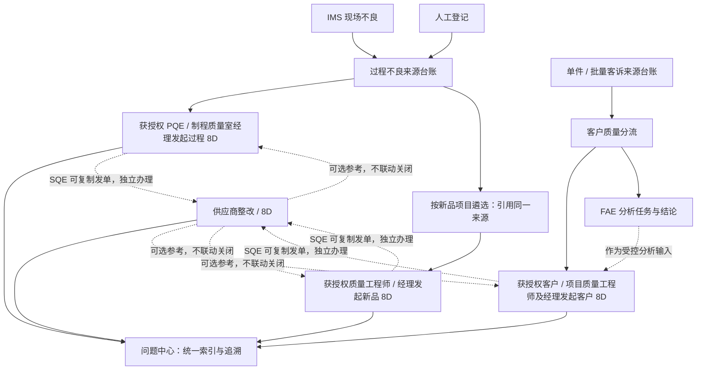

# 各板块问题管理与正式构建上线研讨草稿

## 0. 当前摘要与使用边界

| 项目 | 本次记录 |
| --- | --- |
| 准备时间 | 2026-10-23，Asia/Taipei；供 2026-10-24 上午讨论 |
| 文档状态 | 讨论草稿。负责人本次提出的方向、既有规则、源码事实和补充建议分别说明；未决事项不作为开发指令 |
| 本次授权 | 查阅只读历史、核对 QMS 2.0、维护中文策划及独立组织岗位样例；负责人已认可页面交互，并授权将需求聚合约 5 条提交飞书，不等于正式业务或生产配置已实施 |
| 源码基线 | 活动 checkout `D:/WorkSpace/QMS-2.0`，HEAD `784735deaeb0e1c2269d5870434b2d9ea0619a01`，提交标题 `V0.0.27 统一岗位权限与用户任职授权 (#63)`；核查起点工作区干净，HEAD 为 detached 状态 |
| 当前检查点 | D01～D67 已逐项沉淀，来源规则及未决项归并到[完整需求清单](2026-10-24-qms-problem-management-requirements-list.md)；独立组织岗位样例依前置计划第 4.1 节制作及验证，不扩大生产组织录入或自动迁移误建对象。未执行本轮业务服务验收或线上验证 |
| 本轮补充验证 | IMS 截图与源码静态对照后，`check:governance` 的文档部分通过，维护检查因既有 `MAINT-001` 于 `2026-10-23` 到期而失败；未改动或延期该事项。`git diff --check` 通过；未运行 IMS / AI 业务验证 |
| 交付映射 | 已按负责人要求提交 REQ-0025～0029，见[五条提单](2026-10-24-qms-five-requirement-submission.md)；74 个 QMS-DISC 仅内部追溯，不逐项建单。未建立本轮 Issue / PR 或分配发布版本，正式实施接续实际映射 |
| 下一动作与责任 | Codex 将已充分讨论的业务主线整理为工程规格、五条需求的交付与验收矩阵，按实际授权接续；工程细化与接口资料不整包返询负责人，确实改变已定业务含义的具体冲突才单点提请决定 |

本草稿不替代[阶段四设计](2026-09-24-qms-2.0-phase-4-domain-quality-design.md)、[平台接入协议](../../../qms-2.0/docs/PROBLEM-WORKSPACE.md)或[交付流程](../../../qms-2.0/docs/DELIVERY-MAINTENANCE-PROCESS.md)。已明确确认的业务规则与仍待决定的建议分别标注；确认设计不等于正式业务开发或上线完成，后续规范化修订与交付依对应授权接续。

2026-10-24 整理说明：本轮业务主干已充分讨论，最新完整清单将原宽泛“待确认”拆分为工程细化、真实对接资料、实际上线准备；正文保留的早期待决措辞需结合最新确认阅读，不作为要求负责人重新确认整包业务的依据。确实新增业务规则或改变已定权限的具体冲突才单点提请决定，工程人员不借此自行扩权或删减一期。

源码基线与部署版本必须分开。当前提交已包含岗位授权变更，但部分能力总账和历史计划仍保留“本地实现 / Draft PR”等旧阶段文字；本次不据此推断线上版本，也不把历史 PASS 作为新主链通过的证据。

## 1. 负责人本次提出的业务方向

| 板块 | 本次输入 |
| --- | --- |
| 过程质量 | IMS 同步及手工登记形成台账，关联物料 / 供应商；获授权 PQE / 制程质量室经理单选或多选发起 8D，实际发单人专业审核；SQE 可复制向供应商独立发单 |
| 客户质量 | 人工录入单件、批量客诉；勾选是否需要功能解析，交 FAE 处理；客户质量工程师单选或多选不良数据发起 8D；物料不良由 SQE 复制向供应商发单 |
| 新品质量 | 从过程质量数据按新品项目遴选，形成新品试产问题台账基础；项目质量工程师单选或多选不良数据发起 8D；物料不良由 SQE 复制向供应商发单 |
| 供应商质量 | 以供应商问题响应与整改为主，同时承接其他板块转入的问题 |
| 共同能力 | 与已规划工作流衔接，明确任务流转、问题中心及各板块可视化图表，形成落地规范和后续构建上线活动 |

本轮负责人结合 IMS“流转不良查询”截图进一步明确：来源包含时间、线体、追溯码、不良描述相关信息；需要维护成品编码到项目号 / 类型等信息的对照清单；需要用 AI 从不良项目名称、备注等字段总结提炼不良描述。这两项作为本轮明确需求，具体字段、维护责任、异常处理和 AI 结果确认方式继续讨论，见第 5.4～5.5 节。

负责人已明确一行代表一条不良线索，同条码在其他工序出现的问题分别保留。入账规则本轮进一步确定为正常记录自动入账，异常记录也保留入账并标注异常，不采用此前建议的“异常只留原始接收区、暂不进入台账”。空字段不自动等于整行无效；原始记录继续后台备查，数据问题按实际原因提示及后补，不删除或猜填。

关于类型，负责人进一步提出区分产品类型（大类）和细分类型；PCBA 段的细分包括控制板、驱动板等。负责人已确认同一项目的控制板、驱动板、整机有各自对应的独立编码，支持以成品编码精确维护分类对照；具体大类清单、分类适用关系继续讨论。

负责人已明确人工完善应覆盖两个时点：台账归档留存后，以及发起 8D 时。可完善内容包括缺失基础信息和不准确的 AI 汇总描述，不能把编辑入口限制在正式发单之前，或仅限 AI 生成文本。

关于选取线索，负责人明确由人工筛选重点问题、类似故障描述的问题、同款物料的问题等，决定单选或多选发起 8D；这些是工程师可分别使用或组合使用的业务依据，不预设必须同时满足。

负责人已确认过程 8D 的发单资格为获授权 PQE 及制程质量室经理，不限来源登记 / 维护 / 关闭人员；实际发单人指定责任部门及问题负责人，并承担本单专业审核。工程师或科室经理均可被指定为问题负责人，组织关系复用既有架构 / 任职。关闭管理审批仍按风险：中低风险责任科室经理，经理与问题负责人同人可按既有规则跳过经理侧；高 / 重大风险责任部门部长。`CRITICAL` 中文为重大风险；发单资格扩展不自动扩大其他独立动作权限。

负责人已确认风险等级在发起 8D 时由 PQE 选择，之后可以随着问题挖掘和风险评价变化进行调整，不能将发单等级永久锁定。发单后允许调整风险的人员为 PQE、制程质量室经理、质量部长、管理员；审批期间调整如涉及审批人员变动，应提醒并自动取消待审批状态，由问题负责人重新提交。不扩大为每次升降级均自动取消；审批人员不变时的接续仍需明确。

负责人已确认分级管理审批在关闭环节，责任部门完整提交后，实际发单人专业审核与经理 / 部长关闭审批并行，两侧条件均满足才关闭。中低风险经理与问题负责人同人跳过仅满足经理侧，不免除专业审核，不因经理发单将两侧结果自动合并。过程经理发单的资格及专业审核责任见第 5.10 节，原 PQE 发单场景按此统一衔接。

负责人已确认任一侧退回后，责任部门修改并重新提交，两侧均需要重新审批；另一侧此前通过的结果只保留为历史，不延续为本轮有效结果。

负责人已确认协作编辑方式：问题负责人可以添加协作人员，允许跨部门选择，共同编辑完善该问题的 8D 内容；由问题负责人执行完整提交，协作人员不因参与编辑获得提交资格。不将此前建议的“协作人员仅编辑自己负责的内容”视为已确认限制。可编辑字段范围及移除后的权限接续继续确定；添加跨部门协作人员不改变问题责任部门与负责人，也不自动授予风险改级、转派或审批权限，不等于将问题转派给其他部门。

负责人已确认提交后的编辑规则：完整提交后锁定本轮 8D 表格内容，问题负责人和协作人员均不能直接修改；任一侧退回后，恢复当前有权人员的编辑资格，由问题负责人修改完善后重新提交，两侧重新审批。旧提交版本与审批记录保留，不因恢复编辑而被覆盖。此项锁定针对表格内容，不撤销已确认的专门风险调整授权；审批期间改级涉及审批人员变动时，提醒并自动取消待审批状态，由问题负责人重新提交，细则见第 9.6 节。

负责人已确认分派调整边界：办理阶段 PQE 可以撤回重派，重新指定责任部门及问题负责人；责任部门收到后，由当前问题责任人、其科室经理、责任部门部长在本部门内部转派，不能自行将问题转给其他部门。责任部门完整提交、进入双侧并行审批后，处理工作已经完成，不允许 PQE 撤回重派或责任部门内部转派；不为审批阶段额外设计这些操作的接续路线。

负责人进一步明确台账处置顺序：不良信息接收转化形成 QMS 台账后，由制程质量跟进分析进度，支持单条或批量判定不良分类；涉及物料不良时，维护具体物料编码、供应商、批次等信息。物料关系由入账后的人工分析维护取得，不能要求 IMS 原始线索或 AI 在入账时就给出判定。

负责人进一步明确过程台账由 PQC 确认关闭，PQE 跟进正式 8D，不增加 PQE 台账关闭审批。班长和 PQC 均可登记及维护台账，包含现场信息、分析进展、单条 / 批量六类判定及物料 / 供应商 / 批次补充，不将班长维护资格限定为仅本人登记的现场线索；具体数据范围按已有授权落实。台账关闭与 8D 闭环分别记录，见第 5.8 节，不将登记维护权扩大为 8D 权限。

负责人已明确责任 SQE 在不良品台账中复核 / 处置的四类为：不良属实、非物料不良、协商处理、返厂解析；对应 SQE 协作待办在 8D 正式发单后才产生。不采用“台账判为物料不良并明确供应商后立即自动产生 SQE 核实待办”的建议。台账复核、正式问题待办和向供应商发单分别记录，不因台账分类自动对外发单。

负责人已确认对供应商和对内部是两张独立单据，不做强制关联：供应商单尚未关闭时，内部原 8D 可以在自身条件满足后先关闭。不要求创建或绑定供应商单才能提交 / 关闭内部单，也不因一单关闭自动关闭另一单。复制来源留痕、可选参考及结论引用可继续讨论，但不得作为强制业务关联或关闭依赖。

负责人已确认供应商 8D 由供应商通过门户填写并提交，先由 SQE 完成专业审核，通过后才启动关闭管理审批：中低风险由科室经理审批，高风险与重大风险由科室经理和部长并行双批，均通过后才满足管理审批条件。管理审批任一人退回后，由供应商修改重提，重新经过 SQE 专业审核及新一轮管理审批，旧通过结果只留历史。供应商单分阶段安排时间：SQE 指定原因分析 / 对策制定期限，对策制定后供应商填写完整提交计划，SQE 设定计划关闭时间。管理岗位具体组织归属及延期规则继续确认；不将 SQE 审核通过直接等同于供应商单已关闭。

负责人已确认供应商单由 SQE 在发单时单独确定风险等级，不直接沿用内部原单作为最终定级；SQE 复制发单时可针对供应商实际整改范围修改复制内容，并非只能修改风险字段。修改作用于准备发出的供应商独立单，不回写内部原单；具体可复制 / 可编辑字段及披露边界继续细化，不能借复制编辑越过供应商数据隔离或附件授权。

负责人已确认供应商延期审批：中低风险由 SQE 审批，高风险 / 重大风险为 SQE → 科室经理串行审批，不需要部长延期审批；与供应商单关闭管理审批分别配置。延期申请不暂停计时，批准前按原期限、批准后按新期限，保留原期限、申请 / 批准时间及历史超期记录，与已确认的内部延期计时及留痕规则一致。

负责人已确认供应商单提交待审批时版本锁定；问题关闭后，为 SQE 及经理预留编辑更新功能，主要用于资料修补，不需要重新审批，不因该项更新自动重开问题。具体字段、岗位与本单数据范围及修订记录呈现继续确认；不将此要求解释为审批中可直接改写，或自动向供应商、部长及任意经理开放闭后编辑，也不自动套用到内部单。

负责人已确认客诉需要功能解析时可以独立派给 FAE，不必先创建 8D；FAE 或供应商解析尚未完成时，也允许获准发单人判断后人工单选 / 多选先发 8D，解析与整改可并行。不因派出或完成解析自动发单，不将“8D 发单后才产生对应 SQE 正式问题待办”的规则套到 FAE。完整提交关闭审批仍须必要对策已实施且验证有效，不以先发单代替已取得解析结论。

负责人已确认功能解析由客户质量工程师直接指定具体 FAE，FAE 内部可以转派，不先经过科室经理分配。内部转派不等于对外部任意人员开放派工；具体操作人、FAE 内部候选范围及可转派状态继续确定，不自动照搬过程 8D 的转派权限矩阵。

负责人已明确 FAE 不走解析报告提交后由客户质量工程师确认 / 退回的审批路线，而是由 FAE 直接更新解析内容。解析区同时提供文字录入及附件上传入口，文字说明或解析附件任一种有内容即可算已解析，不要求两者都填；两者均无内容算未解析。不新增“结论待复核”或人工批准解析完成的关卡。

负责人已确认客户 8D 发单资格为客户质量、项目质量工程师及对应经理均可，不受台账质量工程师归属限制；本单专业审核由实际发单人承担，见第 6.14 节。发单指定责任部门 / 问题负责人，负责人可组织跨部门协作并完整提交，发单人专业审核与分级管理审批并行：中低风险责任科室经理，高 / 重大风险责任部门部长，中低风险经理与问题负责人同人按既有规则跳过经理侧，不跳过专业审核。报告编辑及审批继续沿用已确认规则，过程专属改级 / 延期权限不自动扩大。

负责人已补充过程与客诉 8D 关联的不良台账范围可在发单后继续编辑，不是发单时定死。应支持追加相关台账记录、移除不再适用的关联，不要求为调整范围重新创建 8D；调整关联不等于删除原始台账。调整权限仅限对应工程师：过程单由 PQE 操作，客诉单由客户质量工程师操作；问题负责人及协作人员不因编辑报告或负责办理而获得此权限。已确认办理中、退回修改及关闭后均可调整；审批中默认锁定，本稿采用负责人给出的可选处理方式：提示影响并经对应工程师确认后取消本轮审批，恢复编辑，再由问题负责人重新提交，不直接在有效审批轮次中改关联。

负责人已确认一条不良台账记录允许关联多张 8D；关联时须明确提示已有单据，并提醒对应工程师确认是否属于前期问题采取对策后再次发生而重新发单。不能以已有单据为由强制禁止关联，也不能将存在多关联自动认定为复发、原对策无效或要求重开旧单；应由人工区分再次发单的实际背景。

负责人已确认新品试产 8D 按内部整改主线统一：获准质量工程师 / 经理发单、指定责任部门 / 负责人并承担本单专业审核，项目质量跟进，见第 6.14 节；负责人组织协作及提交，专业审核与分级管理审批并行，中低风险责任科室经理、高 / 重大风险责任部门部长；新品单台账范围由项目质量工程师维护。组件映射共用项目新品 / 量产状态，转量产后保留历史及在途问题，新发生不良不再自动纳入新品、仍保留过程台账，不随状态切换删除或自动关闭。

负责人已明确组件号—项目映射及项目新品 / 量产状态的维护作为一项可配置权限开通，业务预期授权对象为管理员、项目质量室经理，不默认由所有项目质量工程师维护。不在业务代码中按岗位名称写死允许名单，复用现有岗位及有效权限链；其他人员是否可维护取决于是否经授权取得该权限及适用数据范围，不因参与项目自动获得。

负责人已确认首期不良分类共六类：物料、作业、设备、工艺、设计、误报。其他类别及分类体系扩展不纳入本轮默认范围。

负责人已确认误报的指标边界：纳入直通率统计，不纳入不良率统计。两个指标分别采用自己的纳入规则，不能笼统将误报排除于全部质量指标。

负责人已确认期限分阶段安排：PQE 指定原因分析、对策制定部分完成的时间；对策制定完成后，由问题负责人填写完整提交的计划时间，问题计划关闭时间由 PQE 设定，不要求发单时就确定完整提交期限。计划关闭时间不替代两侧审批完成后的实际关闭时间。延期申请原则上先由上一级领导审批，通过后再到 PQE 审批；已确认的领导与申请人同人例外仅跳过领导侧，详见第 9.7 节，不泛化为所有延期仅由 PQE 单级批准。

负责人已确认内部整改的阶段完成标记：由问题负责人执行“分析及对策制定完成”确认，保存当时分析 / 对策内容并记录实际完成时间，转入措施实施与有效性验证阶段，填写完整提交计划时间；不触发阶段审批，不仅凭文本框有内容自动认定完成。完整 8D 提交后才进入已确认的关闭审核，协作编辑权不自动包含阶段完成确认权。供应商侧是否采用同类标记及具体门户操作者另行确认，不直接复用内部负责人资格。

负责人已确认 D4 需先呈现分析过程，再总结原因：发生原因和流出原因分开写，另为系统因分析预留独立空间，系统因不强制填写。本轮进一步确定一期采用文字说明（原因分析总结）及分析附件上传、点击弹窗预览的方案；FTA、鱼骨图、流程图等由外部工具制作后上传佐证，一期不建设系统内绘制 / 编辑 / 保存图稿的工具，不将在线绘图作为上线阻断项。

负责人已确认 D5 / D6 使用同一份多行措施清单，D5 填计划，D6 承接各措施补实施及验证结果，不分别重复抄写。D6 还须明确改善前 / 改善后状态对比并提供佐证，总结改善导入断点批次，记录断点后跟进多少批或多长时间、验证结果及有效性结论；不以措施已完成、到达日期或上传附件自动认定有效，详见第 10.6 节。

2026-10-24 负责人进一步澄清：本处验证针对发生因、流出因对策导入后的实际产品范围，改善断点是落实对策后的首批导入批次。检验规范和设备程序变更同样应记录其实际应用的导入断点，不能仅用文件 / 程序版本或生效日期替代首批导入事实；版本和日期可作为辅助追溯信息。不采用此前将此类变更当作非批次措施而免除导入批次的建议。

负责人已同意 D7 采用横展及标准化清单，适用时填写、不适用时注明理由，不强制各类都执行；D5 / D6 已有变更及验证可引用，不重复填写。标准化清单按本轮提供图片的检查表结构设计，预置相关文件项目，允许手工新增行追加项目，具体列及预置项见第 10.7 节。

负责人提供 D3 两张现用表格作为参考：第一张包含临时对策清单及本问题客户 / 厂内库存围堵，第二张为受影响机型 / 物料的扩展围堵表，明确作为可选项。按现用表结构组织，不用此前泛化字段清单替代；具体区域及列见第 10.8 节。图片示例文字、数量和 NG 数提示不是待写入的真实业务数据，也不因第一张为主表就自动要求每个区域必须有库存或全部必填。

负责人已明确 D3 上方临时对策清单中的“完成日期”指临时措施导入时间，不是围堵全部完成、验证结束或临时措施解除的时间。正式字段说明应表达该含义，不以保存 / 提交时间自动替代；下方库存围堵表的“计划完成时间”仍按原表保留，不混用。

负责人进一步明确临时措施需要附件上传入口，必要时上传佐证；附件为按需提供，不要求每项措施都强制上传。附件应能对应到具体临时措施，复用受控上传、扫描、授权及图片 / PDF 弹窗预览，不新建独立附件系统。

负责人已确认 D2 必须保留关联台账明细，基础信息表按板块差异化；本轮现用模板作为客户质量的字段及布局参考，不强套过程、新品、供应商板块。D2 附图佐证需要体现 OK / NG 对比，不只是混排附件；图片模板中的 5W1H 说明作为问题描述填写引导，不据截图自动推定所有字段必填，详见第 10.9 节。

负责人已确认日常保存与完整提交分开校验：办理中可保存未完成内容；完整提交关闭审批前，发生因 / 流出因的必要对策须已实施且验证有效。未导入、尚待验证或验证无效时可继续完善，但不能完整提交关闭审批；系统只验证记录及结论，不自动代替质量工程师判断技术合理性。已明确非必填及按需项不借完整性检查变成强制填写，详见第 10.10 节。

负责人已明确当前统计范围：先分工序做好直通率、不良率基础数据统计；整体指标及质量目标留到质量目标部分再统一策划。本轮不提前扩展整体目标、跨工序汇总评价或综合看板。

“过程质量”和当前源码、旧文档中的“制程质量”在本文指同一业务板块。最终菜单名称在讨论中统一。“功能解析 / 失效分析”是否属于同一 FAE 业务、是否还包含非退件分析，保留为待决项，不自行改写术语。

## 2. 先给出的总体建议

### 2.1 建议沿用的主线



图中 FAE 与客户 8D 的先后、并行以及关闭门槛尚待业务确认；箭头只表示关联和输入，不表示已经实现的自动流转。

建议明确四类对象，避免一条数据同时承担多个含义：

1. **来源事实**：现场不良、客诉、试产遴选记录、IQC 异常等，回答“发生了什么、数量多少、来源是什么”。
2. **正式问题单**：PQE / 客户质量工程师 / 项目质量工程师 / SQE 决定纳入受控整改的问题，回答“这次组织解决什么问题”。
3. **专业任务及其成果**：解析、围堵、措施、审批、验证等，回答“谁在何时交付什么结果”。任务完成不自动代表问题关闭。
4. **来源与参考关系**：来源与问题、问题与 FAE 结论的引用，回答“依据来自哪里”；内部单与供应商单不强制关联，可选参考形式另行确认，不产生关闭依赖。

`problem_index` 继续作为正式问题的公共索引；各板块持有专业事实，不把全部字段挤入公共索引。

### 2.2 三种组织方式的比较

| 方案 | 业务操作与代价 | 研讨建议 |
| --- | --- | --- |
| 各板块分别管理来源、问题和状态 | 每块局部容易理解，但复制发单、跨域追溯和报表很快产生重复口径 | 不建议继续扩大 |
| 所有异常合并成一个通用问题大表单 | 统一入口直观，但现场不良、客诉实物、项目阶段门、供应商披露边界差异较大，改造面也大 | 不建议作为本次建设方向 |
| 专业来源台账 + 统一问题索引 / 流程 + 明确的跨域关联 | 保留现有 2.0 分层，补齐发单和协作接缝；来源、处理、统计可分别追溯 | **推荐作为讨论基础** |

## 3. QMS 1.0 与 2.0 应怎样衔接

### 3.1 从旧版继承业务思路

旧版的参考价值在于“先有不良 / 客诉来源，再由质量工程师选择发单”，以及新品项目、试产批次、遗留问题、供应商协同等实际业务路径。阶段四设计已经吸收这条主线，本次应在它的基础上补齐规则。

旧版代码、旧状态枚举和旧编号不直接移植。尤其要逐项辨认“有设计描述”“有接口或页面代码”“有闭环证据”，旧页面出现某个按钮或字段不能证明整条业务链曾验收。

旧版只通过 Git 中的 `archive/qms-1.0/` 开发快照查阅，未构建、测试或恢复到活动 checkout。归档提交 `63db7aa` 明确它是开发快照，不能作为曾经正式验收的证据。

| 旧版主题 | 本次查到的实际内容 | 本轮取舍 |
| --- | --- | --- |
| 过程问题 | `process_issue_service.py:80` 起已有来源不良关联、正式问题创建、回复、验证与关闭代码 | 继承来源与处理分离；避免领域单与公共问题两套状态各自更新 |
| 客户解析 / 8D | `customer_complaint_service.py:299` 起有实物处置 / 分析分流；`eight_d_customer_service.py:143` 起有多客诉关联、解析前置和 8D 审核 | 继承业务路径，重新确认 FAE 责任、合单规则和实际 SLA |
| IMS 追溯 | `customer_complaint_service.py:426` 的方法直接构造示例记录，没有真实请求 | 不作为 IMS 接入成果复用 |
| 新品问题 | `new_product_defect_service.py:155` 起有登记、正式问题创建及简报 / 8D 选择入口 | 可参考业务语义，不能据入口认定完整新品 8D 已运行 |
| 供应商问题 | `scar_service.py:97` 起有 SCAR 创建、分派、供应商响应 / 审批代码，邮件仍留有未实现标记 | 参考 SQE / 供应商责任分工；未找到跨板块复制 SCAR 的直接实现，索赔生成也不等于整改发单 |
| 问题中心 / 图表 | `problem_management_service.py` 有跨域汇总；`QualityDashboard.vue:290` 起有趋势图，专项分析页仍为占位 | 继承统一检索与趋势；避免汇总层猜测各域 JSON 字段、混合状态和内存分页 |

上述文件路径分别位于归档的 `backend/app/services/` 与 `frontend/src/views/`。旧客户 SLA 代码在 `eight_d_customer_service.py:1046` 附近从客诉创建日起按自然日计数，与历史设计的正式发单后工作日要求不同，不能照搬其 7 / 10 天常量。

### 3.2 当前 2.0 的基础与缺口

下表是本次静态核查结论；“已有”指所列源码或历史记录存在，不代表本次进行了业务验收。

| 能力 | 当前可复用基础 | 本次应补齐或重新验证 |
| --- | --- | --- |
| 过程来源台账 | API 人工登记、不良类型、数量、生产上下文、来源标识；页面可选 1～100 条来源合发简报 | 页面手工登记入口、IMS 真实连接、物料 / 供应商主数据一致性、过程 8D；API 当前明确返回 `PROCESS_EIGHT_D_NOT_IMPLEMENTED` |
| 客户来源台账 | 人工登记和逐行导入页面；客诉、实物 / 分析；API 支持 1～100 条来源合发简报 / 8D | “一宗批量客诉”的数量模型、页面多选发单、FAE 派工、合单后报告归属与门槛 |
| 新品问题 | API 显式选入过程不良、来源快照、正式问题、简报升级、验证及量产门禁；页面可按项目 ID 查询 | 项目检索、来源遴选 / 发单页面、严格项目映射、源权限一致性、与过程单重复整改的边界 |
| 供应商问题 | 独立供应商专业单据、门户隔离、流程与内部验证 | 从其他领域发起关联单、披露审查、源单回传与双方关闭规则 |
| 工作流与任务 | 固定发布版本、处理 / 审批 / 验证 / 关闭、领取与通知基础 | 各领域 8D 业务字段 / 节点动作接入、FAE 和供应商关联的专门守卫；不假定已有任意并行子流程 |
| 问题中心 | 跨域可见性过滤、筛选、个人视图、工作空间及报告 / 历史 / 升级接缝 | 生产领域专业表单注册、不可变历史修订、来源台账导航、关联单和当前用户下一动作；通用适配器不能证明全部领域历史报告完整 |
| 质量数据 | 指标定义、事实、期间、来源快照、趋势 / 看板和下钻基础 | 各图真实来源、刷新与更正、跨板块去重、权限一致性；不能仅因已有指标 API 就称自动统计完成 |
| 供应商绩效 | 当前月度卡片使用 IQC 来源及配合度评分 | 过程 / 客诉 / 新品的责任确认数据尚不能直接当成现有评分输入，应先建立核实事实和规则 |

特别注意两个差距：

- 过程质量现有正式发单围绕 `BRIEF` 路径；客户有 `BRIEF` / `8D` 基础；新品 API 已有按复杂度直接创建 `EIGHT_D`、绑定 `NEW_PRODUCT_8D` 的分支，也有简报升级适配器。三块不能以“平台支持 8D”推导它们都已有相同的 8D 用户闭环。
- 现有外部来源枚举与快照可以记录 `IMS`，实际指标事实的受控来源和真实同步启用是另外的门槛。此前 P0/P1 的 G 单元仍为文档预留，本次若确定 IMS 接入，应另行批准实际适配器交付单元。

另有两项应进入实施前差距审查：

- **客户 8D 报告的唯一归属。** `customer-issue.service.ts` 能多来源合单，但 `schema.prisma:1358` 附近的报告字段仍在每条客诉上；`customer-complaint-processing.service.ts:172` 按客诉 ID 查最近关联的 `CUSTOMER_8D`。建议以正式问题明确报告身份与版本，来源客诉只关联；存量报告怎样保留 / 迁移、同源多单时怎样精确选择，要先形成方案，不能让一张单无意持有多份报告，也不能按“最近一单”误操作。
- **新品来源的验证强度。** `new-product-source-selection.integration-spec.ts:4` 仅检查方法存在，没有证明真实选入 / 发单行为；现有匹配还接受产品码相同。后续必须补真实项目归属、来源版本、权限与发单事务验证，不能按文件名将其计作已覆盖的 PostgreSQL 主链。

## 4. 来源台账、发单与数量：建议先冻结的共同规则

### 4.1 单选、多选与合单

建议一期将“多选发单”定义为：选中同一责任组织、可以作为同一问题处理的多条来源，**合并发起一张 8D**。自动按规则拆成多张 8D 属于另一项能力，先不隐式加入。

负责人已确认人工选取的主要依据：

- 重点问题：可选取一条重点线索发单，也可由工程师选取相关线索一并处理；“重点”不在本轮自行扩展为自动分级算法或新增状态。
- 类似故障描述：依据线索描述及原始记录人工判断关联，线索可被选入同一张 8D；相似文字不自动证明同一根因，发单前不要求根因已查明。
- 同款物料：依据已登记的物料关系人工选取相关线索。负责人已明确制程质量在台账分析后维护物料编码、供应商、批次；不能仅按同一成品编码替代不良物料，具体检索范围由工程师选择。

建议台账提供必要的时间、项目 / 分类、工序、描述关键词和已登记物料筛选，以及多选、已关联问题提示、发单预览；单条重点问题可直接进入同一发单入口。筛选结果是候选范围，实际纳入哪些线索由工程师确认，不把 AI 描述提炼扩大成自动合单或自动发单。

三种批量操作单独命名：导入 N 条来源、N 条来源合成一张问题、N 条来源分别创建 N 张问题。当前客户导入能力属于第一种，过程 / 客户多来源发单属于第二种；第三种未发现专用完整入口。

发单预览至少回答来源范围、已有问题、共同现象、来源版本、责任人、流程及供应商协作。过程单由实际发单的获授权 PQE / 制程质量室经理选择责任部门及问题负责人，工程师 / 科室经理均可作为候选，预览与正式发单体现所选责任；跨页显示完整选择数量，筛选变化不悄悄扩大范围。

不建议一开始就要求所有来源同一供应商，因为一个制程 / 客诉问题可能包含责任待定或多个物料因素；但不允许把不相关现象仅为减少单号强行合单。分组规则由工程师确认，系统提示已有单与冲突，不根据未知根因自动判断。

当前客户 API 还要求合单来源严重度一致，8D 审批级别不得冲突。这些既有约束在正式修订前继续保留；如需允许不同等级合单，应先明确严重度、审批级别及各期限的取值政策，避免以较宽松规则覆盖高风险来源。

负责人已确认客户 8D 可合并同一客户的零公里及售后来源，也允许跨客户合并，由工程师判断是否属于同一整改问题。不以客户不同或零公里 / 售后不同直接禁止多选发单及追加关联。各条客户、类型、数量、追溯及分析信息独立保留；此项不自动确定不同新品 / 量产项目混选时的发单与专业审核人员、风险或期限政策，详见第 6.13 节。

来源关联至少保留原记录 ID、发单时快照及版本、关联人 / 时间和关系历史。增加或移除来源要重新检查权限、审批影响和数量口径；不得移除最后一条必要来源。已关闭问题追加来源是否重开，作为明确业务动作，不静默改写。

负责人本轮已确认过程与客诉两类 8D 的台账关联范围可在发单后调整，支持补入相关线索或取消不适用的关联；不能仅在发单页面多选、发出后就失去调整入口。调整权限仅限本业务对应工程师：过程单 PQE、客诉单客户质量工程师，并须具备本单及来源数据的有效访问范围；不因具备报告编辑、负责人、协作、经理 / 部长审批、风险调整或管理员身份就自动获得关联增删权限，兼具相应工程师资格时按该资格判断。此处未限定为仅原发单人本人，具体本单授权关系在实施规范中落实。

已确认办理中、退回修改以及关闭后都允许对应工程师调整台账范围。审批期间默认锁定关联范围；采用负责人提供的确认取消方案：工程师请求调整时，明确提示将取消本轮审批且需负责人重新提交，确认后才取消，取消确认对话不变更审批及关联。取消生效后停止旧轮待办，旧通过结果仅保留历史，恢复负责人 / 有权协作人员的表格编辑，但关联范围仍只有对应工程师可改；由问题负责人完整重提，两侧按新一轮重新审批。不能仅刷新页面或直接替换来源就延续旧轮结果；确认与审批 / 关闭并发时需校验当前状态和版本，不把已关闭问题误处理为仍在审批。

调整保持原 8D 身份和原始台账记录，不以重建整单或删除台账实现。建议保留每次增删的来源、操作人和时间，当前关联范围与历次提交 / 审批所依据范围分别追溯；关闭后也不以当前来源重写当时审核范围或使新增记录看似已获旧审批。不据本项自动覆盖历史、沿用不匹配的审批或更改风险 / 责任部门，统计按真实来源事实计数，不因一次增删关联重复计量。闭后变更是否需独立重新审批 / 重开尚未明确，不因已允许编辑便自动创建流程；最小保留来源、跨范围限制继续确认，其中客户既有不得移除最后一条来源的约束，正式修订前继续保留，过程规则不冒充本轮已获确认。

### 4.2 避免两类重复

**技术重复**：同一 IMS 事件重投、同一次发单重试，只产生一次效果。正常重投、更正、撤销要有不同语义。

**业务重复**：同一现场事实被过程、新品和供应商单共同引用，可以有多个整改责任，但不能凭“建立了三张单”把不良数量算三遍。

负责人已确认一条台账记录可关联多张 8D。新增关联时须明确展示已有关联单据，并提示确认是否为前期问题采取对策后再次发生、因此重新发单；既包括新发 8D 选入已有关联的来源，也包括发单后追加台账关联的入口，不只在首次发单预览显示。取消确认不新增关联或新单，不因已有单据直接阻断再次关联。技术重试仍按幂等处理，不能把重试当成人工确认后的再次发单。

负责人已确认上述提示及留痕方式：在数据权限内显示已有单号、主题及状态，保留人工关于是否属于对策后复发的确认结果、操作者和时间；选择不是复发也不直接禁止关联，可存在不同整改范围，不自动重开旧单或认定原对策无效。必要时说明参考前期哪张单，具体界面及字段布局在样例中确认。不通过无权限关联提示泄露单据细节，也不因看不到详情就把“存在但无权查看”伪装成没有已有单据。

复用同一条台账来源不自动代表新发生一次不良，确认复发也不自动更改旧单对策有效性结论、风险等级、审批或关闭状态；关联单数与不良事实数分别计量。不自动创建强制父子单依赖、重开旧单、计算复发扣分或扩大为 AI 相似问题识别。需要限制的是无意重复及未说明的范围重叠，不是人工确认后的多关联。

### 4.3 最小数量字典

| 口径 | 建议含义 | 不能直接替代 |
| --- | --- | --- |
| 来源记录数 | IMS 每行一条不良线索；客户来源按客诉事件另行定义 | 不良实物数量；同码跨工序线索不得合并丢失 |
| 不良数量 | 已确认粒度下的缺陷品数量 | 缺陷项数、投诉次数 |
| 缺陷项数 | 同一实物可能有多个不良现象 | 去重后的不良品数 |
| 正式问题数 | 已创建的受控处理单数量 | 不良品数、责任供应商数 |
| 供应商责任数量 | 经受控确认归属于某供应商的数量或比例 | 所有“疑似物料不良”数量 |

没有 SN / 序列级标识时，不宣称跨记录能精确去重实物；应说明去重粒度、限制和人工核实责任。一条来源涉及多个供应商时，责任数量 / 比例是否拆分及总量约束须先确定。

过程板块已确认按线索条数记录；同一追溯码在不同工序的问题分别保留。后续图表可分别展示线索条数及明确范围内的去重条码数，不能将两者都称为不良件数。同步防重复应基于 IMS 记录身份及版本，不以条码作为唯一接收键；真实 API 身份字段仍待核实。

## 5. 过程质量：IMS 与人工来源汇合

### 5.1 建议用户路径

```text
IMS 同步 / 手工登记
→ 接收转化并形成台账：正常自动入账，异常保留入账并提示
→ 制程质量跟进分析进度，单条 / 批量判定不良分类
→ 涉及物料不良时维护物料编码、供应商、物料批次
→ 获授权 PQE / 制程质量室经理单选 / 多选，完善发单信息并指定责任板块、问题负责人
→ 过程 8D
→ 指定问题负责人跟进；涉及供应商时，SQE 可复制向供应商独立发单，不强制关联或联动关闭
→ 责任部门完成完整问题处理表格及相关依据并提交
→ 并行审批：A. 实际发单人审核问题分析、对策合理性及对策有效性
             B. 中低风险责任科室经理（同人可跳过），高 / 重大风险责任部门部长
→ 两侧条件均满足，并复验其他关闭条件后判定关闭
```

人工登记应在 IMS 不可用时独立运行，标明 `MANUAL`。IMS 原始字段与 QMS 补充结论要分清拥有者：例如 IMS 的发现时间 / 数量更正，不能覆盖 QMS 已确认责任、分析和处置。后补 IMS 与人工记录疑似重复时，由班长 / PQC 按第 5.9 节核对；不得仅按同条码、时间或数量自动删除或合并。

负责人已明确 PQC、班长可手工新增登记，日常即可使用，不仅作为 IMS 故障时的备用入口。手工表单基本信息与可折叠展开的补充线索分区，责任类型、已知物料 / 供应商等按第 5.7 节处理；登记资格不自动包含 PQE 发起过程 8D 或专业审核的权限。

跟进分析、分类和维护物料信息是台账处理能力，不以已经创建 8D 为前提。上图描述常规路径；本轮未确认“全部分类完成”是所有 8D 发单的强制条件，不能据箭头顺序禁止重点问题先行发单及后续完善。

### 5.2 IMS 接口讨论清单

首轮建议只接入已确认的现场不良事实及必要生产上下文。主数据接收、生产分母、附件下载、工单同步分别确认，不假设 IMS 均已提供。

| 需要确认 | 要取得的具体资料 / 规则 |
| --- | --- |
| 对接方式 | IMS 提供拉取 API 还是推送事件；网络、测试环境、限流、责任人 |
| 机器认证 | 服务身份、最小权限、凭据保存 / 轮换、组织映射；不使用人员登录会话替代 |
| 唯一身份 | 来源系统、业务记录键、事件 ID / 版本；是否存在一件多缺陷、多次复检 |
| 增量边界 | 时间水位或游标、分页、迟到事件、跨页顺序、回补与断点恢复 |
| 字段映射 | 发生 / 更新时间、不良现象、数量与粒度、产品 / 工单 / 批次 / 工序 / 项目等真实可供字段 |
| 主数据 | 物料、供应商、项目编码怎样对应；无法匹配时进入明确的待核实状态，不自行创建错误主数据 |
| 更正与撤销 | 原记录更正、作废、删除事件；历史快照与已发问题如何保留、提示和复核 |
| 对账 | 同一窗口接收、拒绝、重复、待映射数量，与 IMS 样本核对；最后成功同步时间和延迟分开显示 |
| 附件 | 是否有独立下载授权；进入 QMS 后仍需资源授权、文件版本与扫描，不直接信任外链 |

同步状态属于数据接入；来源复核属于质量业务。HTTP 接收成功不等于业务记录入账成功。网络中断、映射失败、业务拒绝、重复投递应能分别查询，恢复不覆盖原错误证据。

生产分母未取得或不完整时，可先显示数量 / 趋势，不展示伪造的不良率。人工数据和 IMS 数据可同时展示，但应能按来源筛选并披露覆盖范围。

### 5.3 物料、供应商与绩效准备

负责人已确认由制程质量在 QMS 台账形成后跟进分析并判定分类，支持单条和批量处理。建议在台账区分以下内容：

| 内容 | 业务含义及来源 |
| --- | --- |
| 分析进度 | 制程质量跟进的不良分析进展，具体状态 / 记录方式待定；不是已发 8D 的流程节点状态 |
| 不良分类 | 已确认首期六类：物料、作业、设备、工艺、设计、误报；人员依据分析结果单条或批量判定 |
| 不良描述 | IMS 项目名称 / 备注经 AI 提炼、人工完善的现象表达，不替代分析后的分类 |
| 涉及物料 | 物料不良相关的具体物料编码、供应商及物料批次，由分析后人工维护，可供同款物料检索与 SQE 后续核实 |

台账需要允许“已接收、尚未判定分类”的线索，未分类作为分析处理状态。现有人工入口要求立即填写五选一责任类别，与该业务顺序及首期六类存在差距；实施时需同时支持尚未分类与新增误报，不以 AI 猜测或强填默认类别满足校验。当前源码 `MATERIAL / OPERATION / EQUIPMENT / PROCESS / DESIGN` 对应前五类，尚无误报枚举；本轮仅确定业务名称，不凭讨论稿声称实现已更新。

建议误报保留原始线索、人工判定及修订历史，并可单独统计；未分析或资料不足不能自动归为误报。负责人已明确误报纳入直通率统计、不纳入不良率统计；归为误报不抹去其真实首次未通过记录。已关联问题如何接续，以及反复误报是否需要专项整改，继续按业务规则确认，不因新增分类自动删除线索或关闭关联 8D。

物料批次与来源生产批次分开记录、解释，不能复用一个含糊批次字段而覆盖来源事实。物料编码、供应商、批次缺失时可按已确认的持续人工完善方式补充；哪些信息在 SQE 正式对外发单前必须齐备另行确定。

负责人已确认一条不良线索默认按一组物料 / 供应商关系填写，支持需要时追加多组，不强制所有记录先管理多行明细。“默认 1 对 1”是常用录入方式，不是要求每条线索必须登记一项物料，也不是断言物料与供应商主数据全局唯一；尚无线索及非物料问题仍可留空。涉及物料清单沿用已讨论字段：物料编码 / 名称、供应商、物料批次、责任 SQE、补充说明，具体必填性另按已确认的渐进完善规则落实，不增设规格 / 单位等无来源字段。

台账主表默认直接显示物料编码、供应商名称，不能只提供藏在详情中的入口；一组关系按常规列呈现，有多组时配置明确的可点击展开入口，提示多条及数量，展开显示本线索全部物料 / 供应商 / 批次 / SQE 等明细。保持一条线索在主表仍是一行，不以平铺多物料行重复展示 / 统计同一线索；收起态不能把一组显示成唯一事实，代表项及具体列宽 / 展开样式在样例中调试。键盘及触屏均可展开，不以仅悬停代替用户明确要求的点击展开。

不同物料或供应商对应的责任 SQE 分别维护其复核结果，不把某项的“不良属实 / 非物料不良 / 协商处理 / 返厂解析”自动套到全部明细；主线索六类分类仍独立保留。追加明细不自动生成新线索、增加不良数量、创建正式待办或认定供应商责任；不因主表折叠影响 PQC / 班长原有台账维护及 SQE 本项复核权限。

负责人明确当前责任 SQE 由人工选择，暂不采用供应商档案自动映射 / 带出方案；选了供应商或改换供应商也不自动替换已选 SQE，不为本期增加供应商—SQE 配置及回填机制。多项物料明细可分别手工选取对应 SQE，候选复用已有有效用户 / 岗位及本操作权限，不自由填写姓名或创建新身份。选择本身不生成正式待办，仍沿用已确认的 8D 发单后对应待办规则；具体是否必填及后续换人权限按现有渐进完善及正式规范落实，不因本轮选择人工方式新增阻断。

负责人明确台账不良分类与 SQE 复核结果不一致时，保留双方记录即可，不进一步要求班长 / PQC 复核更新。不存在因这类不一致自动新增的差异感叹号、复核待办、审批或关闭阻断，也不自动改分类、删除物料关系或重开来源 / 8D；正常授权维护入口仍保留，但不是必须消除差异的任务。该决定不影响映射缺失、数据格式异常等此前已确认提示。

批量判定分类须显示实际选中范围及拟修改内容。分类相同不自动表示物料、供应商或批次均相同，不因一次批量分类把这些信息统一覆盖；是否另提供批量物料登记继续按明确范围确定。重判分类与更正物料信息保留历史，重新判断后续有效引用和统计影响。

建议分开记录“发现时怀疑物料 / 供应商”“SQE 接受调查”“责任确认”“供应商有异议及复核结果”。这几类结论不能合为一个布尔值。

物料只复用已确认的主数据编码 / 名称；本次不额外扩展物料规格、单位等字段。供应商关联使用商业档案，不要求先开通门户账号；外部协作前再核对专属隔离边界与有效账号。

未来绩效先提供“责任核实明细”：来源事件、责任依据、确认数量、确认人 / 日期、供应商异议、更正历史、关联整改与统计期间。正式扣分公式、权重、月度冻结与申诉另行批准，不把初次关联或 SQE 发单直接算作供应商责任成立。

### 5.4 本轮补充：成品编码对照与截图来源边界

负责人明确要求维护成品编码到项目号 / 类型的映射，本轮进一步称为组件号—项目映射清单，并要求同步维护对应项目的新品 / 量产状态。建议先以 IMS 完整成品编码进行精确匹配，由对照清单关联 QMS 已有项目及经确认的类型和人工维护的项目状态；不以 AI 猜编码含义，不仅凭编码匹配就创建新品项目或推断试产阶段。组件号与 IMS 成品编码的实际字段对应在接口核实时落实，不擅自改用物料不良明细中的物料编码作为映射键。

对照清单业务内容包括：组件号 / 对应成品编码、关联项目号 / 项目、产品类型（大类）、细分类型，以及对应项目的新品 / 量产状态。前四项映射延续原讨论，项目状态为本轮新增明确要求；具体字段命名及呈现以样例及真实接口对照确认。

负责人已同意新品 / 量产状态归属于项目，在映射清单中维护并展示，同一项目的不同组件号引用同一项目状态，避免逐行各填一份导致控制板已量产、驱动板仍新品等无依据冲突，不扩展为组件独立阶段管理。切换量产后保留此前新品台账及在途问题，切换后新发生的不良不再自动纳入新品台账、继续留在过程台账；维护状态不等于自动通过既有量产移交 / 阶段门审批。具体切换生效边界与补录 / 延迟同步判定仍需落实。

| 分类字段 | 当前讨论含义 | 示例与待决边界 |
| --- | --- | --- |
| 产品类型（大类） | 产品所属的大类 | 实际分类清单由业务提供，不根据截图或编码猜测 |
| 细分类型 | 更具体的板件 / 产品细分 | 负责人已给出 PCBA 段控制板、驱动板等例子；整机或不适用场景如何填写待确认 |

产品类型和细分类型由维护的对照关系确定，IMS 工序保留实际发生位置；建议不因同一码在不同工序出现而改变产品分类。负责人已确认同一项目内控制板、驱动板、整机分别有独立编码；对照清单因此按成品编码逐行维护，同一项目可关联多条不同编码的映射。“大类下固定子级”的约束仍待明确，不能先假定两字段已构成严格分类树。

负责人已明确维护授权采用一项可配置权限，覆盖组件号—项目映射及对应项目新品 / 量产状态维护，业务预期管理员和项目质量室经理可开通。复用岗位即角色及有效任职的既有权限体系，不按用户姓名或“项目质量室经理”字符串直接放行，不另建维护人员清单；也不为了本项拆出多套字段审批或自动扩大其他质量岗位权限。权限标识、权限目录登记及实际开通在获准实施时衔接，不在讨论阶段修改真实授权配置；服务端需校验有效权限及本数据范围，不能只隐藏按钮。

同编码跨项目 / 时期的情形待确认。原始成品编码保留，映射结果保留采用时的依据和版本，后续更改不静默改写已发问题的来源快照。无法匹配或匹配冲突时保留来源并标为待映射，可补齐后重处理。

截图可见工单编码、成品编码、标签编码、设备编码、工序编码、不良项目编码 / 名称、备注、创建用户和创建时间；用户另明确需要时间、线体与追溯信息。其中：

- 标签编码作为原始追溯码保存。负责人已确认同码多行是其他工序出现的问题，每行一条线索，均应保留；标签编码不能独自作为同步唯一键，具体 API 记录 ID / 版本仍需核实。
- 创建时间先按 IMS 创建时间保留，不擅自等同于不良发生时间；线体由接口真实字段或经确认的设备 / 工序对照取得，不凭设备名称猜测。
- 部分行工单 / 成品编码为空。按本轮确认保留原始来源，并可作为异常提示条目入账，不以字段缺失将整行藏在原始接收区。不从相邻行猜填或删除，接口 / 追溯补齐需有真实依据；具体异常字段规则结合样本细化。
- 截图有数值列多行为零，其字段含义尚未确认，不能直接当作不良件数；一行一条线索已确认，不良件数仍需独立定义。

这里的后台归档是原始来源留存，不表示线索已完成处置，也不触发正式问题关闭。业务数据异常条目按新规则已入台账，补正时更新原条目及提示，不重复入账。无法解析为可靠记录、无权限或实际写入失败仍须显示真实接收 / 保存失败，不以允许异常入账为由伪报成功；具体接口拒绝与异常条目边界待真实样本确认。

现有 `ProcessDefectInput` 要求正整数 `defectQuantity`，且责任类别必须从物料 / 作业 / 设备 / 工艺 / 设计中选择，尚不支持本轮确认的误报及入账时未分类；当前模型也未提供本轮所需的完整追溯码、原始文本与生成描述分层。因此不能直接把截图逐行塞入现有人工登记入口，更不能为通过校验默认填 1 件或由 AI 猜责任。实施前应明确待核实接收与正式台账的边界，再以真实接口样本验证。

### 5.5 本轮补充：AI 提炼不良描述

负责人明确 AI 输入来自不良项目名称、备注等源字段，输出为可读的不良描述，并已确认先入账、AI 后补，失败使用原文、人工修改优先。流程如下：

```text
接收并保留 IMS 原始记录
→ 正常自动入账、异常提示入账，先展示可用的不良项目名称 / 备注等原文
→ 组件 / 项目信息按映射规则带出，未匹配不阻断入账
→ 入账后提取必要源文本，由 AI 提炼现象描述并后补
→ 尚无人工作出修订时填入生成描述；已有人工描述则新生成结果仅供人工查看 / 采用
→ PQE 在正式发单时确认或修订本次采用的描述
```

示意：源项目名称“零件不良”、备注“R100：零件不良”，可提炼为“R100 零件不良”。若只有“FCT 不良”或一段追溯码，则保留已知现象并标明信息不足，不补写电路故障、根因或供应商责任。

建议保留三层信息：IMS 原项目名称 / 备注、AI 提炼描述、人员修订 / 确认后的描述。负责人已确认台账归档后和发起 8D 时都需要人工完善；台账编辑不以先发单或先有完整资料为前提。AI 只整理已有事实，不自动完成责任判定、数量去重、供应商关联或 8D 发单。人工修订后，重新生成作为可比较的建议，不直接覆盖人工内容。

负责人已确认 AI 未完成或失败时先展示原始不良信息，台账仍可查看、维护、选取及发单，不把生成成功作为入账或发单门槛。生成异常采用小感叹号及可访问的悬浮说明，告知当前使用原始信息，不新增审批或确认关卡；原文信息不足时如实展示，不伪造可用描述。若已有人工作出修订，失败或重跑不能反向用原文覆盖人工内容；新 AI 结果也只供人工采用。重复接收且原文未变化建议复用已有结果，原文更正保留旧版本，原始 / 生成 / 人工内容不静默互相覆盖。

发单保存本次实际采用的描述及来源版本，已提交报告和审批依据不随台账 AI 后补、重跑或 IMS 再同步静默改变。此项确认的是异步后补及人工优先的业务语义，不代表当前已有可用生成服务；具体队列 / 重试方案复用实际平台能力在实施计划中落实，不先为本项另造调度平台。

发给 AI 的内容限于提炼所需字段；不默认发送完整追溯码、创建用户、整批生产数据等无关内容。模型 / 服务及数据可发送范围仍待确定，本轮未调用 AI 服务；初次生成可在未人工修改时后补，人工内容优先及发单时采用描述的规则已确认，不再作为待定的统一人工审批步骤。

现象提炼是文字整理；是否进一步映射到标准不良类别，以后续明确需求为准，不能把相似文字自动当作同一根因或同一个整改问题。

### 5.6 已确认的人工完善入口与建议的追溯规则

| 时点 | 已确认需要的能力 | 建议的保存方式 |
| --- | --- | --- |
| 线索进入台账并归档留存后 | 授权人员可以持续补齐基础资料、修正描述等业务信息 | 保留 IMS 原始记录，业务采用值按版本修订；记录修改人、时间和变更前后内容 |
| 发起 8D 时 | 工程师可以对所选线索及拟发问题的信息、描述进行完善 | 明确区分修订某条来源台账与编辑本次 8D 问题描述；提交时保存实际采用的来源版本及问题描述 |

归档后可编辑的对象包括已经被正式问题引用的来源台账。建议新修订保留于台账当前版本，已发 8D 继续保留当时来源快照；影响已有处理依据时提示相关责任人按受控方式确认或更新，不静默改写历史。人工内容在 IMS 再同步或 AI 重跑后仍应保留，冲突应明确提示。

这里的“台账归档”指来源入库留存，不能直接套用现有归档锁写行为而使编辑入口消失。也不能仅凭本项要求推定已关闭 8D 的审批、验证和历史报告可任意覆盖；正式问题的更正 / 重开另循其冻结规则。

### 5.7 已确认的异常提示入账及 PQC / 班长手工登记

负责人已确认正常 IMS 线索自动进入过程不良台账，存在数据异常的线索也保留入账，并在对应条目提示具体问题，便于后续补正，不增加逐条人工准入审批。异常包括缺失 / 待映射及其他已识别的数据问题，具体清单结合接口样本落实；不能因可入账就将无效日期、数量或未知责任当成有效事实。复用第 6.11 节已确认的原始填写 / 规范值分开及无效字段不参与相应计算原则；原始来源不丢失，规范字段不猜填，提示沿用小感叹号与可访问浮层。

异常补正后重验并解除已解决提示，记录身份及已有关联保持，不能重复生成台账或自动发 8D。原始数据解析失败、安全 / 权限拒绝及写入失败仍展示实际失败，不承诺将无法识别的输入转换为完整业务记录；这不改变业务线索正常与异常均可入账的规则。

PQC、班长均可手工新增及维护过程台账，复用已有有效岗位 / 权限及数据范围，不仅凭显示名称放行；不将 PQC 与 PQE 混为同一岗位。维护包含现场信息、分析进展、六类不良的单条 / 批量判定及物料编码、供应商、批次等信息，不只允许班长编辑自己登记的现场字段，也不要求 IMS 来源只能由 PQE 补充。手工记录标明人工来源，IMS 原始内容仍独立保留；人工修订不被再次同步静默覆盖。后补 IMS 与人工记录疑似重复时核实，不按同条码直接删除。

手工登记采用基础信息区 + 折叠展开的其他线索区。补充区支持填写当时已知的责任类型及物料 / 供应商信息，物料编码、供应商、物料批次沿用前述业务字段；类型仍为物料、作业、设备、工艺、设计、误报，不另建一套分类。没有线索时允许折叠留空，后续制程质量可继续单条 / 批量分析完善；不能要求登记人已经完成根因调查，也不默认判为误报或物料不良。

补充线索是登记时可用的信息，不直接视为 SQE 已复核、供应商责任成立或绩效扣分依据；不因选了供应商自动发正式待办 / 供应商 8D。折叠不清空已填内容，保存和错误定位须覆盖折叠区，必要时展开并指向实际问题；具体基础字段、必填及已有信息的后续校验在正式表单规范中确定。

### 5.8 已确认的 PQC 台账关闭与 PQE 8D 跟进

负责人明确过程不良台账由 PQC 确认关闭即可，PQE 跟进正式 8D 问题。沿用本轮讨论的简洁台账两态“跟进中 / 已关闭”，入账后跟进中，PQC 确认后已关闭，不额外增加 PQE 台账审批。异常提示和六类不良分类分别显示，不充当台账状态；记录关闭人及时间，具体结论字段及关闭检查在表单规则中细化。

获授权 PQE / 制程质量室经理可筛选重点来源、单选 / 多选发起过程 8D，实际发单人承担专业审核；不要求线索先发 8D 才能由 PQC 关闭，不以来源关闭表示 8D 已关闭。PQC 关闭来源不替代报告必要对策验证或两侧审批，报告继续自身流程、来源历史保留。

班长与 PQC 均可登记、维护和完善分类 / 分析信息；关闭仍由 PQC 确认，不因维护权限自动给班长增加关闭权，兼岗按有效资格判断。权限与数据范围在服务端复验，既不按岗位显示名称直接放行，也不以“班长仅能登记”为由拒绝已获准维护，不因台账维护或关闭授予 8D 发单 / 专业审核权。

负责人已确认关闭后班长、PQC 均可补充维护资料，保留修改记录，普通保存不改变已关闭状态。需要重新跟进时，由 PQC 填写原因并执行恢复，台账回到跟进中；后续再次关闭仍由 PQC 确认，保留历次关闭 / 恢复人员、时间、原因及处理记录，不增加审批。恢复沿用原台账身份，不删除旧记录或重新建单；关联 8D 继续自身流程，不因台账补充 / 恢复而自动重开、改派或改变审批。班长仅有登记维护资格时不得执行恢复或再次关闭。

### 5.9 已确认的 IMS 重投及人工来源重合处理

负责人同意技术重复与业务疑似重复分开处理：同一 IMS 记录重复同步时，按真实 IMS 记录身份及版本幂等处理，更新原记录或保持不变，不新增线索；旧版本不得覆盖新版本。真实业务记录键及更正协议仍需接口核实，不能用条码替代来源记录身份。同条码在不同工序出现的不良继续分别保留。

负责人本轮进一步明确：同工序、同条码出现多条问题时，增加条目提醒即可，全部问题记录仍保留；不据此自动合并、删除、阻断入账、要求逐条确认或推定只计一个不良件。提醒复用小感叹号及可访问浮层，说明同工序同条码已有问题，具体展示以样例调试为准。同一 IMS 记录重投仍按来源身份幂等，不因本项保留多条真实问题而制造重复记录；人工 / IMS 来源是否同一事件的人工核对规则继续独立适用。

人工登记与后补 IMS 来源疑似同一现场问题时，先保留来源与记录，通过轻提示展示已有疑似条目，由获授权班长 / PQC 核对，处理分为：

| 人工结论 | 已确认处理 |
| --- | --- |
| 不同问题 | 分别保留并各自跟进，不因同条码等相似字段删除其中一条 |
| 同一问题 | 将 IMS 来源关联到已有人工台账，保留人工补充、分类及物料等信息，确认后的同一不良事实统计一次，不将原有两份数量直接相加 |
| 暂不能确定 | 保留记录及疑似重复提示，允许后续处理，不强迫先判定才能继续使用台账 |

确认同一问题时保留核对操作人、时间、结论及两份来源身份，不直接删除原始数据或抹除历史；已有人工台账身份、关闭状态及关联 8D 的可追溯关系继续保留，不自动改变 8D 办理 / 审批或静默替换已提交来源快照。如果两条记录已各有关联或存在数量 / 内容差异，须在实施规格中明确当前引用及统计归口的衔接，不能以技术合并破坏既有审计和审批依据。

疑似匹配采用哪些可用字段、未确认重复的统计覆盖说明、数量有分歧时采用值及误确认后的纠正细节继续细化，不凭本轮确认宣称可精确跨来源去重全部实物；也不据此新增 AI 相似判定或强制核对审批。再次同步须复用已确认的来源关联，不复活重复条目或重复累计；核对及同步 / 编辑并发时复验版本，技术重试仅产生一次效果。人工确认来源重合与同一台账关联多张 8D 是不同动作，不因合并来源关闭报告或撤销原单。

### 5.10 已确认的过程 8D 发单及专业审核资格

负责人同意过程 8D 向所有获授权 PQE、制程质量室经理开放单选 / 多选发单，在有效来源数据范围内执行，不要求是来源登记人、维护人或关闭台账的 PQC，也不要求多条来源由同一人登记。实际发单人指定责任部门 / 问题负责人并承担本单专业审核，经理发单不另增专业审核人选择，不按首条来源决定审核人。

报告后续沿用已确认主线：负责人组织跨部门协作、完整提交后锁定版本；实际发单人专业审核与分级管理审批并行，中低风险责任科室经理、高 / 重大风险责任部门部长；任一侧退回后负责人重提，两侧重审，原中低风险经理同人跳过范围不扩大。专业审核记录实际发单人及所审核版本，不自动沿用其他 PQE 的通过结果，不要求另一个 PQE 才能审核经理发单。

台账登记 / 维护 / 关闭人员与实际发单人、整改负责人分别记录，发单不回写覆盖班长 / PQC 的登记及关闭事实。经理发单资格不自动附赠 PQC 台账关闭或来源增删、撤回重派等其他动作权限，独立权限按各自已确认规则衔接；风险修订仍保留此前四类授权。文中以 PQE 举例的过程发单 / 专业审核场景均按本节覆盖经理实际发单情况，不将 PQE 专属的其他权限全局替换。

## 6. 客户质量：客诉、FAE 与 8D 的关系

### 6.1 单件与批量不是来源渠道

“单件 / 批量”描述数量及明细粒度，“0KM / 售后”等描述发生场景，两者应作为独立维度讨论，不能二选一混用。用户本次要求人工录入，不默认增加对外客户填报门户。

负责人已确认零公里和售后台账均需灵活支持两种粒度：一件一行，可一次录入多行不良信息；也可一行代表多件，按实际信息和管理需要录入。不按零公里 / 售后类型固定粒度，集中退件也不强制逐件拆行或统一汇总。一次批量录入是操作方式，每行代表多少件是数据粒度，两者分别处理；不以行数代替件数。

负责人已确认每行不良数量由录入人填写，表示本条客诉涉及的不良件数，不按行数或附件自动生成。逐件与汇总建议采用同一台账入口处理，不为此强制新增客诉事件主单或复杂主子结构。负责人已确认一行多件时允许只填批次或上传客户清单，不强制逐件录全条码 / VIN，也不要求批次与客户清单两者同时提供；此项同时适用于零公里及售后汇总记录。清单作为该行附件保留，不因上传就自动拆成多行或改变已填数量，附件上传与结构化批量导入分别处理。

汇总行保留实际数量和可用明细，没有逐件资料时不伪造 SN / VIN、共同里程或逐件分析结论，不把首条 VIN / 里程当作整行全部产品事实。负责人已明确 VIN、里程、购车日期当前暂不做刚性必填校验，不限于汇总行，缺少任一项不阻断客诉登记；保留字段供按需录入及后续补齐，不要求填零、虚构日期或占位 VIN。此项取消强制齐全性要求，不取消已填写值的基础类型、长度、非负里程及日期有效性等安全 / 格式校验，也不代表自动取得前后端实现变更。人工登记与批量导入需统一口径，不能前端可空而 API 或导入仍强制补全三项。

负责人最新明确数量只保留登记归口的一项不良 / 故障件数，不再设置实收退件数量或解析样本数量的独立登记入口，不从行数、附件或收件动作产生另一套数量。实物跟踪本期仅维护快递单号、收件日期，不扩展返修 / 报废等处置记录。批量中只有部分实物需解析时，可在文字 / 附件中说明实际解析范围，不新增数量表单；数量缺失 / 默认规则及同批逐件 / 汇总重叠计数继续确认。

### 6.2 FAE 独立派工与后续 8D

负责人已确认：客诉人工登记 / 维护 → 客户质量工程师勾选需要功能解析 → 独立派给 FAE；8D 是后续由客户质量工程师决定的正式发单活动，不是 FAE 派工或待办的前置。客诉可以尚无任何 8D 而已有解析任务，不得为了生成 FAE 待办强行创建正式问题；解析完成也不自动产生 8D。

负责人已确认派工到人：由客户质量工程师直接指定具体 FAE，不以科室经理先分配为前置；FAE 内部可以转派。转派保持原客诉与解析任务身份，不应通过重建客诉 / 任务丢失已有分析记录。建议保留转出 / 接手人、时间和操作记录，并将当前办理资格及待办与新处理人同步，不能只改变显示姓名。转派具体操作人、候选人员的组织 / 岗位范围及可操作状态继续确认，不擅自扩大为跨部门任意转派或允许完成后改写处理归属。

负责人已否定“FAE 提交报告 → 客户质量工程师确认 / 退回 → 解析完成”的审批建议，采用 FAE 直接更新解析内容的轻量方式：未填入内容算未解析，不新增报告提交审批、结论待复核或客户质量工程师验收按钮，也不为此建设多级解析状态机。

解析内容区必须提供文字录入和附件上传两部分，可承载文字说明、图片及解析报告等获准附件；具体文件限制复用现有附件能力，不另建存储或绕过授权 / 扫描。负责人已确认文字说明或解析附件任一种有内容即可算已解析，不要求两项都填；文字和附件均为空则未解析。实现应排除纯空白文字、尚未成功保存的上传等空内容，不额外引入人工确认或 AI 判定质量的门槛。仅说明待件等进度信息如何区分于实际解析、清空已有内容的权限及状态接续继续确认。

建议复用已有客诉分析记录，关联原客诉、当前 FAE、解析文字及附件，保留实际更新人和时间；后续 8D 可引用相应成果，不要求先有 8D 编号。已确认的 FAE 派工待办继续保留，但待办如何随内容更新完成、转派具体状态及是否支持批量派工另行确认，不借待办完成新增人工审批。缺实物、需补样、无法复现等可如实记录，不凭空补结论。

旧阶段四规则为“需要解析的客诉必须先完成失效分析输入或明确缺失状态”，当前来源解析校验也接受 `COMPLETED` 或 `MISSING`。本轮已允许未完成解析先发单，正式实现需衔接旧校验，使真实未解析 / 在途状态可发单，不要求伪填 `COMPLETED` 或 `MISSING` 绕过；明确缺失并不等于分析完成。

负责人已确认 FAE 或供应商解析未完成时，可由获准发单人判断后先发 8D，不限于另获批准的紧急例外，不新增解析完成前置审批。发单界面如实展示未解析 / 供应商分析在途等当前事实，允许先分派责任、开展围堵和整改，原台账继续更新解析。后续报告引用解析资料时保留相应版本，不把在途状态改写成已完成；必要对策未导入、尚待验证或无效时仍不得完整提交关闭审批，专业审核仍由实际发单人承担。不单独增加“所有解析分支必须完成”的关闭门槛，是否满足本次分析依据由既定记录校验及专业审核判断。

FAE 负责解析内容，不代替负责该客诉的质量工程师推进整改；新品客诉由项目质量跟进更新及发单。负责人已明确当前系统不涉及对外窗口，不为客户沟通增设独立系统角色、状态或工作流。建议解析更新留痕，后续 8D 已引用的历史分析依据不被新内容静默覆盖；是否通知相关单据及如何提示变化继续确认，不因留痕要求恢复已被否定的解析审批路线。

### 6.3 已确认的客诉台账两态及关闭 / 恢复

负责人最新明确客诉来源台账只使用“跟进中、已关闭”两种状态；此前“结束跟进”在正式台账状态及操作文案中统一为关闭，不新增待跟进、分析中、待审批等台账状态。记录登记后为跟进中，缺质量工程师、缺映射或待补正使用已有轻提示，不另造第三种状态；8D 报告台账状态单独管理，按其真实办理及审批轮次展示，不共用或反向覆盖来源台账状态。具体技术枚举及旧状态迁移在实施时衔接，不仅替换页面文案就声称完成。

客诉台账可由对应质量工程师直接关闭，无需另行审批；新品客诉由对应项目质量工程师操作。未发 8D 的记录，可在补充调查结论及处理结果后手工关闭，不以必须先发 8D 为前置；已发条目展示各关联单进度，台账自身状态分别维护，一条关联多张时不因任一张关闭自动关闭台账。记录实际关闭操作人、时间及处理结论，不用删除台账或只改完成百分比代替。

FAE 或供应商解析内容更新仅更新对应分析信息，不自动关闭客诉台账；台账关闭不自动关闭关联 8D，也不自动填写收件日期。关闭权限不额外向登记人、FAE、SQE 或所有同名岗位开放，仍校验本条有效责任及数据范围，人员为空不伪造操作者资格。解析或收件信息未齐时是否需提示及具体可改字段后续细化，不建立本期已排除的返修 / 报废处置关卡。

负责人已确认关闭后允许对应质量工程师补充资料，无需重新审批；确需继续处理时可手工执行“恢复跟进”，状态从已关闭回到跟进中，填写恢复原因并保留前次关闭的操作人、时间和结论，恢复也无需审批。补充资料本身不自动恢复跟进；恢复后续接原台账身份，保留历次关闭记录，不自动重开或改变关联 8D。普通及新品客诉分别按对应客户质量 / 项目质量工程师资格操作，不能因恢复权限覆盖 FAE / SQE 原分析或越过已冻结的报告审批依据。

当前系统不涉及对外窗口，不新增客户沟通状态或窗口审批。来源台账已关闭与 8D 已关闭分别表述；前者也不直接等同数据库归档 / 锁写，具体保留及修订规则仍依后续字段规范落实。

严重度、响应时限、D3 / D5 / D8 时限、工作日历与客户特殊要求先列出业务政策，再绑定流程版本。旧设计出现的 7 / 10 工作日不能无来源地推广为所有客诉统一 SLA。

### 6.4 已确认的客户 8D 责任及关闭方式

负责人已确认客户 8D 参照过程 8D 主体规则，发单人指定责任部门 / 问题负责人，并承担分析、对策合理性及有效性的专业审核。发单资格按第 6.14 节范围校验，不要求是来源台账跟进人；工程师或经理发单均由本人承担本单专业审核，不额外设置另一位审核人选择。协作人员可跨部门编辑，由问题负责人完整提交；专业审核与分级管理关闭审批两侧并行。

| 客户 8D 风险 | 关闭审批安排 |
| --- | --- |
| 低 / 中风险 | 实际发单人专业审核 + 责任科室经理审批，经理与问题负责人同人时按既有规则跳过经理侧，不跳过专业审核 |
| 高 / 重大风险 | 实际发单人专业审核 + 责任部门部长审批，不额外套用供应商单经理与部长双批 |

本节确认的是发单、协作及分级关闭规则；功能解析仍为台账侧直接更新，不因此变成客户质量工程师审批 FAE 报告。客户专属的风险修订岗位、延期审批链、期限政策等尚需单独衔接，不简单把文中所有 PQE 字样全局替换后宣称均已确认。过程与客诉发单后的台账范围编辑按第 4.1 节继续细化，不因客户 8D 已建立就冻结来源。

### 6.5 客诉录入补充核查：零公里 / 售后台账尚未冻结

2026-10-24 负责人明确前述讨论尚未覆盖客诉台账细节，要求参考 QMS 1.0 已研究的零公里和售后台账。本次从当前 HEAD 的只读归档 Git 对象核对表单、模型、导入解析及处置入口，不检出 / 运行 / 构建归档代码，不读取真实客诉数据库。以下旧字段与旧行为是参考证据，不自动恢复为 2.0 已批准规则。

#### 1.0 实际存在的录入及台账内容

| 范围 | 只读源码中核对到的内容 |
| --- | --- |
| 单条录入 | 表单先选零公里 / 售后及客户，客户代码随主数据展示；按类型显隐不同字段，不是一张完全相同的录入表 |
| 公共信息 | 客户、产品类型 / 型号、发生 / 故障日期、生产 / 出厂日期、不良描述、是否涉及退件、是否需要实物解析；具体显示与必填以旧表单及校验分别识别 |
| 零公里侧 | 终端客户、项目阶段、批次 / 条码、故障数；发生日期及生产日期按现场语义标注 |
| 售后侧 | 收件日期、故障日期、产品出厂日期、产品追溯码、退件类型（零星 / 集中）、退件月份、服务月数 / 分类、VIN、里程 / 分类、购车日期、4S 店、发生区域、服务方式、解析优先级、故障分类 |
| 批量添加 | 可粘贴表格行，支持中文表头及别名识别、日期转换、客户解析、导入预览，旧实现每次最多 100 条；这是多条记录录入，不等于一宗批量质量事件或 100 件缺陷的数量模型 |
| 台账跟进 | 列表区分是否退件、实物解析、实物处理及 8D 状态，支持选择单条 / 多条发单；实物处理表可录入退件、账务、返修、客户备案等处理方案及备注，但不是完整物流或财务系统 |

证据位置均为 `archive/qms-1.0/` 的 Git 只读对象：`frontend/src/components/CustomerComplaintForm.vue`、`frontend/src/utils/customerComplaintBatchImport.ts`、`frontend/src/views/CustomerComplaintList.vue`、`frontend/src/components/CustomerComplaintDispositionDialog.vue`、`frontend/src/components/CustomerComplaintAnalysisDialog.vue`、`frontend/src/utils/customerComplaint.ts`、`backend/app/models/customer_complaint.py`、`backend/app/schemas/customer_complaint.py`。同名业务字段不自动代表已真实联调、可统计或适合照搬。

#### 与当前 2.0 的真实差距

| 本次源码事实 | 需要讨论 / 修订的范围 |
| --- | --- |
| 2.0 已有人工登记、零公里 / 售后类型、客户主数据及 Excel 导入；当前人工登记主要为客户、描述、产品代码、售后 VIN / 里程 / 购车日期、严重度及退件 / 解析开关 | 旧台账的收件 / 发生 / 生产 / 退件日期、追溯、服务月及地区等业务字段尚未被该入口完整覆盖；不能用 D2 表单代替来源台账录入 |
| 现有人工登记让用户填写严重度策略版本及 JSON 快照；导入以英文契约列名、客户 UUID、策略快照及 ERP / SAP / IMS 外部身份等作为必填字段 | 应形成面向业务人员的中文录入 / 导入方案，主数据匹配及策略快照由系统按有效规则处理；人工清单不能为凑导入校验伪造外部系统身份，具体契约修订待批准 |
| 2.0 服务当前售后登记要求 VIN、里程、购车日期齐全，基础信息更新方法仅接收描述和风险策略相关字段 | 本轮已明确这三项暂不刚性必填，录入和导入须支持缺失；具体后补入口及可改字段继续确认。现有 API 尚未改动，不能把规则确认当作接口已经支持 |
| 1.0 发单辅助逻辑限制同客户 / 同类型、已有 8D 不再批量发单，并以实物处理 / 解析结果作为发单条件 | 本轮已允许跨客户、跨零公里 / 售后合单、多张关联及解析未完成先发单，不恢复旧解析完成门槛。FAE 直接更新、文字 / 附件任一有效即可标已解析，仍按真实事实记录，不伪填状态绕过旧校验 |

2.0 证据为 `apps/web/src/features/customer-quality/CustomerComplaintEntry.tsx`、`CustomerQualityPage.tsx`、`customer-quality-import.ts`，以及 `apps/api/src/modules/customer-quality/customer-quality.dto.ts`、`customer-quality.service.ts` 的 `normalize` / `updateComplaint` 等。上述是静态核查，不是浏览器可用性或业务验收结果。

#### 下一轮必须先确定的台账决定

1. 每行粒度已确认：零公里 / 售后均允许逐件多行或一行多件，数量由录入人填写；汇总行可只填批次或上传客户清单，VIN / 里程 / 购车日期暂不刚性必填，集中退件不固定粒度。接续明确数量缺失规则、其他字段要求及同批重叠计数，清单附件、批量录入及一行汇总分别处理。
2. 两类字段与主数据：沿用哪些 1.0 字段、哪些新增字段来自 D2 模板，客户 / 终端车厂 / 客户零件号 / 内部组件号如何对应；旧自由文本产品类型与新编码映射不能形成两套互相冲突的分类。
3. 录入入口已确认一期包含单条登记、直接粘贴 Excel 多行及上传 Excel 清单；批量预览问题说明并允许选择取消录入、继续录入或跳过错误行录入，继续录入的问题条目用小感叹号悬浮提示后续更新，详见第 6.11 节。三入口共用业务字段及校验，不要求人工填写 UUID、策略 JSON 或伪造外部系统身份；具体列映射、问题分级及重复识别继续细化，结构化导入与保存原始清单附件分别处理。
4. 实物跟踪范围已明确：仅快递单号、收件日期，对应质量工程师及登记该条目的售后人员均可维护；数量只有登记归口，不设实收数量，返修 / 报废等处置暂不纳入。FAE 解析单独维护，不将是否解析与能否补收件信息设成互斥；未退件是否仍允许功能解析须结合样本确认。
5. 台账状态已确认仅跟进中 / 已关闭，8D 报告台账状态单独管理；对应质量工程师可直接关闭，不另审批或强制发 8D，闭后补资料不变状态，恢复须填原因并保留历次关闭记录，无需审批、不自动重开关联单。接续明确在途分析 / 收件提示及字段编辑范围。
6. 服务月数已确认纳入售后，按控制器生产至故障发生日期计算，MIS 按生产日期加 3 / 12 个日历月判断且每条只显示一个互斥标签，目标月无对应日号取月末；月数展示精度见第 6.10 节。故障类别及退件月份继续确认；里程范围按第 6.7 节自动归类，不从分类推定绩效结论，汇总行不得用某件数据代表全部产品。

建议先从“每行记录什么”确认，再冻结零公里 / 售后字段与录入样例；这些未决项是客户质量正式构建的输入缺口，不凭已有整改规则宣布可直接全面实施。

### 6.6 现用售后 / 零公里登记截图补充

负责人提供两张现用登记截图，第一张为售后参考，第二张明确显示零公里审批模板。截图用于补齐实际字段与使用习惯，不视为前述“五类核心信息必填”的批准，也不因原界面有星号就将其恢复为 2.0 必填规则。业务细节以本轮已确认规则优先，原界面的默认值、日期及示例项目号不作为系统初始化数据。

| 范围 | 本轮截图可见信息 |
| --- | --- |
| 两张均可见的管理信息 | 状态、优先级、质量负责人、开始日期、完成百分比 |
| 两张均可见的客诉事实 | 服务方式、发生日期、发生地点、发生区域、客户名称、拦截状态、快递单号、产品生产日期、产品追溯码、产品类型、项目号、故障件数、车辆 VIN、详细故障描述、调查过程及结论 |
| 售后截图额外可见 | 车辆交付日期、车辆下线日期、故障里程、里程范围 |
| 零公里截图额外可见 | 审批模板、主题、上线日期；不据售后截图上方未展示的部分推断售后一定没有主题或模板 |

建议按客户与产品、发生与追溯、服务与实物处置、调查跟进等分组呈现，零公里 / 售后保留适用差异，不将所有字段排成一张强制填写的大表。开始日期与发生日期、产品生产日期与车辆下线 / 上线 / 交付日期分别识别，不互相猜填；日期的准确业务含义继续确认。负责人随后明确项目号沿用前述组件号映射清单，带出项目及新品 / 量产等信息，具体见第 6.7 节；不直接把截图示例组件编码当作独立项目编码保存。

当前明确约束如下：

- VIN、故障里程、购车日期暂不刚性必填，不能因截图故障里程有星号而恢复；车辆交付日期也不自动等同购车日期。
- 故障件数承接录入人填写的不良件数，数量只保留登记归口，不另设实收数量。汇总记录不将某一件的 VIN / 日期 / 里程冒充全部产品共同事实。
- 负责人已明确台账优先级不保留，取消人工填写完成百分比，重点按 8D 的低 / 中 / 高 / 重大风险进行管理。旧 Normal 等值仅为历史参考，不在登记表、编辑或中文导入模板中恢复，不自动映射成 8D 风险，也不擅自改成系统计算百分比。
- “零公里审批流程”为旧系统机制，不因参考截图新增台账登记审批。客诉来源台账仅跟进中 / 已关闭，FAE 解析与正式 8D 的状态分别按已确认规则维护；8D 风险在发单及获授权调整环节管理，未发 8D 不伪造一项默认风险。
- 调查过程及结论由对应质量工程师随台账跟进更新；FAE 另行登记解析过程及相关信息，详见第 6.8 节。初次登记不因旧模板星号而要求已有调查 / 解析结论，不自动生成新的解析审批。
- 本节最初截图未展开下拉；随后补图已给出拦截状态三项、里程范围五档及服务方式三项，见第 6.7 节。产品类型沿用前述组件映射分类；拦截与服务 / 备件 / 索赔记录的详细关系继续确认，不由名称自动触发财务或库存动作。

前述“五类核心信息必填”仍为建议，不视为本轮截图已经批准。首期录入与三类入口应在上述参考及实际业务语义明确后形成中文字段表、补录规则和预览样例，不复制截图全部星号、审批模板或界面皮肤。

### 6.7 补充下拉选项、自动里程分类与组件映射

负责人补充截图提供拦截状态、里程范围及服务方式选项，并明确里程范围按登记里程自动生成、项目信息复用既有组件号映射清单。图片星号不自动确定 2.0 的登记必填规则，也不改变此前 VIN / 里程 / 购车日期非刚性必填的决定。

#### 服务方式

按最新截图保留三项原文：远程指导、现场现调、未接到通知。“请选择”为未选择占位，不作为业务值；不默认选中任何一项，不将空值自动填成“未接到通知”。本字段记录服务方式 / 情况，与拦截状态、退件、FAE 解析及 8D 状态分别保留，不因选择某项自动要求退件、分派 FAE、生成 8D 或标记完成。两类客诉登记及中文批量入口沿用同一选项含义；具体必填性及是否允许后续改选仍待字段规则确认，截图中的星号不单独构成批准。

#### 拦截状态

按截图保留三项业务选项：“是，已发备件”“否，索赔件”“否，不索赔”。“请选择”仅为空态占位，不作为第四项业务状态；不压缩为单一布尔值，以免丢失备件及索赔差异。不凭此选择自动创建索赔单、确认财务责任、发备件或执行库存动作；是否需要备件 / 索赔进一步记录及选项具体含义继续讨论。

#### 里程范围自动生成

负责人明确以实际登记的故障里程（km）自动归档，无需再人工选择里程范围。按截图阈值将显示规范为无重叠、无空档的区间，以下下限解释为承接前档的严格大于，不机械复制原选项中方向不清的“<5000～≤20000”等写法：

| 已填故障里程 m（km） | 自动显示范围 |
| --- | --- |
| 0 ≤ m ≤ 5000 | ≤5000 |
| 5000 < m ≤ 20000 | >5000～≤20000 |
| 20000 < m ≤ 60000 | >20000～≤60000 |
| 60000 < m ≤ 100000 | >60000～≤100000 |
| m > 100000 | >100000 |

缺少里程时范围保持空 / 未知，不默认零公里、不要求为生成分类补填；里程录入或更正后按同一规则生成范围，人工登记、粘贴及 Excel 导入保持一致。已填写值仍校验非负及数值有效性。汇总行涉及不同实物里程时，不用首条或任意平均里程给整行强行归档，具体表达按实际资料后续确定；本项也不批准从客户附件自动抽取或猜测里程。

#### 项目及产品信息复用映射

负责人明确项目号沿用组件号—项目映射清单，由组件号匹配带出对应项目及项目新品 / 量产状态等既有映射信息，产品大类 / 细分类型沿用先前清单规则，不另造客诉独立的项目分类清单。建议表单清楚区分“组件号”与“映射项目”，不要因旧标签叫项目号就把组件编码再次抄进项目字段。

负责人已确认组件号暂未匹配时允许先登记客诉，对应条目明确提示“未检索到映射关系”；有维护权限人员补齐清单后，系统自动匹配并恢复项目、产品分类及项目新品 / 量产等可带出信息，解除该缺失提示，不要求重新登记、再次导入或逐条手工点击修复。不因映射失败猜填项目 / 状态，也不将原组件号丢失或改成其他字段。

自动恢复针对当前台账缺失的映射关系，不是任意重算历史：保留原有客诉事实、人工修订内容及已提交 / 审批的来源快照，不自动改写已发 8D、改变其风险 / 审批状态或将新增信息假装为当时已知。映射清单后续变更已有关系、多个冲突结果及历史生效策略仍需细化；冲突不能静默任选一条并清除提示，人工补充与自动映射存在不一致时须明确处理，不借自动恢复覆盖人工字段。

负责人已进一步明确对应问题条目需要展示映射带出的“新品 / 量产”标签，涉及新品时需由项目质量处理，标签不是仅供查看的装饰。映射缺失恢复后，标签也应随可确认的映射信息补齐；无映射时保留“未检索到映射关系”，不默认量产。具体标签显示入口及当前映射 / 历史快照的区分在样例中落实。

负责人已明确新品客诉由项目质量跟进更新台账；发单按第 6.14 节开放给获准客户 / 项目质量工程师及经理，不将台账项目质量跟进人作为唯一发单人。当前系统不涉及对外窗口，不增设客户沟通路线或客户门户。新品客诉保留客诉来源及零公里 / 售后类型，不伪造过程来源或强制复制新品台账。

负责人已确认可在项目对应资料 / 映射维护中分别维护客户质量工程师、项目质量工程师，两项均允许为空。登记客诉时有适用人员映射可带出；没有映射到对应工程师时，录入人可手工选择本条质量工程师，也可留空先登记，不以项目未匹配或人员未配置阻断入账。人员从已有有效用户 / 岗位关系选取，不另建自由姓名清单；人工及批量入口应采用同一可空规则，不因旧界面质量负责人有星号而恢复强制必填。

工程师字段表示客诉台账的质量跟进人，与后续 8D 指定的责任部门及问题负责人分别记录；留空不生成虚假责任人或指定给管理员，也不因登记时手工选人就自动授予越权操作。建议无跟进人时显示“待指定质量工程师”，具体提示文案在样例中确认。

负责人已明确手工指定优先：条目已有人工指定的质量工程师时，后续补齐或变更映射不能自动覆盖该人员，但须在对应条目做出提醒。当前跟进人继续保留，不因提醒自动换人、转派或改变在途审批；如需调整由有权人员明确操作。提醒采用负责人截图所示的字段旁小标识，并明确可用感叹号，鼠标移入浮出业务说明，不占用大块警告区域。建议确有差异时提示“当前质量工程师为人工指定，已保留；项目映射建议为……”，授权范围内区分当前值和建议，人员相同不误报差异。

同类非阻断映射 / 来源差异与兼容性提醒按负责人要求横展，统一规则已补入[交互体系第 3.1 节](2026-10-21-qms-interaction-system-design.md)：复用既有感叹号图标及 Tooltip，支持键盘聚焦及触屏点击，不隐藏真正的阻断 / 安全错误；具体视觉样例确认先于正式页面迁移。此项是条目内轻提示，不自动增加外部通知、审批或强制确认弹窗，截图中的计费说明不作为 QMS 文案或业务规则。

负责人已确认质量工程师为空的条目，在清单补齐适用工程师后允许自动补入，不因登记时允许留空而永久失去自动恢复能力；映射仍无人员时保持空，不指定虚假兜底。项目资料中两类工程师仍可为空，实际带出需对应新品 / 量产处理分工及有效人员资格，不能任选不适用工程师。不覆盖已有人工作出的指定，也不因补入台账跟进人自动更改已发 8D 的责任人或审批人。

负责人已确认售后 / 客户质量人员登记、对应质量工程师跟进、FAE 登记解析，后续 8D 由实际发单人专业审核，详见第 6.8、6.14 节。项目转量产时人员接续按第 6.16 节：新登记按量产分工带出，在途保留原人并提示人工交接，已关闭条目及已发 8D 保留原责任 / 审核关系。非阶段切换的原自动工程师变更及提醒解除细节继续明确；空人员补入与人工指定不覆盖分别处理，不因项目字段恢复自动赋予全部客诉访问权。

项目状态与客诉发生场景是不同维度，映射新品不自动改变零公里 / 售后类型；处理职责按上述新品分流继续细化，但不自动创建新品 8D 或将客诉伪装成过程来源。映射结果保留所用依据，项目后续转量产不静默改写历史来源或已发 8D 的快照。具体自动重匹配触发机制与更新延迟由实现计划确定，不在此新增定时接单 / 调度任务或承诺浏览器无刷新实时推送；但须满足缺失关系补齐后无需逐条人工修复的结果。

### 6.8 已确认的登记、质量跟进与 FAE 解析分工

负责人明确由售后、客户质量人员登记，对应质量工程师跟进更新，再由 FAE 登记分析过程。新品客诉的对应质量工程师沿用项目质量承接规则；登记人、台账质量跟进人及 FAE 分别记录，不将登记动作当成解析完成，也不要求登记人先填出调查或解析结论。人员仍经现有岗位权限及数据范围校验，不仅凭部门 / 显示名称开放全量客诉。

| 内容区 | 维护职责 |
| --- | --- |
| 客诉登记 | 售后、客户质量人员录入已知客户 / 产品 / 不良事实，可采用已确认的三种入口；质量工程师允许先空 |
| 调查跟进及结论 | 对应客户质量 / 项目质量工程师跟进更新台账，不将此内容框与 FAE 解析过程强制互相复制 |
| FAE 解析 | 指定的 FAE 直接维护解析内容及相关信息，内部可转派；继续沿用无独立解析审批的规则 |
| 供应商分析跟进 | 需要供应商分析时可选择对应 SQE，由该 SQE 更新供应商分析进展及结果，保留在本条客诉的分析上下文中 |

负责人再次确认正式发单保持人工遴选，选择单条或多条合发 8D；客户 / 项目质量工程师及对应经理均可，不要求是台账工程师。新品仍由项目质量跟进更新，但不限制其他获准岗位发单。FAE / SQE 分析更新不自动发单或赋予代发资格，兼岗按有效资格判断，SQE 供应商独立发单另行校验；已有单继续提示及确认对策后复发。解析未完成也可由发单人判断后先发，不能伪改解析状态。

负责人补充的解析区域截图显示以下字段，作为业务结构参考：FAE 解析人员、解析完成日期、是否需供应商分析、解析过程、失效部件、失效物料号。图片被红线遮住的字段名及未展开的下拉选项不作推断。

解析区保留此前明确的附件上传：文字说明或有效解析附件任一种有内容即已解析，两者均无算未解析。新增解析完成日期、失效部件 / 物料号等不自动升级为另一组完成判定必填项；日期表示解析实际完成事实，不以每次保存时间或系统创建时间自动替代。具体填写时点、日期 / 里程等跟进字段的编辑边界在字段表落实，不反向新增人工审核。

失效部件和失效物料号分别记录，不把成品 / 组件编码自动视为失效物料编码，也不仅凭登记物料号就认定供应商责任。负责人已确认需要供应商分析时可选择对应 SQE，由其跟进并更新供应商分析进展及结果，记录回当前客诉的分析区域。该记录与 FAE 原分析分别保留，不因 SQE 更新覆盖 FAE 内容；截图未明确具体选人操作岗位、是否可换人或转派，权限细则继续落实。

是否需供应商分析及 SQE 选择本身不自动创建供应商 8D、提前触发 SQE 正式问题待办或改变内部单关闭条件，与此前“正式 8D 发单后产生对应待办”的规则衔接。当前确认的是直接维护分析进展与结果，不新增解析审批链；建议提供文字进展 / 结论与附件佐证，具体状态、必填及完成判定另行细化，不能把 FAE 有内容即已解析的口径自动套到供应商分析完成。

负责人提出后期在供应商质量板块延伸“失效分析汇总”，范围包含制程和客诉来源。作为后续明确需求预留，本轮先保证分析记录有稳定的来源类型及原台账身份，可追溯相关物料、供应商、责任 SQE 和已有内容 / 附件；已有主数据和关系优先复用，具体必要字段由实施规格决定，不为“预留”先新增通用分析平台、空壳页面、独立后台任务或复制一套分析数据。

后续汇总应读取 / 引用来源记录，能够回查原台账；客诉汇总一行多件、同源关联多张 8D 及制程一行一线索的差异继续保留，不能把汇总行数当成不良件数或因多单引用重复计量。跨板块读取仍校验来源权限；不因未来在供应商质量展示就自动向供应商门户披露内部分析，也不把分析记录数量直接转成供应商责任扣分。汇总页、筛选 / 图表、去重口径及正式分析生命周期后续单独策划，不列为当前一期必须实现的汇总功能。

### 6.9 已确认的轻量收件维护及两类登记差异

负责人明确本期实物跟踪仅保留快递单号、收件日期，由对应质量工程师及登记该条目的售后人员均可维护。后者依据真实登记人身份与有效售后岗位 / 权限校验，不扩大为任意售后人员均可修改所有记录。该项维护权不自动包含结束跟进、发 8D、改派质量工程师或覆盖 FAE / SQE 分析的权利。

数量只使用登记人填写的不良 / 故障件数；不新增实收数量、分批收件数量或退件数量归口，不以收件后自动加总改变登记数量。暂不维护返修、报废、账务等处置情况，不建立相应表单、任务或结束关卡。前文引用 1.0 处置字段及 2.0 既有接口仅为历史 / 现状证据，不构成此次首期交付范围；既有其他能力不在本轮文档讨论中擅自删除。

零公里与售后应有各自登记布局，公共规则共用。基于负责人两张现用截图，差异按以下对照落实，实际必填仍依本轮已确认规则，不照搬旧星号：

| 区域 | 零公里登记 | 售后登记 |
| --- | --- | --- |
| 公共登记 / 事实 | 客户、质量工程师、服务方式、发生日期 / 地点 / 区域、组件号及项目映射、产品类别、生产日期、追溯码、不良件数、详细故障描述 | 同左；组件映射及人员可空 / 后补、人工优先等规则一致 |
| 本次截图中特有的日期 | 上线日期，准确业务含义继续确认，不自动解释为产品出厂日期 | 车辆交付日期、车辆下线日期，分别保留，不与购车日期 / 产品生产日期混用 |
| 里程 | 不因售后字段存在而强制显示或填报里程组 | 故障里程、按里程自动生成的范围；里程可空，缺失不归零 |
| VIN / 汇总信息 | 按需记录 VIN / 条码，允许仅批次或客户清单，支持逐件多行或一行多件 | 同左，VIN / 购车日期也暂不刚性必填，不强迫汇总行使用单一车辆事实 |
| 服务 / 收件 | 拦截状态按已确认三项，快递单号 / 收件日期按实际维护 | 同左，不额外新增实收数量或返修 / 报废处置 |
| 跟进 / 解析 | 对应质量工程师更新调查跟进，FAE 解析、指定 SQE 供应商分析分区维护 | 同左；新品标签按映射由项目质量处理，不按零公里 / 售后固定负责人类别 |

服务月数及 MIS 标签已由负责人明确纳入售后，按第 6.10 节执行。旧 1.0 的退件月份、4S 店、故障分类、退件类型等仍为候选，不能因曾存在就全部加入本期或强制填写；旧截图的台账优先级及人工完成百分比已明确取消，审批模板及主题等另行取舍，不默认恢复台账登记审批。两类中文粘贴 / Excel 模板采用与各自登记一致的字段及校验，取消项不作为必填或写入字段；公共列含义一致，不要求零公里模板补售后专属信息。具体字段显示及顺序先形成可审阅样例，不能将本对照当成页面已交付。

### 6.10 已确认的售后服务月数及 MIS 标签需求

负责人明确售后数据需求包含自动计算服务月数，当前基准为控制器生产日期至故障发生日期，以此衡量控制器产出后经过的月数。考虑车辆交付 / 下线日期难以取得，不以这些日期作为本期计算前置，不自动换用购车日期、收件日期或登记日期。保留两个原始日期，展示自动月数及 3MIS、12MIS、其他标签；界面 / 导出应明确“生产日期至故障发生日期口径”，不让查看者将当前口径误认为已取得车辆实际服役起点。

自动计算与标签共用人工、粘贴及 Excel 入口的已保存日期，日期更正后重新计算当前台账派生结果，不修改已提交 8D 的历史依据。日期缺失时显示未计算，不默认零个月或归入“其他”，也不为了生成标签强制填假日期；发生日期早于生产日期时提示日期异常、不给出负月数或有效 MIS 分类。汇总行存在多组生产 / 故障日期时不能取首件或平均值冒充整批，具体混合范围表达继续确认。

负责人已确认每条记录只显示一个标签，采用已讨论的互斥分组：生产至发生不超过 3 个月为 3MIS，超过 3 至不超过 12 个月为 12MIS，超过 12 个月为其他；3MIS 条目不同时显示 12MIS。缺失或异常日期依上段显示未计算 / 日期异常，不强行归入三个有效标签中的任意一项。

负责人已确认 MIS 边界按生产日期直接加 3 / 12 个日历月判断，不换算成固定 90 / 360 天，也不先将展示月数取整后分档。故障发生日期等于三个月边界仍为 3MIS，超过三个月但不超过十二个月边界为 12MIS，超过十二个月才为其他；同日为 3MIS，逆序及缺失日期沿用上述异常处理。

负责人已确认月末 / 闰日规则：目标月份没有对应日号时取该月最后一天，3 月及 12 月边界均从原生产日期分别计算，不连续按单月迭代而产生日期漂移。例如 2026-01-31 加 3 月为 2026-04-30；2024-02-29 加 12 月为 2025-02-28，边界当天分别仍属 3MIS / 12MIS，次日进入后档。实际月数显示为整数还是带余天 / 小数仍需在字段样例中明确，不能令四舍五入后的显示值改变已确定的日期分类。

日历月边界示例（用于验收设计，不是运行通过记录）：生产日期为 2026-01-24，发生日期为 2026-04-24 时是 3MIS，2026-04-25 时是 12MIS，2027-01-24 时是 12MIS，2027-01-25 时是其他。实施验收覆盖缺日期、同日、同月、边界前后一天、跨年及月底，并按最终月末规则验证。本项仅形成售后台账数据及分类，不自动定义累计故障率 / MIS 绩效指标或改变零公里 / 售后、新品 / 量产类型。

### 6.11 已确认的批量问题提示与三种录入选择

负责人明确批量录入遇到问题时，应先告知具体问题说明，由用户选择“取消录入”“继续录入”“跳过错误行录入”，不能只有阻断导入或自动跳过两种行为。用户选择继续录入后，对相应问题条目沿用小感叹号及悬浮说明，提醒后续更新。负责人已确认下面的数据问题分类及保留原值、无效规范字段暂空且不参与计算的处理，不把既有可空规则推翻；具体契约及字段范围在实施规格中落实。

| 用户选择 | 已确认的录入意图 |
| --- | --- |
| 取消录入 | 本次确认前不创建记录，保留可返回修正的预览上下文 |
| 继续录入 | 正确行及可保留的问题行一起录入，问题条目显示感叹号，悬浮展示本条问题及需要补充 / 修正的字段，不将缺项自动补成虚假值 |
| 跳过错误行录入 | 仅录入无该批数据问题的行，明确列出跳过行号及原因，不能静默丢行；正常存在的选填空值不因此跳过 |

确认前建议按原始行号、中文字段、原填写内容及原因展示问题清单，并列出总行数、正常行数及问题行数；结果分别反馈实际录入、待补正、跳过和执行失败，不把前置预览通过当作保存成功。问题提醒随实际字段更正或映射补齐重验，已解决项解除提示，未解决项继续保留；权限内查看，鼠标 / 键盘 / 触屏行为复用统一交互规范，不为“已看到提示”新增审批或强制回执。

以下问题类别及例子已经负责人确认，用于区分可空信息、待补正数据与实际执行失败，不据此新增尚未批准的必填集合：

| 类别 | 示例 | 处理边界 |
| --- | --- | --- |
| 已允许的空值，不能算错误 | 缺 VIN、里程、购车日期、质量工程师；汇总记录没有逐件条码 | 按已确认规则登记，不要求纠正，不列为错误行；缺生产 / 发生日期时 MIS 只显示未计算，缺里程时里程范围留空 |
| 已有兼容 / 映射提醒 | 组件号尚无映射、人工工程师与后补映射不同 | 延用允许登记、自动恢复映射或保留人工并提示的既定规则，不因此新增强制阻断；不能把既有允许状态当作不可入账错误 |
| 待修正的数据格式 / 逻辑问题 | 2026-02-30 等无效日期、数量填为文字或负数、里程已填但为负 / 非数字、故障日期早于生产日期、下拉值无法识别 | 已确认可选择继续录入，保留原始填写及问题说明，无效规范字段暂空、相关计算 / 分类暂不使用，条目提示待补正；不丢原文、不改零、不猜日期，也不把无效值写成有效业务事实。具体契约保存及日期逻辑冲突的字段处理在设计中落实 |
| 待核实的业务关系 | 客户名称 / 编码查不到或出现多个候选 | 保留原客户输入及待匹配问题，不能任选客户、伪造默认客户或自动创建主数据兜底；继续录入的待匹配表达按契约落实。最小登记必填集合仍待确定，不将此前五项必填建议视为已批准 |
| 无法形成可靠行或实际执行失败 | 文件损坏、表头歧义导致无法识别列、无权限、上传 / 服务 / 数据库失败 | 明确指出无法读取 / 待调整列映射 / 保存失败等真实结果；没有可信数据行或请求失败时不能假称已录入，继续录入选择不绕过权限、扫描及事务约束 |

现有 2.0 导入器还存在英文列名、客户 UUID、策略 JSON、外部系统身份及售后三项齐全等技术校验，属于本轮需改造的旧契约事实，不向业务用户列为必须人工纠正的客诉数据错误。重复登记的识别依据仍待确认，同 VIN / 同条码不能直接认定重复，更不能把已关联 8D 当成重复登记错误。对缺失映射与可空字段使用既定轻提示，对真实读写失败保留明确错误，避免把所有异常统一塞进感叹号后继续。

### 6.12 已确认的疑似重复登记处理

负责人同意重复录入采用人工核对：发现疑似重复时，在权限范围内展示已有条目及核对信息，由录入人选择新增、跳过或补充已有记录。同一条码 / VIN 可能多次发生不同故障，不仅凭标识相同就去重、禁止录入或删除已有记录；已有 8D 关联也不等于重复登记，不与第 4.2 节的多单关联 / 对策后复发提示混用。

| 选择 | 已确认行为 |
| --- | --- |
| 新增 | 录入人确认本次为需独立保留的记录，创建新台账，不自动删除或合并旧记录 |
| 跳过 | 不新增本条、不修改已有条目，批量结果列明对应行及跳过原因 |
| 补充已有记录 | 明确选择要补充的已有条目，覆盖已有内容前确认具体变更，保留人工跟进、FAE / SQE 解析及其附件，不把导入整行直接覆盖成已有记录全部内容 |

补充操作仍须具备目标条目的更新权限，登记权及可见性不自动包含覆盖已有跟进 / 解析的资格；空导入单元格也不自动表示清空已有值。建议先展示拟变更字段的原值与新值，确认后保存并留修改记录；并发已被他人更新时保留本次待录内容并要求核对，不沿用过期预览静默覆盖。不同动作及逐行结果按实际成功 / 失败反馈，不因点击继续就伪报成功。

具体疑似重复匹配依据仍需在录入样例中明确，可比较已有客户、组件 / 批次、发生日期、追溯标识及不良描述等可用信息，但不据此承诺 AI 相似检索或确定唯一事实身份。汇总行与逐件行可能部分重叠，不能只按数量或描述相同自动合并；新增 / 补充时怎样提示数量重叠继续细化。技术请求重试依既有幂等语义只产生一次效果，不让网络重试变成人工确认的又一次新增，也不把技术幂等要求扩大为禁止业务再次登记。

### 6.13 已确认的跨客户及跨客诉类型合单

负责人明确同一客户的零公里与售后记录可经工程师判断合发一张 8D，并进一步允许跨客户合并。正式发单仍为工程师人工选择单条 / 多条来源，不根据客户相同、描述相似或 AI 建议自动合单，也不能因客户或类型不同就把多选强制拆单。发单后追加来源沿用相同的跨客户 / 类型允许规则及已确认的编辑状态边界。

每条来源继续保留各自客户、零公里 / 售后类型、项目 / 组件、故障日期、数量、VIN / 批次或客户清单，以及 FAE / SQE 分析依据，不将整单信息写回覆盖各条客诉。建议报告基础区将客户、客诉类型等多值明确呈现，详情可回到逐条来源；不能取首条客户或首条车辆事实代表整张报告，也不把不同客户的客户零件号 / 项目混为同一标识。整单问题概述由工程师围绕共同整改范围编写，不简单拼接所有记录。

合单不扩大读取权限，选择及正式提交均校验操作者对所有拟纳入来源的访问及发单资格。此项确认不自动打通内部单与供应商单，也不因供应商复制发单而默认披露合单中全部客户和内部分析；对外内容仍经 SQE 按既有规则选择。多客户关联数不重复计算来源不良数量，关联单数与原不良事实数分别表达。

新品 / 量产及不同项目工程师的混合来源可由第 6.14 节获准岗位发单，不因台账工程师不同阻断，本单专业审核由实际发单人承担，不按首条来源或逐条跟进人生成多个审核侧。整单风险与期限继续按既有主线策划具体衔接，不额外增加合单审批。

### 6.14 已确认的客户 / 项目质量发单资格

负责人明确发单人不局限于台账中的质量工程师，所有客户质量工程师、项目质量工程师以及客户 / 项目质量对应经理都可以发单。资格复用现有岗位、有效任职及发单权限，在允许访问的来源范围内人工单选 / 多选；不要求是某条来源的登记人、质量跟进人或项目预先映射的唯一工程师，也不要求多条来源的台账工程师相同。

台账质量跟进人、实际发单人、本单专业审核人、责任部门及整改问题负责人分别记录。发单不自动将所选来源的质量工程师全部改为发单人，不覆盖项目人员映射，也不将新增发单资格自动扩大为风险调整、闭后编辑、台账关闭或发单后关联范围维护权限；这些动作按各自已确认范围衔接。本轮未改动过程 PQE 及供应商 SQE 的专属规则。

负责人已明确本单专业审核由实际发单人承担，工程师或经理发单均适用；不新增单独专业审核人选择，不把各来源跟进人自动加入审批。发单人审核分析、对策合理性及有效性，后续报告编辑及审批沿用已确认定义：问题负责人组织跨部门协作，负责人完整提交后锁定审核版本，发单人专业审核与分级管理审批并行；两侧满足才关闭，任一侧退回后修改重提两侧重审，既有同人跳过仅在原范围适用，不新增发单人同人免审规则。经理发单也不改变专业审核与管理审批各自的业务含义或自动将两侧合成一次结果；供应商单继续采用 SQE 先专业审核、再分级管理审批的独立路线。

### 6.15 已确认的客诉列表视图及跟进摘要

负责人同意客诉采用统一台账，提供全部、零公里、售后三个视图，复用同一批记录及权限，不维护三份独立台账。具体显示细节后续可调试，当前先确定信息结构，不把列顺序、宽度、固定列及窄屏布局视为已完成视觉确认。

| 视图 | 已确认的信息重点 |
| --- | --- |
| 全部 | 类型、客户、组件号 / 项目、新品 / 量产标签、发生日期、故障描述、数量、质量工程师、台账跟进中 / 已关闭状态 |
| 零公里 | 公共信息及上线日期、产品生产日期、批次 / 追溯码 |
| 售后 | 公共信息及故障里程 / 范围、服务月数 / MIS 标签、快递单号、收件日期 |

列表提供跟进摘要：FAE 无需解析 / 未解析 / 已解析并可查看内容与附件；供应商分析显示责任 SQE 及最近进展，详情进入条目查看；关联 8D 显示数量及查看入口，多张单各自保留风险和状态，不合成客诉台账状态。摘要是读取已保存事实，不据此新增供应商分析状态机或重定义解析完成规则。缺映射、人工人员差异、待补正数据等沿用小感叹号及悬浮说明；未完成分析不伪装已完成。

筛选优先覆盖客户、项目 / 组件号、新品 / 量产、发生日期、质量工程师、两种台账状态、解析情况和是否已关联 8D。默认展示当前用户有权读取的记录，“我负责的”作为快捷筛选，不因默认视图或搜索泄露其他范围的数量 / 摘要。多选、已有单据提示及发单仍按本轮规则执行。具体列显隐、长内容、摘要密度、窄屏收纳和样式在可点击样例中调试确认，不提前复制旧界面皮肤或把结构确认冒充业务验收。

### 6.16 已确认的转量产后人员接续

负责人采用“新记录按量产分工带出，在途记录保留原质量工程师、提示后人工交接”的规则。此项针对客诉台账质量跟进人，不改变实际发单人的专业审核责任。

| 项目切换量产后的对象 | 已确认处理 |
| --- | --- |
| 新登记客诉 | 默认带出项目维护的客户质量工程师，沿用登记可手选 / 留空规则；映射未配人时不指定虚假兜底 |
| 切换前已登记且仍跟进中的客诉 | 保留当前质量工程师，人工指定或原自动带出均不因阶段变化而直接换人；小感叹号提示项目已转量产，可按需人工交接 |
| 已关闭客诉 | 保留原质量工程师及历史记录，不因阶段变化重开或自动改派 |
| 已发出的 8D | 保留实际发单人及其专业审核责任，整改负责人和既有有效流程不随项目状态自动变更 |

阶段标签可反映当前映射状态，历史阶段及提交依据仍可追溯；标签更新不等于人员交接已经完成。建议交接保留实际操作者、时间及原 / 新质量工程师，具体可执行交接岗位、提示解除及批量方式在权限 / 样例中明确，不为交接默认增设审批或允许普通保存夹带改变 8D 责任关系。

本规则区分新登记与既有在途记录；补录切换前发生的旧事件如何按历史项目阶段带人，仍与此前延迟同步 / 历史映射政策衔接，不将“新登记”解释为可以用当前量产状态覆盖历史阶段。原工程师缺岗、失效或离职时的处理另循有效人员资格规则，保留原责任记录不等于允许失效账号继续办理。

## 7. 新品质量：同源台账与项目责任

### 7.1 台账建议由项目关联形成

过程不良事实只保留一份，新品台账持有项目 / 试产上下文和来源引用。项目关联优先使用可靠的项目、产品、工单或试产批次映射；模糊匹配可给候选，由项目质量人员确认，不凭名称自动认定。

负责人已确认组件号—项目对照清单同步维护对应项目的新品 / 量产状态，多个组件号共用项目状态，为区分新品范围提供显式依据。项目切换量产后，历史新品台账继续保留，未关闭的新品问题按原责任及流程继续跟进；切换后新发生的不良不再自动纳入新品台账，仍进入 / 保留过程台账。切换不删除历史、不自动关闭在途问题，也不将当前项目状态覆盖历史阶段及已发单依据。

建议记录项目状态切换的生效时间及维护记录，以便区分切换前后的发生事实；“切换后新发生”不直接等同于切换后才同步入库。补录 / 延迟同步的旧事件、发生时间缺失时如何处理及是否允许人工补纳新品范围仍需确认，不凭接收时间或 IMS 创建时间猜测实际发生阶段。

现有 `selectProcessDefect` 允许项目码或产品码匹配，不等于严格的项目身份；项目详情与专门来源查询的权限要求也需统一复核。不能只在来源列表加权限，却从项目详情返回同样快照而绕过限制。

建议区分“按当前条件查询到的候选记录”和“已经纳入项目的来源”。前者会随查询变化，后者保留纳入时间和快照，避免后续编码修订导致项目问题凭空消失。

若需要新品专属的设计、试装等非过程不良入口，应另行确认；不能为凑统一来源而伪造过程记录。本次用户提出的是基于过程数据，其他入口属于讨论项。

### 7.2 先确认哪些情况需要独立新品 8D

同一不良在过程已有 8D 时，新品可选择引用其整改成果并增加项目验证；只有存在独立项目风险、责任或交付要求时再发新品单。保留独立发单能力，同时提示重复整改与源单状态，不自动删除项目责任。

建议项目台账同时显示：来源不良、关联过程单、新品单、项目责任人、遗留风险、对项目阶段门的影响。一个来源多项目引用时，集团 / 工厂统计去重规则与各项目各自承担风险的口径分别定义。

### 7.3 保留现有阶段门

普通问题关闭、试产总结批准、带病量产批准、量产移交、初期流动退出分别保留独立业务语义。供应商单关闭不应直接绕过项目内部验证或风险签署。

若来源数量、结论或关联问题版本在总结批准后改变，应沿用既有来源快照 / 版本复核思路，提示重新评估。跨域新链路不能削弱当前量产移交与带病量产门禁。

### 7.4 已确认的新品试产 8D 统一主线

负责人已确认新品试产 8D 参照过程 / 客诉内部整改方式，由获准实际发单人承担分析、对策合理性及有效性的专业审核，发单时指定责任部门及负责人，资格按第 6.14 节衔接，不限预设项目跟进人。负责人组织协作并完整提交，发单人专业审核与管理审批并行，中低风险责任科室经理、高 / 重大风险责任部门部长，不增加供应商单特有双批。

新品单的台账关联范围由项目质量工程师维护，问题负责人及协作人员不因报告编辑权自动取得此权限。具体在审取消 / 重提、风险修订岗位及延期政策等在正式规范中按各域已确认范围衔接，不因统一主线而自动开放所有过程专属岗位权。新品 8D 关闭不代替项目阶段门、试产总结或量产移交。

## 8. SQE 复制发单：内部单与供应商单独立办理

### 8.0 已确认的台账复核与待办时点

不良品台账由责任 SQE 进行复核 / 处置，负责人已确认四类选项，名称按原文保留：

| SQE 复核 / 处置分类 | 本轮边界 |
| --- | --- |
| 不良属实 | 记录责任 SQE 的复核，不据名称自动推定供应商责任比例或绩效扣分 |
| 非物料不良 | 保留 SQE 结论及原台账分类，不等同误报、不自动重分类；与原分类不一致时仅保留记录，不进一步要求复核更新 |
| 协商处理 | 记录处置分类；协商对象、结果及后续结案要求继续确认，不仅凭选择该项自动关闭问题 |
| 返厂解析 | 记录处置分类；返厂对象、样品跟踪及解析后更新规则继续确认，不把选择该项当作解析已完成 |

这四类属于责任 SQE 的台账复核 / 处置维度，不替换物料、作业、设备、工艺、设计、误报六类制程分析分类，也不凭四类选项推断正式问题已关闭。

本轮 SQE 协作待办仅在 8D 正式发单后产生；来源接收、入账、判为物料不良或维护供应商信息本身均不提前产生该待办。不新增发单前强制核实任务；台账已有复核记录应可追溯，但四类是否为发单前置、是否可后续调整及待办具体完成条件尚未确认，不能擅自增加阻断。

### 8.1 复制内容需要受控

建议“复制发单”的产品含义为：SQE 复用原问题的适当内容，发起有独立编号、供应商边界、流程和责任人的供应商问题，选择需要披露的内容及附件，预览后释放到门户。负责人已确认不做强制关联；复制来源留痕或可选参考的具体形式继续讨论，不要求通过绑定原单才能建立或关闭供应商单。

负责人已确认 SQE 复制发单时可以针对性修改内容，并独立确定供应商单风险等级；内部原单只作为内容参考，不自动决定供应商单的风险及分级审批路径。复制所得内容应先成为供应商发单草稿供 SQE 修改确认，不直接原样释放；不因修改副本而改写内部原单。此项是发单时的编辑授权，不自动扩大为 SQE 在供应商提交后任意改写报告或审批快照。

可复制候选：物料与供应商、经确认的现象、受影响数量 / 批次、围堵要求、交付期限和已授权证据。客户名称、VIN、联系方式、价格索赔、内部分析与其他供应商信息默认不因复制而对外披露；确需披露时按业务授权明确选择。

原件附件也不能只复制文件 ID 就获得供应商访问权。需验证资源授权、扫描状态、文件版本，以及披露是否需要单独的脱敏副本。

### 8.2 单据独立性与可选参考

负责人已确认内部原单与供应商单是两张独立单据，不设置强制关联及关闭依赖，内部单无需等待供应商单关闭。双方各自按本单有效流程和材料条件办理，不因关闭状态自动同步、自动关闭或自动重开另一单；内部单仍须满足 PQE 与分级管理审批规则，不因供应商单独立而免除自身有效性审核。

建议原单继续由原质量工程师负责；SQE 负责供应商响应、技术审核与责任核实。供应商返回的原因和措施可作为人工选择采纳的参考，不强制回传，不自动覆盖原单根因字段。可选参考不能演变为必填关联编号或隐性关闭守卫。

| 情况 | 建议处理 |
| --- | --- |
| 同一原问题涉及多个供应商 | 如需发单按供应商分别建立独立单，数量或责任分配单独核实，不向任一供应商披露另一家材料 |
| 同一供应商多次复制 | 建议提示已有复制记录；技术重试幂等，不以强制绑定内部单来代替防重复提交 |
| 多个原问题指向同一供应商共因 | 是否合并为一张供应商单由业务决定，不隐式自动合并，也不强制建立多单绑定 |
| 原单关闭、供应商单未关闭 | 已确认允许；内部单按自身条件关闭，不设置供应商单关闭前置或额外的跨单关闭例外审批 |
| 供应商单关闭 | 只改变该供应商单的状态，不自动关闭原单；原单仍独立完成内部验证与关闭 |
| 原单撤回或供应商责任变更 | 保留已发历史；供应商单是否另作修订由其本单流程处理，不级联取消、删除或重开 |
| 供应商未开通账号 | 可以先内部准备；正式释放前核对档案隔离映射及账号，不能标成“已送达” |

一期建议只补受控内容复制及供应商独立办理所需接缝，不建设强制父子单状态机或通用跨域任意复制引擎。来源留痕是否呈现为可选跳转另行确认，不以可追溯建议推翻不强制关联的业务规则。

### 8.3 供应商自身的问题入口

建议供应商质量保持两种清晰入口：SQE 因 IQC / 来料等异常独立准备供应商问题；SQE 复制过程、客户、新品的适当内容向供应商独立发单。两种入口都复用现有供应商问题草稿、正式释放、回复、审查与验证，不因复制发单增加强制内部关联或回传责任。

现有供应商问题已同时承载部分不良事实和处理要求，不应为追求所有表结构一致，先把它整体重建成另一套来源台账。先补可追溯来源接缝，再依据真实缺口决定是否需要调整模型。

供应商质量页面重点呈现待准备、待释放、待供应商响应、待 SQE 审查、待验证、逾期和已关闭。具体标签要映射实际服务端状态，不能前端自创一套状态机。供应商用户只看到获准释放给本企业的内容；内部 SQE 可回到源单，门户不能借关联跳转进入客户或新品内部资料。

### 8.4 已确认的供应商门户办理主线

负责人已确认：供应商通过门户填写、提交本企业收到的 8D，先由 SQE 专业审核，通过后才启动经理 / 部长关闭管理审批。整体为“供应商提交 → SQE 专业审核 → 按风险启动管理审批 → 满足本单条件后关闭”，高 / 重大风险仅管理层内部为并行双批，不能将 SQE 与管理审批同时启动，也不能将经理、部长改为串行。供应商提交与 SQE 审核分别记录实际操作者及所针对的内容版本；门户只开放获准释放给该供应商的内容，不因复制发单取得内部原单访问权。

负责人已确认供应商单的关闭管理审批：

本表风险采用 SQE 发单时针对供应商单独立确认的等级，而非内部原单等级；发单后的风险调整权限及审批影响仍需明确，不自动继承过程单的四类改级岗位。

| 供应商问题风险 | 已确认的关闭管理审批 |
| --- | --- |
| 低风险 `LOW` / 中风险 `MEDIUM` | 科室经理审批 |
| 高风险 `HIGH` / 重大风险 `CRITICAL` | 科室经理与部长并行双批，两个职责均通过才满足管理审批条件；不同人时分别审批，同人时按下述一次确认、两份职责记录办理；不能改为经理通过后才轮到部长，也不能只保留部长审批 |

本表是供应商单规则，不改写内部过程 8D 的规则：内部单仍为 PQE 与相应分级管理审批两侧并行，高 / 重大风险管理侧为责任部门部长，不因此增加内部经理审批。供应商单不能仅凭 SQE 审核通过就关闭，也不默认经理 / 部长同人可跳过其中一项。

负责人已确认：供应商高 / 重大风险管理审批中，科室经理与部长解析为同一有效人员时，采用“一次确认、两份职责记录”。页面明确列出本次同时履行的两个职责，由本人明确确认后，分别记录经理与部长的审批意见及结果，并关联同一操作、提交版本和审批轮次；这是两项职责实际审批，不标记为免审或同人跳过。服务端需同时复验两项有效资格及待办，记录与汇聚原子完成、重试幂等；不将旧轮次、已失效或已经完成的职责再次审批。该规则不合并 SQE 专业审核与管理审批，也不扩大到其他同人场景。

负责人已确认管理审批退回后的重审路径：任一管理审批人退回 → 回到供应商修改 → 供应商重新提交 → SQE 重新专业审核 → 通过后启动新一轮分级管理审批。高 / 重大风险的经理与部长均重新审批，不能只由退回人复审，也不能沿用另一人或 SQE 的旧通过结果。旧提交内容及各级审批结果保留历史；退回时旧轮次失去关闭资格，尚未完成的旧管理待办停止有效，迟到通过不得关闭问题或计入新轮。

负责人已确认供应商单采用分阶段计划：

| 供应商单时间 | 设定人及填写时点 |
| --- | --- |
| 原因分析 / 对策制定期限 | SQE 发单时指定，不因复制直接把内部原单日期当作不可修改的期限 |
| 完整提交计划时间 | 对策制定完成后由供应商填写，不要求发单时先猜定全部措施实施及验证周期 |
| 计划关闭时间 | 由 SQE 设定，与供应商填写的完整提交计划分别记录 |
| 实际关闭时间 | 按本单实际审批及关闭结果记录，不由计划时间直接替代 |

负责人已确认供应商延期审批按本单风险分级：

| 供应商问题风险 | 延期审批链 |
| --- | --- |
| 低风险 `LOW` / 中风险 `MEDIUM` | 供应商申请 → SQE 审批，通过后延期生效 |
| 高风险 `HIGH` / 重大风险 `CRITICAL` | 供应商申请 → SQE 审批 → 科室经理审批，两级均通过后延期生效；SQE 通过前不进入经理审批，不改为并行，也不默认增加部长审批 |

延期审批与关闭审批分别配置：中低风险延期虽由 SQE 批准，关闭仍需经理审批；高 / 重大风险延期为 SQE 到经理串行，关闭管理审批仍为经理与部长并行双批。不能因延期获批自动通过关闭，或用关闭审批链替代延期审批。

负责人已确认供应商延期沿用内部单的计时及留痕规则：申请不暂停计时，批准前仍按原有效期限判断，审批链全部通过后采用获批新期限；保留原期限、申请时间、批准时间及此前已经发生的超期记录。中低风险的批准时点为 SQE 通过，高 / 重大风险为科室经理最终通过；高 / 重大风险仅 SQE 通过不能提前生效。申请未通过或仍在审批时原期限继续有效，不因延期获批回溯抹除超期。日期边界及具体责任评价口径仍待正式规范细化，不擅自将历史超期自动计入供应商绩效扣分。

负责人已确认编辑状态边界：供应商提交待审批时锁定本轮版本，不能用普通保存或复制发单时的编辑资格改写正在审批的内容；管理退回后按已确认路径由供应商修改重提。问题关闭后，为 SQE 及经理预留编辑更新功能，此项与审批中版本锁定分开实现，不因闭后编辑而倒推允许在审代改。

负责人已确认闭后更新主要用于修补资料，不需要重新审批；本项保存不自动重开问题，不创建新的 SQE 或管理审批任务。此项是闭后资料维护，不将编辑保存当成重新批准，不因此改写历史审批结果。

建议保留关闭时的报告及审批依据，以普通修改记录保留修改人、时间及内容差异，不为此新增审批或复杂修订流程，不能让更新后的内容看起来像已获原审批人批准。具体可改字段、经理的组织及单据范围、供应商能否看到更新版仍待业务确认；不把“预留功能”当成已经交付的可用入口，也不默认可以直接更改风险、审批结果或历史关闭时间。

经理 / 部长的具体组织归属、SQE 专业审核直接退回的细节、供应商侧协作人员及延期退回 / 重提等细节仍需确认。不自动套用内部单的同人跳过、跨部门协作或延期领导链，也不因确认上述计划职责就默认批准供应商自行修改 SQE 设定的期限。未开通门户账号的替代提交方式另行确认，不凭既有接口假定允许代填代签。

## 9. 与现有工作流衔接的方式

### 9.1 业务规则和流程配置各自负责什么

现有流程适合表达顺序处理、审批、独立验证、抄送、关闭和退回等动作；领域服务负责专业字段、来源关系、材料完整性、责任确认与关闭守卫。不能期望画布连线自动实现 FAE 派工、来源合单或供应商结论回传。

8D 的 D1～D8 是业务方法和报告内容，不必机械等于八个工作流节点；一个阶段可能有多个专业任务，一次审批也可能覆盖多个步骤。正式规范要同时给出“业务步骤—必交材料—执行岗位—流程动作—到期规则—退回目标”的映射。

现有绑定必须使用已发布固定版本；新流程发布后在途实例继续使用原版本。简报升级服务用于同一问题升级到 8D，保持问题身份；跨域创建供应商单是另一个问题，不能拿“升级”替代“复制”。

负责人已同意一期采用受约束业务规则、可配置流程说明及期限提醒、随单据动态确定人员的方式。内部 8D 与供应商 8D 分别配置既有主线，延期采用各域已确认的申请链，FAE / SQE 来源分析不新增审批。发布版本不可变，在途继续绑定原版本；必要审批侧、版本锁定、整轮重审及必要对策验证不可由普通画布配置绕过。负责人说明当前部署尚未建完整组织架构和岗位，本轮重点转为流程权限与组织关系的衔接，不据此授权修改线上配置，见第 9.8 节。

### 9.2 发单责任、岗位与权限

过程 8D 当前已确认的分工：

| 对象 | 已确认的业务职责 / 含义 |
| --- | --- |
| 过程发单人（获授权 PQE / 制程质量室经理） | 单选 / 多选发单，指定责任部门及问题负责人；完整提交后承担本单分析、对策合理性及有效性的专业审核 |
| 责任板块 | 引用预先维护的部门 / 科室组织架构，定位本次问题的责任范围 |
| 问题负责人 | 实际发单人从既有组织 / 任职中指定，工程师、科室经理均可；组织协作并完整提交，与发单人及台账人员分别记录 |
| 协作人员 | 由问题负责人添加，允许跨部门选择，共同编辑完善本单 8D；不能仅凭协作身份提交、改级、转派或审批；具体字段范围继续确认 |
| 科室经理 | 可被直接指派为问题负责人；承担一般问题（中低风险）审批，负责人和审批经理同人时可跳过该经理审批 |
| 责任部门部长 | 承担高风险和重大风险问题审批，依据本单责任部门、责任科室及部长分管科室关联，结合有效任职解析，不从部门多名部长中任取一人 |

责任板块与问题负责人是过程 8D 发单需要明确的信息。本草稿将原“责任工程师”字段表述统一为“问题负责人”，避免将经理排除在候选之外。建议选择部门 / 科室后展示相关有效任职人员，复用既有岗位即角色的授权链；跨科室协作、兼岗、转派、退回、复核、验证和关闭职责继续确定。指定负责人的业务责任需与固定流程的节点资格衔接，不能仅保存姓名而没有实际办理路径，也不因被指定而绕过岗位、权限和数据范围校验。

岗位身份与单据职责分别判断。当前已确认的分级审批为：

| 问题风险与代码 | 审批安排 | 已确认的同人例外 |
| --- | --- | --- |
| 低风险 `LOW` | 责任科室经理审批 | 问题负责人与该审批经理为同一人时，可跳过该经理审批 |
| 中风险 `MEDIUM` | 责任科室经理审批 | 同上 |
| 高风险 `HIGH` | 责任部门对应的部长审批 | 本轮未授权将中低风险的经理同人跳过规则扩大到部长审批 |
| 重大风险 `CRITICAL` | 责任部门对应的部长审批 | 同上 |

建议跳过由服务端按稳定用户 ID 核实，不按姓名或职位文本判断；审计和流程历史明确记录“同人跳过”、依据的风险等级、负责人及原审批人，不伪造本人审批通过或签章。缺少经理任职关系、审批人失效或无法解析不等于同人，应提示实际缺项。只按已确认规则处理相应经理审批节点，后续验证、关闭及高风险 / 重大风险的部长审批仍按各自流程要求执行。

审批层级按风险选择，负责人已确认安排在问题关闭时。本轮不默认增加发单审批、过程方案审批或高 / 重大风险的经理加部长串行双审。PQE 发起时选择风险等级，后续由 PQE、制程质量室经理、质量部长、管理员调整；关闭审批期间改级涉及审批人员变动时，提醒并自动取消待审批状态，由问题负责人重新提交，见第 9.6 节。

负责人已确认 `CRITICAL` 统一称“重大风险”，并纳入部长审批，不再保留该档名称或路由待决项。后续实现统一页面、筛选及报告中的中文展示，保留 `CRITICAL` 枚举和已有记录。当前源码的部分页面仍显示“严重”或“紧急”，本轮草稿更新不代表这些入口已完成替换；其他业务域的审批政策仍按各域确认范围衔接，不因名称统一而静默改写。

现有 `Department.parentId` 支持组织层级，`Position.departmentId` 关联部门，`UserPosition` 保存人员任职及起止时间，可作为复用基础。部门 / 科室与经理 / 工程师优先通过该层级、岗位及任职维护，不在每张 8D 上录入一套独立组织关系，也不通过姓名或岗位名称关键词猜测审批人。

责任部门部长从本单责任板块的组织关系取得：选到科室时，关联该科室所属责任部门及其部长任职；选到部门时，取该责任部门对应的部长。具体关联使用已维护的组织 / 岗位关系，不能以任意同名“部长”或质量部长的改级权限代替审批归属。

建议发单保存所选部门 / 科室、责任人员的稳定引用及当时显示信息，后续组织改名或调岗仍能解释原分派依据；新选择与实际办理重验当前有效性。保留历史分派与处理在途任务转派分别执行，不能因任职变化静默更换历史责任人。

源码接缝需要单独核对：当前 `ProcessIssueService` 仍为简报入口，`ownerId` 可选，`responsibleScope` 被固定校验为 `process-quality`。这里的技术领域范围不能直接改作业务责任部门 / 科室；后续应将现有组织引用、负责人能力和固定流程分派接通，不能仅将页面字段改名就视为实现。现有条件可按 `severity` 分支，但没有负责人 / 审批人同人条件字段或公开 `SKIP` 动作；不能声称仅配置画布即可实现本轮受控跳过，也不能给浏览器任意跳过审批的能力。动态审批人解析和留痕跳过的最小接缝须纳入后续设计、契约和真实验证。

候选岗位包括 PQE、客户质量工程师、项目质量工程师、SQE、FAE、措施责任人、独立验证人和审批人。岗位名称供业务讨论，实际授权仍复用当前岗位 / 有效权限链，不创建另一套影子角色。

| 控制层 | 应证明的行为 |
| --- | --- |
| 功能权限 | 能看台账不等于能发单、派工、审批或对外释放 |
| 数据范围 | 组织 / 项目范围、供应商边界及客户敏感信息分别校验 |
| 流程资格 | 当前节点、领取人、有效岗位与权限同时满足；撤岗后重新判断 |
| 职责分离 | 提交、审批、验证和关闭按照冻结政策执行，不因管理员身份自动通过 |
| 附件权限 | 能处理某项任务不自动拥有完整客户资料或所有历史附件 |

### 9.3 分派调整与任务规则

| 操作 | 已确认的权限及范围 |
| --- | --- |
| PQE 撤回重派 | 在获授权的问题范围内撤回并重新指定责任部门、问题负责人；可纠正原部门分派 |
| 责任部门内部转派 | 当前问题责任人、其科室经理、责任部门部长可操作，接手人仅限本责任部门内的人员 |
| 跨责任部门调整 | 责任部门不得自行跨部门转派，由 PQE 撤回重派处理 |

上述分派调整适用于问题办理阶段。负责人已明确，责任部门完成处理并提交进入双侧并行审批后，两类分派调整都不再允许；一侧待审、另一侧已通过或经理侧同人跳过时同样适用。审批退回与 PQE 撤回重派是不同动作，不能以“撤回”为名绕过已确认的审批退回和整轮重审规则。

内部转派不能顺带更改责任部门或转移其关闭审批归属；“本部门”依据已维护的部门 / 科室层级和有效任职判定，不凭用户提交的部门名放行。部门内部是否跨科室的候选范围按组织关系落实，不提前收紧为“只能同科室”，也不扩大为跨部门。

三类转派资格均针对当前问题及其有效责任关系校验：“责任人”为本单当前负责人，不包含所有历史负责人；“其科室经理”通过负责人当前责任任职关系解析；“部长”为本单责任部门对应的部长，不是任意部门的同名岗位。转派权不附带风险调整权，兼任多个岗位时分别按相应操作权限与组织范围判断。

建议撤回、重派、内部转派记录操作者、时间、原因及原 / 新部门、负责人，保留已有来源、表格、附件和处理历史，不通过删除问题再新建模拟重派。问题负责人变更与任务处理人转派需协同更新，不能只换任务显示名称却仍由旧负责人承担业务责任。

办理阶段的撤回重派应停用旧分派对应的可写办理资格及待办，重派后再产生与新责任匹配的处理入口；历史读取继续按真实授权执行，不能把曾经参与自动当作永久可写。审批阶段禁止撤回重派及内部转派，不能通过通用任务转派或普通保存间接更改业务分派；现有同人跳过和审批人解析按有效分派复核。已关闭问题的受控重开另行定义，不由本项操作权限自动授权。

分派变更与完整提交同时发生时，建议按问题版本和事务锁串行确认：已经进入审批的请求不得再接受旧版本转派，不能出现审批依据采用原负责人、实际分派却已变化的状态。此项是实施所需的并发验证，不扩大业务操作范围。

建议明确负责人和候选处理人的区别；任务可以按岗位产生资格，已投影任务复用领取 / 释放 / 转派机制。运行时还存在任务未投影时按实际资格处理的路径，不能把“已生成且已领取任务”写成所有动作的既有强制前置。失去资格后的接手、缺岗、请假与离职不能留下无人可处理的在途单。

超期提醒、升级通知和任务转派是不同动作。现有流程超时升级主要通知配置负责人，不能把它理解为已自动换人或已完成延期审批。通知失败保留可恢复投递结果，业务状态不因一次发送失败而误变。

负责人已确认逾期提醒采用“谁当前需要处理就提醒谁，对应质量工程师掌握整改逾期”的原则，按环节区分：

| 逾期环节 | 已确认提醒对象 |
| --- | --- |
| 内部单分析 / 对策制定、措施实施与有效性验证 | 当前问题负责人 + 对应发单质量工程师（过程 PQE、客诉客户质量工程师、新品项目质量工程师） |
| 专业审核 | 当前专业审核人 |
| 经理 / 部长审批 | 当前仍未完成的审批人，不催已通过或符合规则已跳过的一侧 |
| 供应商整改 | 供应商当前处理人 + 责任 SQE |

提醒是通知，不自动转派、不自动延期、不改变审批结果；提醒频率、提前量、领导升级时点及通知渠道继续配置 / 确认，不把本轮接收人规则当成已批准固定频率或新增后台定时任务。审批或 FAE 尚无明确办理期限时不凭空认定超期。提醒应复验当前人员、状态及有效轮次，转派或取消 / 退回后不继续催失效旧任务；失败可重试，不将通知成功当成任务已完成。

FAE 协作建议先用明确的专业对象及经确认的完成门槛表达并行需求；供应商与内部两单已确认独立办理，不设置跨单完成门槛。只有现有运行时无法满足经确认的必要场景时，再评估平台扩展。现有条件仅覆盖受限公共字段，不把物料、解析结果等任意业务条件直接塞入画布脚本。

### 9.4 关闭、退回、重开必须单列

过程 8D 关闭前的专业审核由实际发单人承担，获准 PQE 或制程质量室经理发单均适用。完整表格提交后，审核分析、对策合理性及有效性，不仅检查是否填写；具体证据及观察周期在表单规范明确，不增未确认材料或额外专业审核人。

责任部门完整提交后同时开放两侧：A 侧为实际发单人专业审核，B 侧按风险由责任科室经理 / 责任部门部长关闭审批，均不必等待另一侧先通过。提交、一侧通过或经理同人跳过均不能单独关闭；经理发单也不自动合并两个职责的结果。

负责人已确认退回后整轮重审：任一侧退回，责任部门修改并重新提交，两侧都重新审批。此前通过、退回及同人跳过结果保留在旧轮次，不用于新一轮汇聚；中低风险经理同人规则仍有效，但每轮按当前负责人、风险及组织任职重新核对并留痕，不能直接沿用旧跳过结果。重提仍同时开放两侧，不变为先前退回方单独复审。

建议将审批结果绑定提交版本与审批轮次。退回时使该轮失去关闭资格，并终止另一侧尚未完成的旧轮待办；迟到的旧轮通过请求不得计入新轮次或触发关闭。退回与另一侧提交、重提并发时通过锁 / 版本校验保障一致性，旧记录与实际失败 / 冲突保留，不静默覆盖。

实际发单人专业审核与经理 / 部长管理审批分别留存，关闭条件为 `发单人专业审核通过 AND（责任经理/部长审批通过 OR 已确认的中低风险经理同人跳过）`，并满足其他已冻结的领域条件。不增加第三次人工关闭审批，两侧针对同一有效提交版本，不拼接不匹配的历史结果。

现有引擎仍为单当前节点，没有通用并行汇聚能力；本轮确认的是必须满足的业务并行要求，不能用两个串行节点替代。正式设计需提供两侧独立办理 / 待办、各自结果、同人留痕跳过及原子汇聚关闭的最小接缝，复用权限、任务、审计和版本机制。先后任一顺序通过都应得到同一结果；同时通过只能关闭一次，任一侧未通过都不满足关闭条件。

建议逐板块冻结以下内容：哪些来源必须有效、哪些 FAE 结论必须完成、哪些措施证据需扫描可用、谁能验证、谁能关闭、哪些例外需要批准、重开后哪些材料可沿用。供应商单的完成或结论回传不得被设置为内部单的强制关闭条件；内部本单自身的分析和有效性依据仍需满足。

发单、领域修订、问题索引、流程启动和审计应保持原子性。任务 / 通知投影继续复用 Outbox 与 Worker；尚未投影时显示真实同步状态，避免前端制造一条假待办。409 保留用户草稿并明确刷新，网络结果未知时用原幂等请求确认结果。

### 9.5 需要显式冻结的运行语义

| 主题 | 当前静态核查事实 | 本轮应确定 |
| --- | --- | --- |
| 并行 | 单实例只有一个当前节点，按唯一命中的边前进；没有并行分叉 / 汇聚或会签投票机制 | 已确认双侧并行汇聚关闭、任一侧退回后重提两侧重审，须补轮次 / 待办 / 关闭守卫接缝；FAE / 供应商协作继续确认，不能以串行替代 |
| 撤回 | 未找到公开的 `WITHDRAW / RECALL` 业务动作；升级取消旧实例不能当通用撤回功能 | 已确认办理阶段 PQE 可撤回重派、责任部门仅内部转派；完整提交进入审批后两类操作均禁止；需补受控入口和状态 / 并发校验 |
| 退回 / 驳回 | 按配置回到已访问目标，重入形成新任务轮次 | 两种动作的业务差别、批准 / 验证是否失效、累计耗时与重做范围 |
| 期限 | 问题的 `dueAt` 与节点进入时间加 `slaMinutes` 的任务期限分别存在；没有通用工作日历 / 暂停继承协议 | 已确认 PQE 指定原因分析 / 对策制定完成时间；对策制定后问题负责人填写完整提交计划时间，PQE 设定计划关闭时间；延期先上一级领导审批，再 PQE 审批，工程师负责人对应其科室经理、科室经理负责人对应所属部门部长。计时口径等继续确定，需要工作日能力时不能用自然分钟冒充 |
| 关闭 | 进入 `CLOSE` 节点对应待最终关闭的 `RESOLVED`；执行关闭动作才成为 `CLOSED`、实例完成 | 本轮业务已确认双侧并行条件满足后判定关闭；正式实现协调 runtime 关闭事务，不要求用户额外第三次审批；页面区分两侧待审与已关闭 |
| 重开 | 可按配置 `REOPEN` 边回到已访问节点，保留问题身份与历史 | 资格、原批准 / 证据有效性、固定流程版本、时限和新一轮关闭周期统计 |

这些是业务规则与实际平台能力的对照，不预设全部扩展都进入首期。现有岗位、节点和简单串行任务足够的场景直接复用；需要独立并行成果时采用明确的领域协作对象，不向 `workflow_tasks` 手工塞入伪并行任务。

### 9.6 风险等级的动态修订

| 环节 | 本轮已确认 / 待决边界 |
| --- | --- |
| 首次定级 | PQE 发起 8D 时选择低 / 中 / 高 / 重大风险 |
| 过程调整 | 问题挖掘过程中可以依据新的风险评价调整等级，不以首次选择为永久结论 |
| 调整权限 | 已确认 PQE、制程质量室经理、质量部长、管理员可以在发单后调整风险等级 |
| 审批影响 | 已确认审批期间改级涉及审批人员变动时，提醒并自动取消待审批状态，由问题负责人重新提交；不能在原轮次直接换人继续审批。审批人员不变时的接续及关闭后修订仍待明确 |

建议每次调整记录原等级、新等级、调整人、时间、理由及必要依据，并保留版本及历史。风险更正与不良分类更正分别记录，不能把“物料 / 误报”等分类自动当作风险升降级；风险调整也不等于简报升级为 8D 或流程重开。

风险调整权限复用上述岗位 / 管理员授权及本问题数据范围，在服务端独立校验，不按客户端传入的角色名或人员姓名放行。一般责任工程师、其他责任科室经理不因能编辑报告、跟进问题或审批而自动取得改级权；同一人兼有获准岗位时依有效授权判断。管理员的本项权限也不代替科室经理 / 部长的业务审批。

“制程质量室经理”作为风险调整岗位，与责任板块的审批科室经理分别识别；“质量部长”具有已确认的改级权限，而高 / 重大风险审批人已明确为本单责任部门对应的部长。两种身份可能同人，也可能不同，分别按操作资格校验，不相互替代。普通报告保存或其他业务更新不能夹带风险字段绕过改级权限。

负责人已明确审批人员变动的处理：审批期间因风险调整涉及审批人员变化，系统提醒并自动取消本轮待审批状态，转为待负责人重新提交，而不是自动换一个审批人延续原轮次。负责人进一步确认取消后恢复表格编辑，当前问题负责人及仍有资格的协作人员可以完善内容，仍由问题负责人重新提交。与前述重新提交后两侧重审规则衔接，旧轮次待办停止有效，已有通过 / 同人跳过仅留历史；负责人重新提交后按最新风险、组织任职及同人规则重新形成两侧审批。此项取消不是删除问题、撤回重派或自动重开已关闭问题，也不授权在审批中跨部门转派；历史提交版本不被恢复后的编辑覆盖，无权或已移除人员不自动恢复资格。提醒接收对象仍需明确，取消原因应与审批退回分别记录。

例如中风险上调高风险，使审批人从责任科室经理变为责任部门部长时，按上述规则提醒、取消待审批并待负责人重提；高风险下调中风险导致相反的人员变化时同样处理。不能将原经理的结果当作部长已审批。低风险与中风险之间、高风险与重大风险之间的调整，如不涉及人员变化，不因等级名称变化就自动套用取消规则，其审核依据及结果是否需复核仍待确认；同一人兼任不同审批岗位时如何判定变化也另行明确。

等级调整不覆盖原报告和审批快照，也不静默切换在途实例绑定的发布流程版本。风险修订与审批并发时须复用版本校验、幂等及审计；不能只更新页面颜色而保持过期的办理资格或审批结论。

当前问题索引已有 `severity` 更新和流程问题版本校验基础，不等于已具备本轮所需的受控编辑入口、四类人员权限校验、评价修订历史及审批联动；实际权限配置与业务接缝在正式实施前落实并验证。关闭后的重新评价按受控修订 / 重开规则另行明确，本轮不据此扩大为任意改写已关闭历史。

### 9.7 分阶段确定计划时间

负责人已确认不采用“发单时就指定完整 8D 提交期限”的建议，改为分阶段安排：

| 时点 / 内容 | 已确认规则 / 待决边界 |
| --- | --- |
| 发单要求 | PQE 指定原因分析、对策制定部分完成的时间；是否分别设置两项日期尚未明确，不自动新增两个串行审批节点 |
| 对策制定完成后 | 问题负责人填写完整提交的计划时间，为措施实施和有效性验证安排周期；不在发单时强制填入猜测日期 |
| 问题计划关闭时间 | 由 PQE 设定，与负责人填写的完整提交计划分别记录；PQE 设定计划关闭时间不等于增加一次计划审批，也不代替最终分级关闭审批 |
| 实际结果 | 计划时间不代替实际提交及关闭事实；最终关闭仍依已确认双侧审批规则，不以到达日期或填写计划日期直接关闭 |

负责人已确认内部单由问题负责人主动执行一次“分析及对策制定完成”标记，不增设专业工程师或经理的阶段审批。该动作保存当时分析与对策、记录实际完成时间，转入措施实施与有效性验证阶段，并由问题负责人填写完整提交计划时间。不能仅检测分析 / 对策字段非空就自动结束阶段，也不能由普通协作保存冒充阶段确认。此动作不等于完整 8D 提交，不启动关闭审批或提前锁定为已审核报告；具体内容完整性规则、重做阶段及编辑后完成标记的接续在正式表单规范中细化。

负责人已确认延期审批原则上为串行：延期申请 → 上一级领导审批 → PQE 审批。上一级领导通过后才进入 PQE 审批，两级均通过后延期生效；不是两侧并行，也不复用风险分级关闭审批来代替。已确认上级对应关系：工程师负责的问题由其科室经理审批延期，科室经理本人负责的问题由所属部门部长审批；通过现有组织及有效任职解析，不任意选择其他科室经理或部长。

负责人进一步确认内部延期的同人例外：因经理兼任部长等有效任职关系，实际解析出的上一级领导与申请人为同一人时，不让本人审批自己的延期；记录“上级与申请人同人”及对应任职依据，跳过领导侧，直接交既定质量侧审批人审批。不追加更高层级、不伪造领导通过，质量侧审批仍须实际通过后延期才生效，申请期间原期限继续计时。缺岗、任职失效或解析不唯一不构成同人，不能据此跳过；该例外不自动套用供应商延期，也不授权跳过质量侧或质量侧自批。申请人范围、其他特殊任职、退回与重提规则、具体可延期的日期范围继续确定。

负责人已确认延期申请期间不自动暂停计时：批准前仍按原有效期限判断，批准后采用获批新期限；保留原期限、申请时间、批准时间及此前已经发生的超期记录，不用新期限覆盖或抹去历史。申请被拒绝或仍未完成两级审批时，原期限继续有效。建议申请明确延期对象、申请的新日期和原因；可据申请 / 审批时间区分按时申请后审批耗时与已超期后申请，但具体责任评价及绩效算法不在本轮擅自定义。

负责人已确认当前期限按人员指定的明确截止日期判断是否超期，暂不引入默认完成天数的自动计算。截止日期遇休息日，由设定人结合实际安排选择，系统不擅自顺延；本轮不因此新增工作日历或将既有客户专项工作日要求改写为自然日。日期字段的日终边界、业务时区及审批任务自身时限仍需在正式规范中明确，不将日期选择擅自解释为已批准统一的分钟 SLA。

建议阶段提醒和超期展示对应其实际阶段，不把尚未确定后续计划误显示为已逾期或自动生成虚假期限；具体必填时点及审批时限仍需后续确定。阶段内容完成不自动触发未经确认的阶段审批，也不改变“完整表格提交后两侧并行审批”的主链。

### 9.8 组织、岗位、任职与单据办理资格的关联草案

本节依据当前源码只读核查提出落地建议；负责人已确认科室关联经理岗位、部门维护部长岗位，通过有效任职解析人员，并按科室限定人员选择范围；进一步明确同部门可有两名部长，部长需关联分管科室，同一科室不会同时由两名部长分管，不能只凭部门确定唯一部长。具体字段及缺岗 / 其他岗位多人处理仍需细化，不冒充现有线上能力。负责人已说明线上组织及岗位尚未配置完整；本轮未访问生产配置，不推测线上实际人员和权限。

#### 已有基础与实际缺口

- `Department.parentId` 支持同组织内部门层级，`Position.departmentId` 记录岗位归属，`UserPosition` 记录有效起止任职；`PositionCategory` 是岗位分类，不代表已具备科室经理 / 部长的流程职责标识。
- 按[岗位即角色设计](2026-10-22-qms-position-as-role-design.md)，业务上在岗位中维护权限、给人员任职；兼岗沿用多任职和有效权限并集，不新增主岗 / 副岗或要求另建独立业务角色。既有兼容授权仍作为实际权限来源保留，不在本轮删除或批量改权。
- `workflow-access-policy.ts` 当前检查 `roleCode`、`assigneeUserId`、`permission`，同时配置时共同满足；它能判断固定资格，但未完整表达本单责任科室经理、责任部门部长等动态职责。部门树及岗位任职存在不等于这些审批人解析已经实现。
- 当前数据模型没有明确的部门经理 / 部长职责岗位关联，不能仅按岗位中文名称、分类名称或在树上遇到第一个有审批权限的人就认定为本单审批人。

#### 建议的四步判断

1. 岗位功能权限：允许做什么，例如台账维护、PQC 关闭、过程发单、专业审核或管理审批；上级部门不自动继承所有下属功能，管理员配置权也不等同业务审批身份。
2. 单据及来源范围：允许访问哪些对象；具备发单权仍需有所有选中来源的访问及操作资格。任职部门不自动成为唯一数据范围，尤其客户 / 项目工程师已允许跨客户合单及跨部门协作。
3. 单据职责：这张单由谁发起、谁负责、谁协作、责任科室 / 部门是谁；实际发单人取得本单专业审核职责，整改负责人不自动变成审批人。
4. 状态及版本：当前是否可执行，例如待审批版本锁定、退回整轮失效及关闭前有效性检查。人员与岗位均有效且对应权限、数据范围、本单职责和状态条件满足时才允许提交动作。

#### 最小组织职责映射建议

企业 / 工厂等授权组织继续使用 `Organization`，部长部门及下属科室使用同组织内的 `Department` 层级，不为每个科室新建独立授权组织。实际层级以用户真实架构为准，不套用虚构的公司清单。

已确认在责任科室明确关联其管理岗位，在所属部门维护部长岗位，并关联部长分管的科室；普通岗位仍挂相应科室 / 部门。部长可为多人，不能限制部门仅有一名部长，也不能默认部门内任意部长均可代审。流程先按本单责任科室匹配分管范围，再结合管理岗位及有效任职取得具体人，不在流程模板中固定姓名。部门层级不能唯一确定管理层级时显式维护责任部门归属，具体字段及 UI 在正式设计中采用最小表达，不先建设通用组织规则引擎。

建议在部长任职维护中可选择其分管科室，一个部长可分管多个科室；即使同一部长岗位有多名任职人，也需按各自有效任职关系区分分管范围，不仅绑定同一个岗位而留下人员歧义，不为区分人而强制创建重复岗位或账号。负责人已明确同一科室不会同时由两名部长分管：同一有效时段只能关联一名分管部长，不建设多部长会签或任取一人审批。配置冲突需明确提示并拒绝保存重叠有效关系，保留用户输入及既有有效配置；历史任职仍保留。换任职人需明确接续分管范围及核查在途审批影响，不修改流程模板、不静默扩大分管权限。

负责人进一步明确通过科室限定人员选择范围，并指出部长兼任科室经理的实际场景。责任科室人员候选依据该科室有效任职，不按用户唯一部门或所有兼职权限混合推断；该范围不扩大为取消既有跨部门协作规则，也不将部长审批人错误限制为仅在科室普通岗位任职的人。建议同一账号分别任职部门部长岗位及对应科室经理岗位，使其以经理身份进入该科室候选、以部长身份承接本部门职责，不重复创建账号或临时借其他科室权限。

兼任不自动免审：内部单沿既定风险分别解析经理或部长，低 / 中风险经理与负责人同人仅在已确认范围内跳过经理侧；高 / 重大风险不因此跳过部长审批。供应商高 / 重大风险经理与部长并行时，若解析为同一人，已确认一次明确确认、分别留下两份职责审批记录，细则见第 8.4 节，不作为任一职责免审。内部延期实际解析的上级与申请人同人时，已确认留痕跳过领导侧、交既定质量侧实际审批，细则见第 9.7 节，不自动自批或增加越级链。

| 已确认流程职责 | 建议从哪里取得具体人员 |
| --- | --- |
| 专业审核人 | 本单实际发单人，复验当前有效账号及本单办理资格，不再全局搜索任意 PQE / CQE |
| 整改办理人 | 本单明确指定的当前问题负责人；协作人员依据本单授权共同编辑，提交仍由负责人执行 |
| 内部中低风险管理审批 | 本单责任科室关联的管理岗位 → 有效任职人，按原经理与问题负责人同人规则判断是否跳过 |
| 内部高 / 重大风险管理审批 | 本单责任科室 → 所属责任部门内分管该科室的部长 → 有效任职人，不默认质量部长或任意同部门部长 |
| 内部延期上级领导 | 工程师负责人对应科室经理，经理负责人对应分管本责任科室的所属部门部长；先领导再本域已确认的质量侧审批人，同人例外见第 9.7 节 |
| 供应商关闭管理审批 | 科室经理及部长按供应商质量责任归属解析，中低风险经理、高 / 重大风险经理与部长并行；归属哪个科室 / 部门仍需业务确认，不能套用内部整改责任部门猜测 |

发单时选择责任科室及负责人、提交时预览实际将产生的审批侧及人员，便于配置不完整时定位。建议提交审批前解析本轮实际人员并记录使用的部门 / 岗位 / 任职依据；办理时复验当前资格。流程版本固定与组织人员变更是不同维度，换任职人不要求重新发布流程，但已在审审批人变更不能静默改派，接续政策还需明确，不能擅自扩大此前仅针对风险改级导致人员变更的取消规则。

#### 组织未齐备时的最小准备与核验建议

可以先建立本期实际试点涉及的责任部门 / 科室、经理 / 部长岗位和有效任职，给台账登记维护、关闭、发单、专业 / 管理审批等所需岗位配置对应权限，不要求为试点先录完全公司所有岗位。业务维护动作仍按既有授权进行，前述可空的台账质量工程师和组件映射人员不因组织准备而变成登记必填。

负责人已确认分动作校验的放行原则：组织配置尚不完整时，在已有账号权限及数据范围内允许登记台账、保存草稿；发单或提交审批时检查该动作所需岗位、人员及权限，缺少必要配置则定位缺项并阻止该动作，不自动找管理员兜底。不要求预先录完全公司结构，本次试点所需配置齐备即可；台账质量工程师可空等已确认业务规则不因此被收紧。

缺少应审批岗位、无有效任职、或多位候选未定当前审批人时，保留办理草稿并明确缺项，在提交审批前解决，不按其他部门经理或任意同名人员兜底；本单必要审批不得伪跳过。同岗多人及其他兼职场景按已确认分管和同人规则处理，其他未确认情形继续细化，不将权限并集直接当成本单任职上下文，更不默认所有经理多人会签或同人自动免审。

建议用一个真实组织样本验证：工程师任负责人时解析其责任科室经理；经理任负责人时中低风险仅跳过管理侧、仍有发单人专业审核；高 / 重大风险定位正确部长；延期按已确认上级关系；换一部门后不误取质量部门领导。展示功能权限、来源范围及本单可办动作的允许 / 拒绝预览，再配置真实人员，不以只画组织树代替运行验证。

### 9.9 首次业务接入的组织准备、模板部署与启用建议

负责人提供线上组织结构及流程设计列表截图，要求明确首次接入业务流程的实施 / 上线顺序。本节给出可审阅的建议，尚未授权建立或修改生产组织、岗位、账号、权限、流程发布或业务绑定。

#### 截图与源码核对事实

截图显示管理组织为智新控制（QMS-HQ），位于“组织结构”页，另有“部门岗位”入口；流程列表显示代码 001、名称 test、状态草稿、版本 1。截图不能证明部门岗位为空或完整、也不替代实时生产状态核查，现有 test 草稿不视作批准的正式业务模板，不自动删除或覆盖。

现有 `Department` / `Position` 归属授权组织，科室通过 `Department.parentId` 建层级；同一公司的职能部门与科室主要在部门岗位维护，不把每个科室都创建为独立授权组织。现有流程属性支持固定岗位兼容代码、用户及权限限制，尚无本轮所需完整动态职责解析及双侧并行能力；因此“先手工画完流程、之后只选岗位”不足以承接既定 8D。

当前 `deployment/deploy.sh` 执行数据库迁移与服务构建 / 更新，没有本轮流程模板的自动初始化。`prisma/seed.ts` 明确用于本地开发回环库的 demo seed，不可用于生产初始化。`workflow-definition.service.ts` 发布校验主要为图结构及版本 / 授权检查，发布不等于全部真实任职已正确解析；运行启动要求准确的已发布定义 / 版本。应把本轮受控模板准备及上线配置核验作为独立交付，不宣称已有一键带入能力。

#### 什么可以提前准备

建议先书面核对试点真实责任部门 / 科室、岗位代码和名称、人员任职及业务权限。最新截图进一步暴露组织 / 部门入口和纠错缺口，先按第 9.10 节完成组织治理前置，再在获准后维护生产基础资料；当前不建议继续批量创建子组织代替部门。不要求等全部业务页面完成或录完全公司无关岗位，配置前仍核对兼容授权及有效权限预览。

经理 / 部长职责岗位关联、动态人员预览及新业务权限项依赖本轮能力，待对应平台功能部署后补齐；不能在旧版不存在的配置位置强行实现。新权限目录尚未发布时先完成结构准备，随后按批准矩阵授予所需权限，不提前用管理员或宽泛流程权限兜底。真实组织数据不进入开发初始化文件，不在部署中重建或覆盖已维护的岗位。

#### 模板携带什么、生产环境再配置什么

负责人已确认部署后配置再启用的安排：本轮交付版本化的内部 8D、供应商 8D 及相应已确认延期路径，先以候选草稿进入目标环境，不要求用户从空白画布重建已确认流程。各域分别绑定具体已发布版本，复用结构不等于所有域共用同一个在途实例。正式模板使用本单发单人、问题负责人、责任科室经理、分管本单责任科室的部长等受控人员来源，必须满足各域业务守卫。该目标属于后续流程基础及问题管理交付，不改变先上线验收组织治理的顺序。

已确认配置入口分工：“组织与岗位”维护真实组织、部门 / 科室、岗位功能权限、用户任职、经理职责及部长分管科室；“流程设计”复用这些关系，核对节点动态人员来源及必要功能权限，不重新建立组织或逐流程复制分管名单。可以有固定岗位候选约束，但不逐个节点固定选择某部门经理来冒充跨部门动态审批，也不把岗位名称当作稳定关联。单据运行时再结合本单责任关系与有效任职确定具体人。

目标环境的组织、部门、岗位、任职及流程版本均是该环境资源。不能复制开发库 UUID、用户 ID 或假设随机生成的内部岗位 roleCode 在生产相同；初始化须明确目标组织及依赖映射，产出检查 / 差异预览。最小初始化方式在实施计划中决定，不为此先建设通用导入平台。重复执行不能重复建模板、重置权限或覆盖管理员改过的草稿 / 已发布版本；升级采用可核对的新候选版本，生产发布及业务绑定独立留痕。

已确认顺序为部署获准版本及候选草稿 → 在组织与岗位补齐职责岗位 / 权限 / 任职 / 分管关系 → 在流程设计核对模板及动态人员来源 → 代表性场景实际人员解析 / 缺岗校验 → 流程发布 → 各业务域绑定准确发布版本 → 获准开通正式发单。发布及业务绑定提供明确入口或受控操作步骤，不要求用户直接修改数据库。权限、岗位或人员变化需复验，不以画布合法就显示可正式运行。部署代码、发布流程、配置业务绑定、正式使用是分别检查的动作；禁止依靠只隐藏按钮防止未配置业务被 API 调用，具体受控启用方式由本轮实现，不当作当前已有开关。

#### 推荐的开发依赖与生产放行顺序

| 阶段 | 开发及配置产物 | 进入下一阶段的依据 |
| --- | --- | --- |
| A. 组织治理及授权基线 | 先修正组织 → 部门 / 科室的统一下穿与岗位定位、代码编辑和受控删除等第 9.10 节前置；书面确认真实架构 / 岗位 / 人员矩阵，获准后录入基础资料 | 不再混建子组织代替部门，误建对象引用先核查；试点结构及权限可核对，这不是业务正式放行 |
| B. 组织—流程基础接缝 | 职责岗位关联、动态处理人解析、专业 / 管理并行及轮次失效、同人规则、权限与人员预览、候选模板及配置校验 | 用一次性环境演练工程师 / 经理负责人、中低 / 高重大风险、缺岗 / 多候选及退回；受影响真实验证通过，尚不能当作各业务主链完成 |
| C. 首条内部业务完整链 | 建议先以过程人工台账及内部 8D 验证登记维护 → PQC 关闭 / PQE 或经理发单 → 协作 / 验证 → 并行审批 / 延期 → 报告导出，交互样例先行 | 页面、服务、附件、通知及权限真实贯通；不发布半成品仅靠流程草图支撑真实发单 |
| D. 领域扩展与接口接入 | 客诉 / FAE / SQE 分析、新品项目筛选及映射、供应商独立 8D 与门户、IMS 真实同步；公共接缝稳定后按所有权可并行 | 各自业务与数据边界验证，不将内部主链通过当作供应商门户或 IMS 联调通过；指标计算仍归后续质量目标面板 |
| E. 目标环境配置就绪 | 部署获准版本及必要迁移，初始化候选模板，补齐职责岗位 / 新权限 / 有效任职，解析真实审批人，发布并绑定批准版本 | 回读生产配置与流程版本、部署 SHA，处理缺岗 / 多候选；正式业务前完成人工试点核对，不用 demo seed |
| F. 业务开通与试点放行 | 按获准范围启用发单 / 门户 / 同步，业务代表完成真实角色回归，确认支持与回滚 | 逐范围放行，不因代码已部署就宣称业务上线完成；不将测试单混入真实统计或要求清空业务表 |

以上为推荐顺序，不能据此自动把用户一期范围拆除或授权多次生产发布。B 可独立作为前置平台交付，C 的首条完整链选择及 D 的分期应在正式计划中批准；若 IMS 或其他域属于首批必选范围，缺其验收就阻断该范围放行，不得以先做人工链为由省略。开发时无需访问真实生产记录，可使用脱敏结构清单及一次性测试组织 / 用户；生产配置与正式开通遵循独立授权及交付流程。

### 9.10 新发现的组织治理缺口及业务接入前置

负责人指出两项当前问题：组织结构应可下穿部门 / 科室并联动部门岗位；组织 / 部门代码需可编辑，并需提供删除功能。本次仅核查截图与活动源码，提出前置设计，不执行生产改名、迁移、授权清理或删除。

负责人已进一步确认本轮先优化基础管理，再推进问题管理上线。基础管理作为独立前置交付，组织 / 部门联动、代码编辑及受控删除优先；具体任务与验收接续[基础管理前置交付计划](../plans/2026-10-24-qms-basic-management-prerequisite.md)。流程职责关联及业务主链随后推进，不把当前顺序确认当成生产数据清理授权或基础功能已经上线。

#### 根因与截图含义

- `OrganizationAdministration.tsx` 调用组织 tree 接口，显示组织表并提供“新增子组织”；它没有读取 / 展示该组织的部门 / 科室，也没有携带节点定位到部门岗位。
- `StructureAdministration.tsx` 按当前管理组织的 ID 单独读取部门、岗位及任职。`AdminPage.tsx` 分别挂载两页，没有组织节点 → 部门选择的联动；底层已有 `Department.organizationId`、`Department.parentId`、`Position.departmentId`，不是完全独立的两套数据，但现有 UI 无法让用户完整看到同一业务架构。
- 两张截图当前管理组织同为智新控制，组织页下“质量管理部 ZLGLB”为子组织且停用，部门页为空。按该创建路径，ZLGLB 是另一授权组织，不能自动作为智新控制下的 Department 出现；不将截图当作生产库无引用的证明，也不自动将其转换 / 删除。
- 组织 / 部门编辑表单仅新建时展示代码，`UpdateOrganizationDto` / `UpdateDepartmentDto` 未接收 code，服务更新字段也不写 code；组织治理控制器没有删除组织 / 部门的路由。因此编辑代码和删除需前后端完整交付，不是仅取消输入框禁用或补一个按钮。

#### 统一展现与单一数据关系建议

组织结构提供同一可下穿视图，展现“授权组织 → 部门 → 科室”，节点明确标识类型，科室仍采用 Department 的层级结构，岗位继续属于相应部门 / 科室。不把统一视觉树实现成将 Department 全部迁入 Organization，也不因展开可见就扩大子组织权限。

负责人已确认采用评估推荐的页面整合方案：原组织结构和部门岗位收敛为“组织与岗位”单一入口，左侧组织 / 部门 / 科室树，右侧按节点展示基本信息、岗位及人员任职；岗位权限和任职使用既有能力。不是长期保留两页再增加跳转，也不是将两张全量表堆到同一页；具体样例与任务见前置交付计划第 1.1 节。

负责人同时明确管理员可作为全量权限的组织岗位，纳入现有岗位即角色及人员任职链。按本组织统一有效权限目录配置全部适用功能，不另设按 admin 名称放行的业务旁路；全量功能授权与已有数据范围 / 单据职责 / 状态守卫共同生效，不自动取得任意组织权限或替代本单经理 / 部长审批。已有管理员账号及直接 / 兼容授权不在本轮策划中自动迁移删除，具体管理员岗位初始化和任职范围在实施设计核对。

点击组织展示本组织部门 / 科室，点击部门或科室时，“查看 / 管理岗位”携带稳定组织及部门 ID，定位到部门岗位并过滤对应岗位 / 任职；切组织清理旧选择及迟到响应。任一入口新增 / 编辑部门都写同一 Department，刷新后两处一致，不能复制一份同名节点来假装联动。岗位及人员汇总按有效任职读取，具体显示不新增主岗 / 副岗。

新增动作按节点类型给出：组织下分别明确“新增部门”与“新增子组织”；部门下“新增下级部门 / 科室”“新增岗位”，不继续用一个含糊的新增子组织承载所有结构。保留必要公司 / 工厂授权组织边界；正式命名、布局及节点权限在交互样例中核对。

#### 组织 / 部门代码编辑

负责人已确认组织 / 部门 / 科室名称与代码填错时原地修改，沿用原对象不可变 UUID 维持外键 / 任职 / 流程关系，业务 code 可经授权修改；组织代码维持全局唯一，部门代码维持本组织内唯一。当前管理界面显示更新信息，历史审批记录及已归档报告保留当时信息。提交检查合法格式、冲突及预期版本，保留旧 / 新值、操作人和时间，不能删旧建新或连带改动岗位内部 roleCode、权限和发布流程；更名 / 改码不等于调整部门归属或重新分配权限。

组织代码还可能用于账号恢复中的组织识别及外部约定，修改前提示影响，调用点及历史展示规则在实施中检查；不擅自扩大成自动改外部系统配置或重写历史快照。更新 DTO 后生成并验证契约，前端编辑传真实 code，列表 / 选择器失效刷新；代码变更不冒充权限变更，任何安全版本接续依实际影响处理。

#### 已确认的删除与停用边界

负责人已确认提供真实的受控删除，仅用于误建、未使用且无下级 / 岗位 / 任职 / 业务等阻止引用的组织 / 部门 / 科室；不能只将删除按钮实现为停用并宣称满足需求。删除前在服务端检查子节点、岗位 / 任职、用户 / 授权、流程 / 台账 / 文件及其他真实引用，明确给出阻止原因；有效或历史任职、业务及历史责任引用均阻止直接删除，不递归 / 级联删除业务资料。不提供强制删除全部关联数据的按钮；不能将有引用的对象直接停用视为安全替代，停用按下述已确认条件办理。删除与新增引用并发时同样约束，不能只依前端 count 或数据库恰好允许 Cascade 来判断安全。

组织创建时现有服务会自动生成组织治理角色及操作者授权并写审计，界面未使用也不代表完全无数据。误建空组织如需删除，必须辨识这些初始化授权及真实使用引用，制定受控清理而非绕过鉴权或全局删除角色；审计历史应保留，不能因为有创建审计就永久无法删除所有误建空节点。具体清理对象及审计保留方式在实现设计中落实，不在本轮运行脚本处理。

当前主组织、系统保护对象及操作者自身有效组织不提供普通直接删除；部门如仍有下级 / 岗位先明确迁移或保留，不能自动归到父部门改变责任。停用不等于满足删除条件，批量 / 级联删除不因本项自动获准。删除确认需展示准确对象和影响，失败不留下部分迁移 / 改权结果。

负责人已确认一期停用采用“先处理有效关系及在途责任，再允许停用”，不自动批量迁移。只有历史引用、没有有效任职、在途办理 / 审批任务或仍生效流程配置依赖时可停用；历史继续按权限查询，新业务不再选择。存在有效任职、科室经理 / 部长分管职责关联、启用的下级科室 / 岗位、在途问题或审批时，列明实际依赖，先按各自既定规则处理，再复验停用条件。不级联停用、不自动撤权或改派，不以停用绕过审批锁定；涉及审批人员变更仍按既定取消审批状态、责任人重新提交规则接续。会导致失去必要管理入口时阻止操作并先安排有效接替，历史单据及审计不随停用删除。具体引用枚举、事务及并发拒绝路径在实现设计补齐，不把本项确认当作生产停用授权。

#### 对上线顺序的修正

将本节作为第 9.9 节 A 阶段的前置：先确认组织 / 部门统一交互及代码 / 删除规则 → 开发并验证组织治理修正 → 获准部署 → 核查 / 纠正误建对象、录入真实部门岗位及任职 → 补流程职责岗位关系和新权限 → 初始化候选流程并校验 / 发布 / 绑定 → 业务试点。不要求先在割裂入口录完全公司结构再回头迁移。

截图中的质量管理部若业务上确属智新控制内部部门，建议后续在正确组织下维护 Department；现有子组织是否已有关联、能否安全删除或需迁移必须先做只读引用核查并另按授权执行，不能凭停用标签直接删除。新发现的问题可形成组织治理独立交付单元，不改变本轮仍在讨论阶段的事实，不以此自动创建 Issue / PR 或执行发布。

## 10. 问题中心与各板块页面

### 10.1 已确认的三类入口与进度呈现

| 入口 | 使用者首先想做的事 | 建议内容 |
| --- | --- | --- |
| 各板块来源台账 | 找到异常、核实数据、决定是否发单 | 来源、数量、项目 / 客户 / 物料 / 供应商、核实情况、已关联问题、批量发单 |
| 问题中心 | 跨板块跟进正式问题 | 统一编号、板块、主题、严重度、责任人、当前阶段、期限、关联单与整体风险 |
| 我的任务 | 找到现在需要本人处理的动作 | 待领取 / 待处理 / 逾期、节点、截止时间、可执行动作；一张问题可有多项任务 |

负责人已确认三类入口分工：各板块台账负责来源核实及发单准备；问题中心以正式问题为粒度，一行一张单；我的待办以当前处理动作为粒度，承载 FAE 解析、整改办理、审批、延期审批等。一个问题可有多个待办，但问题中心不重复计为多张单；未发 8D 的功能解析不为进入待办而虚构正式问题。不把所有原始来源行装进问题中心；未发单来源可通过台账的“未处理 / 待发单”视图呈现，若需要待分流概览，须与正式问题总数区分。

负责人已确认问题中心当前环节采用“总体状态 + 各处理 / 审批侧明细”展示，不仅给出笼统的审批中；示例如下，具体文案在交互样例中确认：

| 场景 | 总体环节 | 进度明细示例 |
| --- | --- | --- |
| 内部单两侧并行 | 关闭审批中 | 专业审核已通过，部长待审批 |
| 中低风险内部单经理同人 | 关闭审批中 | 专业审核待处理，经理侧同人跳过；不将跳过显示为实际签批 |
| 供应商单专业审核 | SQE 审核中 | SQE 待审核，尚未启动管理审批 |
| 供应商高 / 重大风险管理审批 | 管理审批中 | 经理已通过，部长待审批，两侧均满足前不关闭 |
| 审批退回 | 退回修改 | 显示退回人及权限内原因摘要 |
| 确认取消本轮审批后调整范围 | 待重新提交 | 显示取消原因，不伪装为审批驳回 |

进度展示依据服务端有效轮次及实际结果，不新增流程节点，不把单当前节点或“审批中”简单替换成虚假并行事实。需区分已通过、待审批、尚未启动、同人跳过、旧轮次失效等真实含义；具体技术枚举在正式设计中映射，不在前端自造状态机。

负责人已确认时间展示按阶段区分：列表突出当前阶段期限及相应超期，详情分别展示原因分析 / 对策制定期限、完整提交计划、计划关闭、实际提交 / 关闭及延期历史。已提交待审批时不能仍显示为负责人未完成办理；总问题未关闭、审批耗时和责任部门提交耗时分别表达，不擅自增加统一超期责任评价或绩效算法。审批任务时限尚未冻结时不编造默认时限。

### 10.2 工作空间建议

建议围绕一张正式问题提供：概览、来源明细、8D 专业内容、当前任务 / 流程、FAE / 供应商关联、附件、历史 / 审计。具体 Tabs 数量待可点击样例比较后确定。

存在获准的参考关系时，可显示相应来源或参考单，有权时可跳转，无权时给出允许披露的受限说明；不要求内部与供应商单必须关联或必须展示对方状态。跨域关系的编号、数量、标题和状态也可能泄露信息，不能只隐藏详情按钮。

当前用户的下一动作应来自服务端资格与领域动作。只读用户能看当前状态，具备处理资格的用户看到具体动作及禁用原因；不提供公共任意 JSON 的“完成任务”按钮。

本次未发现生产 Web 已接入 `ProblemDomainUiProvider` 的完整注册，缺失时工作空间会提示领域表单尚未接入；通用读取适配器也不能证明不可变历史报告已接齐。后续应把“能从中心看摘要”“能在中心处理”“能读取当时版本的报告”列为三项独立交付和验收。

### 10.3 图表和交互先做样例

正式页面继续采用现有 Ant Design、主题、导航、语言和工作标签规则。按[已确认交互体系](2026-10-21-qms-interaction-system-design.md)，先提供可独立点击的台账选择 / 发单预览、FAE 分流、供应商披露、问题关联和图表下钻样例，再迁移正式页。

样例需覆盖无来源、加载失败、无权限、已有关联、跨页选择、409、重复提交、附件未扫描、关闭阻断和窄屏；样例视觉确认单独记账，不替代真实业务验收。

### 10.4 已有 Blendex 参考与本轮表单建议

负责人再次指明 [Blendex 8D Workspace](https://8d.blendexlab.com/?lang=zh) 为参考。原[整体重设计第 6.5 节](2026-09-18-qms-2.0-redesign-design.md)已明确借鉴其工作空间组织方式，不直接复制固定 D0～D8 业务规则；不再要求负责人另找模板才能继续讨论。

2026-10-23 只读获取公开页面 HTML 成功，核查了表单结构和内嵌中文使用说明：页面含问题输入、风险、时间线、D0～D8、完成检查，以及编辑 / 报告 / 追溯视图；分析内容区分发生与流出原因，措施与验证记录分别关联前置对象。上述为公开源码静态观察，未完成交互浏览器验证，不证明其所有按钮、导出、保存或 AI 能力实际可用。未向网站提交 QMS 业务资料。

以下是结合参考组织的 QMS 表单建议，尚未冻结为必填字段或新增审批：

| 内容区 | QMS 建议承载内容与边界 |
| --- | --- |
| 基础档案 / D2 问题事实 | 必须保留关联台账明细；基础信息按板块差异化，客户板块参考现用模板，问题说明可人工完善；附图体现 OK / NG 对比，不用 AI 代填未经确认原因或强行合并不同来源字段 |
| D0 紧急响应 / D3 临时处置 | D3 参照现用表：临时对策清单 + 客户端 / 厂内库存围堵，另提供可选的受影响机型 / 物料扩展围堵表；D0 与 D3 引用避免重复，具体必填规则继续确认 |
| D1 协作团队 | 从既有组织任职选择责任人及必要协作人；协作成员不因此自动获得改级、跨部门转派或关闭审批权 |
| D4 原因分析 | 一期文字说明（原因分析总结） + 分析附件上传及点击弹窗预览，发生原因 / 流出原因分开、系统因选填；在线绘图不纳入一期，不把填完分析文本当作根因已被证实 |
| D5 措施安排 | 已确认多行措施计划，记录对应原因、措施、执行人、计划日期及验证方法 / 标准，D6 承接同一措施，不以填写措施代替执行 |
| D6 实施与验证 | 已确认补充同一措施的实施 / 验证结果、改善前后状态对比与佐证、改善导入断点批次及断点后跟进批数或时长；不以已实施自动认定有效，具体验证阈值继续确认 |
| D7 防止再发 | 已确认横展及标准化清单按适用性填写，标准化采用参考图片的文件更新检查表，可手工新增行，复用 D5 / D6 已有记录；不另造文控系统或强制每项更新 |
| D8 关闭记录 | 使用本轮已确认的 PQE 与分级管理审批两侧结果生成关闭记录，不另要求参考站的 Sponsor / Team Leader 签字来增加审批层 |

D0～D8 是表单内容导航，不自动成为八个串行任务或八道审批。办理中问题负责人可添加协作人员共同编辑，由问题负责人完整提交；完整提交后锁定本轮表格内容，问题负责人和协作人员均不能直接修改，两侧并行审批。任一侧退回，或因风险调整涉及审批人员变动而自动取消待审批后，均恢复当前有权的负责人及协作人员编辑，由问题负责人重新提交，两侧重审；历史提交版本保留。各内容区完成要求和协作编辑的具体字段范围仍需业务确认，但不得绕过上述已确认的状态边界。共同编辑不等于已决定采用实时多人光标或自动合并；实现至少应避免静默覆盖他人保存，并保证提交版本与审批依据一致。

不直接采用参考站的评分维度、P0～P3 优先级计算、专用签署身份、客户提交关卡或例外放行机制。QMS 风险继续采用本轮确认的低 / 中 / 高 / 重大风险，由授权人员选择及调整。报告由受控内容与实际审批结果生成，不额外维护一份脱离办理数据的报告；一期网页报告预览及 PDF 导出范围已确认，办理中 / 审批中草稿、关闭时版本及闭后补充版本按第 10.11 节分别呈现。

### 10.5 已确认的 D4 分析过程及原因总结

负责人明确 D4 不能只有原因总结，内容顺序采用：

1. 分析过程佐证：一期上传外部制作的 FTA（故障树分析）、鱼骨图、流程图等分析附件，点击成稿弹窗查看，展示如何从问题事实分析到原因；不要求在 QMS 内绘图。
2. 发生原因：单独填写，不与流出原因合成一个笼统结论。
3. 流出原因：单独填写，说明现有控制未能拦截问题的原因。
4. 系统因分析：预留独立编辑空间，不强制填写，不因留空阻断阶段确认或完整提交。

负责人已确定一期范围为文字说明（原因分析总结）及上传附件实现弹窗预览。“先过程、后总结”是内容组织顺序，不新增流程审批，也不要求使用所有分析工具。保留发生原因 / 流出原因分写和系统因非必填的已确认规则，不再将在线绘图深度列为一期待决或前置条件。

一期预览按已讨论的最小范围落实：图片点击弹窗放大 / 缩放，PDF 受控弹窗预览，保留下载；其他获准附件保留文件信息及下载，不默认增加 Word / Excel 在线转换或 Office 编辑。具体格式、文件大小及浏览器兼容性在实现计划中复核现有能力，不承诺任意文件都能预览；无法预览时明确说明并提供有权限的下载，不弹空白窗口或伪装成功。

附件复用现有授权、上传及扫描边界，不能把失败上传当成有效佐证，也不为弹窗预览提供未授权的公共链接；已提交版本应引用当时的附件依据，不被后续替换静默覆盖。文字 / 附件的必填规则、系统因与后续措施如何对应在正式表单规范中进一步细化，不从 FAE 的文字 / 附件二选一规则推定 D4 具有相同提交校验。

系统内 FTA / 鱼骨图 / 流程图的绘制、编辑、源稿保存和导出留作后续增强，非一期上线必选项；不安装新绘图库、不接外部编辑服务，不因“预留”先建复杂插件接口。此处为一期交付范围确认，不代表已实施或验收完成，后续按正式规格及实施计划接续。

### 10.6 已确认的 D5 措施计划与 D6 改善验证

负责人已同意使用多行措施清单，D5 填计划，D6 在同一措施上补实际实施及验证结果，不再分别重复填写措施汇总。计划内容采用已讨论的对应原因、措施内容、执行人、计划完成日期、验证方法及判定标准、按需附件；一项措施可对应多类原因，同类原因可有多项措施，系统因不倒逼必填。一期不为每项措施再生成独立审批或复杂子流程。字段必填性及完整提交校验仍在正式规范中细化。

负责人进一步明确 D6 应提供以下内容，不能只写“已完成、有效”：

| D6 内容 | 已确认业务要求 / 设计边界 |
| --- | --- |
| 实施结果 | 承接 D5 措施，记录实际实施情况与完成日期，避免重抄措施或将计划当实绩 |
| 改善前状态 | 描述改善前实际状态，采用与本措施相关的文字、数据或图像依据，不强制所有措施统一套用不良率 |
| 改善后状态 | 与改善前可对应地展示变化，提供佐证；数据的对象、范围及口径应可辨识，避免不同批次范围的数字被误作同口径比较 |
| 改善导入断点 | 发生因、流出因对策实施后的首批实际导入批次，区分改善前后实物 / 生产范围；检验规范 / 设备程序变更也需追溯到实际应用的首批，不以保存时间、文件生效日期或版本号替代 |
| 断点后跟进 | 明确实际跟进多少批或者多长时间，可兼有两者；记录验证结果及支撑资料，不强制批数和时长同时填写，也不预设统一批数 / 天数 |
| 有效性结论 | 结合前后对比、断点后跟进和 D5 验证要求确认，不因填入批数、达到日期或附件存在自动判定有效；必要对策未导入、尚待验证或无效时不得完整提交关闭审批，具体记录校验继续细化 |

2026-10-24 已明确这里的对策验证是发生因 / 流出因改善后首批导入及后续实际跟进，不因措施表现为检验规范更新或设备程序变更就免除断点批次。规范 / 程序已发布不等于已应用于产品；可补充版本、上线时间及适用设备等追溯依据，但须明确实际应用改善的首批批次。对策尚未实际导入时如实显示待导入，不用虚构批次、文件版本或计划日期凑成已完成验证。

建议对每项措施保留改善及验证依据；需要整单总结时引用各措施信息，不用单一整单断点掩盖不同措施分批导入。批次具体标识、连续批次是否必须、验证人 / 日期及阈值、证据必填粒度待后续确认；不将“跟进多长时间”解释为允许省略已确认的首批导入断点。系统因仍为非必填分析区域，不以本轮发生 / 流出对策验证要求倒逼填写。附件沿用受控上传 / 弹窗预览，不新增在线绘图；无实际批次及生产数据接入证据时，一期不承诺从 IMS 自动计算跟进批数或验证有效。

### 10.7 已确认的 D7 横展及标准化检查表

负责人同意 D7 采用两类轻量记录：横展清单记录对象 / 范围、检查结果、措施、责任人、完成情况及佐证；标准化清单采用本轮图片中的文件更新检查表。适用时填写，不适用时注明理由，不要求所有类别均更新；D5 / D6 已记录的规范 / 程序变更及验证可引用，不重复抄写，也不另建文控或独立审批子流程。

标准化检查表保留图片的七列结构：

| 列 | 用途及边界 |
| --- | --- |
| 序号 | 表内行序号 |
| 相关文件 | 文件类别 / 项目名称，预置常用项，新增行可手工填写 |
| 是否需要更新 | 逐项判断，不将预置项目默认视作必须更新；不需要更新的理由可在行内补充说明中记录，具体控件待样例确认 |
| 部门 / 主导者 | 记录该项的责任部门及主导人员，不因此变更整单负责人或自动授予编辑 / 提交权 |
| 计划完成日期 | 本项计划，不能自动替代整单期限 |
| 实际完成日期 | 实际完成事实，不以录入计划就自动填入 |
| 状态 | 展示本项实施情况，不自动表示受控文件发布获批；选项及提交校验待细化 |

按图片预置以下 11 项，保持名称与业务含义，不另加通用字段取代其结构：

1. DFMEA 设计潜在失效模式和后果分析。
2. PFMEA 过程潜在失效模式和后果分析。
3. 设计记录（图纸、技术规格书等）。
4. 特殊特性清单。
5. 过程流程图。
6. 控制计划。
7. SOP 标准作业指导书。
8. 检验基准书。
9. 包装确认单。
10. 内部过程审核检查表。
11. 经验总结报告（LLR）。

负责人明确可手工新增行追加其他文件项目，不把 11 项做成封闭枚举或要求所有行都更新；未明确授权移除预置项，不将图片提示中的“增减”自动扩大成删除历史行的操作规则。截图用于表格结构及项目参考，正式页面沿用 QMS 既有主题和交互，不机械复制图片配色、斜体或说明气泡。

建议已填写项可按需引用文件 / 程序版本、D5 / D6 记录及获准附件，以行展开或说明承载，不擅自把这些都加成主表必填列。预置项维护范围、状态选项、无需更新原因的具体填写方式及提交校验后续细化；不能仅凭此检查表标记已完成就宣称真实受控文件已经修订发布。横展与标准化的佐证沿用权限、扫描及弹窗预览能力。

### 10.8 已确认的 D3 临时对策及库存围堵表

负责人提供两张现用表格，第一张作为 D3 主体结构参考，第二张受影响机型 / 物料围堵作为可选项，不强制每张问题填写扩展表。截图只作为业务结构与名称参考，正式界面遵循现有主题及可访问交互，不复制示例内容为真实数据。

#### 临时对策清单

负责人已确认正式表格采用“序号、临时对策、部门 / 责任人、导入时间、附件操作”，延续参考表的四项业务信息并增加附件操作列。原图“完成日期”统一明确为临时措施导入时间，不是全部围堵完成日期或措施解除时间。不能用计划完成、表单保存或提交时间冒充真实导入时间，也不擅自增加两套计划 / 实际日期作为必填。下方库存围堵表的计划完成时间是另一字段，分别记录。可逐行记录不同临时措施并追加行；图片中更换其他批次 VCU 的文字仅为示例。

负责人明确每项临时措施需支持按需上传附件佐证，不强制每行均有附件；通过已确认的附件操作列管理具体措施的佐证，复用现有受控上传及图片 / PDF 弹窗预览，其他获准文件可授权下载。上传失败不记为有效证据，未扫描或无权限附件不开放预览，提交锁定时附件绑定同样不能绕过版本约束。

#### 本问题客户端 / 厂内库存围堵

保留主列：区域（分组及位置）、数量、处理措施、责任人、计划完成时间、完成情况。完成情况中按图片保留 NG 数的填写位置；具体是否拆为结构化数值与说明，在交互样例中落实，不擅自增加绩效统计含义。

| 区域分组 | 位置（按参考表原名） |
| --- | --- |
| PCBA | 在制品、智新库存 |
| 成品 | 客户端、运输中、智新库存、在制品、VMI 仓 |
| 物料 | 供应商、公司内 |

各行记录实际涉及范围与处置事实，不将未知数量默认为零。图片中的 0、50 仅为示例，不能写入初始化数据；区域数量 / NG 数也不直接替代不良台账数量或整体不良率分母。该表记录围堵，不直接执行或宣称已完成 IMS / 仓库系统库存冻结、停发、放行等操作。

#### 可选的受影响机型 / 物料扩展围堵

第二张图在标题处填写受影响机型 / 物料，使用相同区域、数量、处理措施、责任人、计划完成时间、完成情况（含 NG 数）的结构。提供可选启用及填写入口，未启用不阻断 D3 或整单提交；不只把与主表相同的数据再抄一遍，应明确额外覆盖的对象。

参考图片对扩展对象的说明为：受同工装、设备、作业影响的产品 / 物料，以及设计相同或相似的产品 / 物料。此处为临时风险覆盖，不替代 D7 后续防止再发横展的完成要求；是否覆盖到特定对象仍由实际分析确认，不因名称相似自动扩大围堵。

可选表按需记录，不默认多张问题必须执行所有区域或扩展至所有相似产品。主表的必填项、无需围堵的填写方式、临时措施解除、数量及 NG 数校验、导入时间的日期 / 时刻精度继续确认，不把模板存在当成已完成管控或新增审批。

### 10.9 已确认的 D2 分板块基础信息及 OK / NG 对比

负责人明确关联台账明细必须保留；基础信息表需按板块差异化，本轮图片更适合客户质量，不能用同一张带 VIN / 车辆里程的表格覆盖全部业务域。建议采用各域专业字段及共享的描述、附件能力，不因此建设通用可编程表单设计器。各域具体字段 / 必填规则仍需逐项冻结。

客户模板的基础信息按图片识别为：

| 模板行 | 基础信息字段（按原含义） |
| --- | --- |
| 第一行 | 车厂、产品名称、机型 |
| 第二行 | 车型、客户零件号、发生日期 |
| 第三行 | 产品条码、发生地点、生产日期 |
| 第四行 | 车辆 VIN 码、车辆里程、故障数量 |

上述为客户基础表参考，不代表批量客诉必须伪造一辆车、一条条码或一个共同日期。多台账合单时，逐条差异保留在来源明细，不能随意取首条值掩盖其他来源；主表的代表范围 / 多值显示与数量口径仍需明确。客户零件号不替代内部组件号，车厂 / 客户 / 终端客户关系也不能仅按字段名字自动合并。过程基础信息可优先参考项目 / 产品、工序 / 线体 / 追溯等已确认来源，新品体现项目状态与试产上下文，供应商体现供应商 / 物料及批次；这些其他板块字段仍是差异化建议，不由本图新增强制字段。

图片的故障描述区要求按 5W1H 描述问题，建议作为填写提示，帮助整理什么问题、何时何地发现、涉及谁 / 什么对象及发现方式等已知事实。D2 不提前填未经验证的根因；5W1H 的 Why 不强制等同于必须查明发生根因，不因原因尚未知就阻断发单，也不擅自新增六个必填输入框。AI 描述提炼仍遵循人工确认与不发明事实的边界。

负责人明确附图佐证需要体现 OK / NG 对比，并已确认采用引导而非强制校验：OK 侧允许正常实物照片、图纸、标准截图或示意图，重点是让查看者清楚不良发生在哪里、与正常 / 要求有何差异。不强制 OK / NG 双侧齐全、不强制图片数量或必须是实物照片，不因未上传对比图阻断保存 / 提交，也不设置强制勾选、填理由等绕行门槛。

建议分别标识“OK 正常状态 / 标准参考”和“NG 实际异常”，并排展示图片及说明，点击受控弹窗放大；在区域旁放置非阻断提示，例如“建议结合正常 / 标准参考与异常图片，标明不良位置及差异；正常参考可使用图纸、标准截图或示意图”。提示不自动判断图像质量、不生成证据。OK / NG 是问题现象与正常 / 标准的比较，不是 D6 改善前后对比；OK 参考也不自动证明措施有效。仅取消业务内容齐全性强制校验，文件格式 / 大小、授权、扫描及版本锁定等安全校验仍保留，不将用户本项要求扩大为附件可绕过安全检查。

附件按现有授权、扫描和提交版本锁定；仅确认展示结构，不增加独立附件审批，不把参考模板中的静态说明当作实际故障描述。未知或缺失基础信息允许按此前人工完善规则处理，不由界面自动猜填。

### 10.10 已确认的保存及完整提交校验原则

负责人已同意日常保存、完整提交前检查与引导提示分开处理：

| 操作 / 校验 | 已确认规则 |
| --- | --- |
| 日常保存 | 在允许编辑状态下可保存未完成内容，仍校验权限、数据格式及版本冲突；不因已完整提交锁定的版本缺少内容而允许直接修改 |
| 完整提交关闭审批 | 检查核心分析、措施及验证记录是否齐备；发生因 / 流出因的必要对策须已实施并验证有效，未导入、尚待验证或验证无效不能完整提交，缺项定位到具体区域 / 措施且保留已填内容 |
| 技术审核边界 | 系统验证记录和所填结论，不通过附件存在、时间到达、文字非空或 AI 自动证明措施有效；对应质量工程师仍审核分析、对策合理性及有效性，不将通过格式检查当作专业审核通过 |
| 引导及按需项 | 系统因、D2 OK / NG 图片齐全性、D3 按需附件、可选扩展围堵表及 D7 不适用项目仍按各自已确认规则处理，不通过提交校验强制全部填写 |

“必要对策”的具体记录 / 认定方式、无效后如何改进及保留失败验证、详细必填字段清单尚需细化；不擅自新增一个可随意勾选以绕开有效性要求的“非必要”开关，也不默认将所有新增草稿措施永久列为关闭阻断。尚未满足要求时允许在办理阶段完善措施、补足首批导入和实际跟进，不为省事先提交后让审批人代为发现空缺。本原则不新增阶段审批或提前自动关闭，完整提交后的各域审批结构保持已确认规则。

### 10.11 已确认的一期报告预览及 PDF 导出

负责人同意先交付网页报告预览及 PDF 导出，并再次指定第 10.4 节的 Blendex 参考页面作为设计参考。沿用同一工作空间中的工作区 / 报告预览切换、按章节阅读及预览后导出方式，具体版式先经交互样例确认；不以本轮批准宣称参考页交互已重新验证或正式报告能力已交付。

报告直接根据已保存的受控表单、来源依据及实际审核 / 审批记录生成，公共版式一致，过程 / 客诉 / 新品 / 供应商基础信息保留各自差异；多客户或多类型来源不取首条代表整单。主要内容为关联台账明细、D2 描述及 OK / NG 参考、D3 临时措施与围堵、D4 原因总结及分析附件、D5 / D6 措施及改善前后佐证 / 首批导入断点 / 跟进验证、D7 横展及标准化检查表，以及 D8 实际审核、审批和关闭记录。可选内容依实际记录呈现，不为填满报告强制补系统因、D2 对比图片或可选围堵表。

| 报告时点 | 已确认的预览 / 导出规则 |
| --- | --- |
| 办理中 / 待审批 | 可查看及导出，明确标注草稿、当前状态及所依据版本，不将未完成审核或同人跳过伪装为实际签批 |
| 已关闭 | 可导出关闭时版本，保留当时内容、来源范围及审批记录 |
| 关闭后补充更新 | 当前版体现更新情况及时间，保留关闭时版本可追溯；补充内容不冒充原审批人已审核，不因提供报告版本就改变已确认无需重审的资料修补规则 |

图片按实际内容插入相应报告区域，网页预览可点击受控查看；PDF、Excel 等原始附件按文件名及用途列示，不默认将每个附件的全部页面合并进报告。附件详情 / 下载继续校验权限与扫描状态，不将临时授权 URL 或内部资料放入无需权限的公共链接；导出版本应可辨识，原始附件单独访问策略在实施时落实。长表、跨页、图片比例、清晰度与多行来源的完整性须在实际 PDF 样例中检查，不能用网页截图代替导出验收。

一期不因选择 PDF 再扩展 Word / Excel 可编辑报告或在线绘图；后续需要时单独策划。报告导出只生成可下载文件，当前无客户对外窗口，不自动发送给客户或供应商，供应商用户仍仅能访问获准披露的本企业内容。

## 11. 可视化与供应商绩效核实

### 11.1 后续统计方向与图表候选

负责人最新明确质量指标计算随后续“质量目标统计面板”一同策划及开发，本轮先落实台账记录及同工序同条码问题提醒，不冻结产品去重件数、分子 / 分母或公式，也不将指标计算列为当前台账主线的前置验收。当前保留真实源数据及已确认的业务方向，面板开发时再核实算法与计算依据；不提前建设指标引擎或假统计图表。售后里程范围、服务月数 / MIS 单标签等此前明确的录入辅助派生字段仍按各自规则处理，不因此取消或扩展成质量绩效计算。此前统计方向及误报纳入差异如下，不代表本轮已批准指标算法实现：

| 后续指标方向 | 统计范围 | 已确认的业务方向 |
| --- | --- | --- |
| 直通率 | 分工序 | 纳入误报对首次通过情况的影响 |
| 不良率 | 分工序 | 排除确认属于误报的部分 |

保留必要的源数据、分子 / 分母及计算依据，所需生产 / 检测数据在接口核实阶段取得。整体指标、跨工序汇总与质量目标管理后续在质量目标板块统一策划，不在当前基础统计中先行定义。

以下各板块图表保留为后续讨论候选，不代表本轮已批准统计范围：

| 板块 | 建议首批展示 | 必须明确的统计口径 |
| --- | --- | --- |
| 过程质量 | 不良数量趋势、现象 Pareto、责任类别分布、待核实 / 待发单；有完整分母后再展示不良率 / 直通率 | 发生日期、工序 / 批次范围、实物 / 缺陷项粒度、复检去重、生产分母覆盖；误报纳入直通率、不纳入不良率 |
| 客户质量 | 客诉事件 / 数量趋势、单件 / 批量、场景分布、FAE 在途及耗时、8D 按期情况 | 投诉事件与投诉件数分开；解析耗时是否扣除待件；PPM 需同范围出货分母 |
| 新品质量 | 项目 / 试产阶段问题分布、风险与遗留、关闭趋势、阶段门阻断 | 项目纳入范围、同源去重、是否复用过程整改、项目各自风险和全局数量分开 |
| 供应商质量 | 责任待核实 / 已确认数量、来源构成、响应与整改按期情况、复发 / 异议 | “疑似”不计入正式责任绩效；供应商副单与源事实不重复计量 |
| 问题中心 | 各域正式问题数、阶段在途、逾期、待验证和关闭趋势 | 按问题身份计数；关联单展开不增加源不良数量；关闭率采用固定队列或明确期间规则 |

后续过程统计优先方向为分工序直通率及不良率，具体计算和其他图表、目标对比及综合评价放到质量目标统计面板专题策划 / 开发，不以候选项扩大当前台账交付。

### 11.2 每个指标都应有口径卡

至少说明：业务含义、粒度、分子 / 分母、去重键、纳入 / 排除状态、日期字段、期间边界 / 时区、数据来源、刷新时间、口径版本和下钻对象。月度指标应有明确结算范围，不能把“本月关闭数 / 本月新建数”直接叫问题闭环率。

缺分母显示不可计算；缺来源显示覆盖不足；没有业务记录显示无数据。三者都不能自动涂成绿色。

当前指标基础适合受约束的比例 / PPM。若后续要 DPU、成本、均值或可大于分母的缺陷项指标，应先审查现有计算与校验，不把任意公式都当现成支持。

图表、导出、列表、总数和下钻使用同一数据范围；权限在聚合前生效。来源更正后区分当前重算与已发布历史快照，未来供应商月度绩效不得无记录地回写旧分数。

### 11.3 已确认的误报指标规则

负责人此前已确认后续两个指标按工序统计及误报纳入差异；最新明确计算后置。下表首测、去重及重算仅为后续分析参考，不是已冻结的计数算法，也不能据此实现同工序同条码自动去重。

| 指标 | 误报处理 | 计数边界 |
| --- | --- | --- |
| 直通率 | 纳入首次通过情况；首次判定未通过，后续确认误报仍保留该次未直通事实 | 按已确认统计范围内的产品及首测结果计数，不把同条码复测记录或多条线索重复扣减 |
| 不良率 | 排除确认属于误报的记录 / 数量 | 按确认不良及对应统计粒度计数；同一产品还存在真实不良时，不能仅因它另有误报线索就把真实不良一并排除 |
| 线索与追溯 | 原始线索和分类更正历史继续保留 | 分类为误报不删除接收事实；单独展示误报线索数量时标明这是线索口径 |

本轮不采用此前提出的示意公式来冻结实际统计粒度或重复线索计件方式。是否按产品件数及怎样确定首测、期间和分母，由后续指标专题结合真实 IMS 数据确定；当前仅保留数据及提醒，不因本轮讨论新增去重计算。

分工序范围已确认；计算所需的生产 / 检测分母、首测标识、期间边界与重复线索处理仍需真实资料确认。仅有不良线索查询表不足以证明完整的首测分母和通过事实；缺少时标明指标不可计算，不从线索条数倒推。以上示意不冻结实际分母定义，也不展开整体质量目标。

现有 `process-production.service.ts` 的汇总使用已登记的 `totalQuantity / goodQuantity / firstPassQuantity`，并没有证明按本轮六类分类自动调整指标。正式实现应明确源事实与指标间的关系：判为误报可影响不良率纳入，但不会把真实首次未通过改成首次通过；更正、重算及已发布快照分别追溯。

## 12. 明早建议逐项确定的决定

以下问题按依赖排序，推荐值仅为草稿。先确定前六项，再讨论页面排版，可减少返工。

| 编号 | 需要业务决定 | 草稿推荐 / 讨论产物 |
| --- | --- | --- |
| D01 | 已确认 IMS 一行一线索，同码跨工序保留；正常自动入账，异常也保留入账并提示，原始来源后台备查；PQC / 班长可手工登记 | 线索数 / 去重条码数 / 不良件数分开，无效规范字段不猜填或参与相应计算；异常补正不重复入账，真实接收失败边界及基础字段结合接口样本细化 |
| D02 | 已确认工程师按重点问题、类似故障、同款物料等人工选取来源，客户 8D 允许跨客户及跨零公里 / 售后合单；物料编码 / 供应商 / 批次由台账分析后维护 | 不自动合单或因客户 / 类型不同强制拆单，逐条事实保留；不同新品 / 量产责任、整单风险及期限继续明确，既有严重度契约在正式实现时受控修订 |
| D03 | 已确认一条台账可关联多张 8D，关联时提示权限内已有单号 / 主题 / 状态，确认是否为前期对策后复发并记录结果、操作人及时间，非复发不直接禁止；过程与新品何时独立发单继续确认 | 不自动认定复发、原对策无效或重开旧单；新发单及追加关联入口都需提示，不因单数增加重复计算不良事实；具体界面布局待样例确认 |
| D04 | 已确认独立指定 FAE、内部转派、直接更新文字 / 附件，任一有效即已解析，不走解析审批；解析未完成也可由发单人判断先发 8D | 不要求经理先分配或伪填解析完成，不自动发单；转派范围及待办完成继续细化，完整提交仍满足必要对策已实施 / 验证有效 |
| D05 | 已确认台账责任 SQE 复核 / 处置分不良属实、非物料不良、协商处理、返厂解析四类，8D 发单后才产生相应待办；SQE 复制时可针对性修改并独立定级；供应商提交、SQE 专业审核通过后启动中低风险经理审批或高 / 重大风险经理与部长并行双批；管理退回后供应商修改重提，SQE 及管理整轮重审；待审批锁版本，闭后为 SQE 和经理预留资料修补功能，不需重新审批 | 台账复核、正式待办、供应商独立发单分开；不因物料分类提前造待办或自动对外发单；管理岗位组织归属、后续改级、闭后更新字段及披露范围继续确认 |
| D06 | 已确认内部单与供应商单独立、不做强制关联，供应商单未关闭不阻断内部单关闭；FAE 关卡及各单自身撤回 / 重开继续确认 | 不建立供应商子单关闭守卫、强制回传或跨单关闭例外审批；内部关闭仍满足本单条件，不自动级联状态变化 |
| D07 | 各板块是否一律直接 8D，哪些来源只台账处置或允许简报 | 本次优先满足明确的 8D 发单路径，保留旧简报行为；是否缩减由负责人决定 |
| D08 | 已确认完整提交后双侧并行审批、两侧均满足后关闭；任一侧退回重提后两侧重审；中低风险经理同人可跳过，高 / 重大风险责任部门部长审批；四类人员可改级，涉及审批人员变动时提醒并自动取消待审批，恢复负责人及有权协作人员编辑，由负责人重提 | 两侧结果绑定有效提交版本与轮次，原子汇聚关闭；旧通过 / 跳过只留历史，每轮重验；待明确表格 / 有效性依据及人员不变的改级接续 |
| D09 | IMS 对接方能提供哪些 API、样本、机器认证及更正机制 | 真实接口资料与成功 / 失败 / 重投 / 更正样本；先冻结数据契约 |
| D10 | 已确认组件号—项目映射共用项目新品 / 量产状态，新品 8D 按内部主线统一；转量产后保留历史新品台账及在途问题，新发生不良不再自动纳入新品、仍保留过程台账；维护通过可配置权限开通，预期管理员和项目质量室经理 | 不以改状态代替阶段门，不删除历史或自动关闭问题，不硬编码岗位名称放行；切换生效边界、补录 / 延迟同步及非过程来源另行确认 |
| D11 | 哪些质量事实进入供应商绩效，何时确认及结算 | 本轮先核实明细；评分权重、冻结和申诉另行批准 |
| D12 | 最新明确质量指标计算随后续质量目标统计面板策划 / 开发，当前做好台账记录及提醒；后续分工序直通率 / 不良率方向和误报纳入差异保留 | 不冻结去重计件 / 公式，不将指标或面板列为当前主线前置；保留真实数据，已确认录入辅助派生字段照原规则落实，不提前建设指标引擎 |
| D13 | 谁确认业务规范、谁负责 IMS、谁组织试点验收 | 明确负责人和交付单元授权，列上线阻断项与可接受的分期边界 |
| D14 | 已确认控制板、驱动板、整机各有独立编码；组件号—项目清单含项目、产品类型（大类）、细分类型，同一项目多编码共用新品 / 量产状态；维护为一项可配置权限，预期管理员和项目质量室经理；分类关系及历史修订继续细化 | 按真实编码字段精确映射，保留原编码与采用时依据；待映射不猜填，不推断项目阶段，转量产不抹除历史新品身份，不默认向全体项目质量工程师开放维护 |
| D15 | 已确认台账入账后及发单时可人工完善；先入账后 AI 提炼，未完成 / 失败展示原文，不阻断查看、维护或发单，人工修改优先 | 原文 / AI / 人工分层，重跑或同步不覆盖人工，发单保存实际描述及来源版本；模型 / 服务与发送范围待落实，不推断根因及责任 |
| D16 | 已确认制程质量入账后跟进分析、单条 / 批量判定六类并登记物料信息；后续工序指标方向保留误报纳入直通率、排除不良率的差异，实际计算后置 | 接收允许未分类，误报人工判定及来源保留，批量分类不隐式覆盖物料明细；同工序同条码当前只提醒，指标算法及质量目标后续策划 |
| D17 | 已确认办理阶段 PQE 可撤回重派，当前责任人 / 其科室经理 / 责任部门部长可内部转派；完整提交进入双侧审批后，两类操作均不允许 | 按当前责任关系、组织任职及问题状态校验，不借通用任务转派 / 普通保存绕过审批阶段禁令，保留历史并校验提交 / 转派并发 |
| D18 | 已确认问题负责人可添加跨部门协作人员共同编辑，负责人完整提交；提交后锁定表格，任一侧退回恢复编辑，负责人重提后两侧重审；仍需明确字段范围及移除 / 重派后的权限 | 跨部门协作不改变责任归属，不自动授予提交或其他敏感动作权限，也不自动开放其他问题；保留编辑人及历史提交版本，保存冲突不静默覆盖，提交与并发保存协调 |
| D19 | 已确认 PQE 指定原因分析、对策制定部分完成时间；对策制定完成后问题负责人填写完整提交计划时间，问题计划关闭时间由 PQE 设定；延期先经上一级领导审批，再到 PQE 审批，工程师对应其科室经理、科室经理对应所属部门部长；申请不暂停计时，批准前按原期限，批准后按新期限且保留历史超期；人员指定截止日期，系统不按默认天数推算或逢休息日自动顺延 | 不要求发单时先确定完整提交期限，分别记录完整提交计划与关闭计划，不以计划日期代替实际关闭；延期申请范围、特殊任职、日期边界及审批时限继续确定 |
| D20 | 已确认供应商单由 SQE 指定原因分析 / 对策制定期限，对策制定后供应商填写完整提交计划，SQE 设定计划关闭时间；延期中低风险由 SQE 审批，高 / 重大风险为 SQE → 科室经理串行审批；申请不暂停计时，批准前原期限、批准后新期限，保留原期限、申请 / 批准时间及历史超期 | 与内部单时间职责分别校验，不强制复制日期，不用计划代替实际关闭；延期审批不套用关闭管理审批链；日期修订、退回 / 重提及具体日期边界继续确定 |
| D21 | 已确认客户 8D 由获准工程师 / 经理发单并承担专业审核，与分级管理审批并行；对应工程师维护来源，办理中 / 退回 / 闭后可调，在审确认取消后调、负责人重提 | 发单资格不自动扩大关联维护，重提两侧重审；闭后重审 / 重开、最小来源等继续细化，不自动套用过程改级 / 延期权限 |
| D22 | 已确认问题中心一行一张正式问题、我的待办按动作列示，未发 8D 的解析不虚构问题；当前环节展示总体状态与各审批侧明细，期限分阶段呈现 | 内部并行与供应商专业审核后再管理审批分别投影，同人跳过不伪装签批；已提交待审不仍记作负责人未完成办理，具体布局和文案先经可点击样例确认 |
| D23 | 已确认内部单由问题负责人标记分析及对策制定完成，保存当时内容及实际完成时间，进入措施实施与有效性验证，填写完整提交计划，不触发阶段审批 | 协作保存及字段非空不替代负责人确认，阶段完成不等于完整提交或关闭；完整性校验、重做接续及供应商侧采用方式继续细化 |
| D24 | 已确认逾期按当前处理环节提醒：内部办理负责人 + 对应发单质量工程师，专业审核提醒审核人，管理审批只提醒未完成审批人，供应商整改提醒供应商处理人 + SQE | 不催已通过 / 跳过 / 失效旧轮任务，不自动转派、延期或改变审批；频率、提前量、升级时点、渠道及尚未冻结的审批期限继续确认 |
| D25 | 已确认 D4 一期交付文字说明（原因分析总结）及分析附件上传、点击弹窗预览；发生原因 / 流出原因分写，系统因选填，外部分析成稿作为过程佐证 | 图片 / PDF 受控预览，其他获准附件下载；在线绘图 / 源稿编辑保存不纳入一期，非上线阻断项；提交校验及后续措施对应继续细化，不将范围确认冒充已交付 |
| D26 | 已确认 D5 / D6 共用多行措施清单；D6 明确改善前后对比及佐证、发生因 / 流出因对策实际首批导入断点、断点后跟进批数或时长与有效性结论；检验规范 / 设备程序变更同样需实际导入断点 | 不以版本 / 日期替代首批事实、不以发布或完成代替有效，不强制统一验证阈值或批数 / 时长同时填；批次标识、验证阈值、证据及提交校验继续细化，不默认 IMS 自动统计 |
| D27 | 已确认 D7 横展 / 标准化按适用性记录，不适用说明理由；标准化采用截图七列文件更新检查表，预置 11 类文件并支持手工新增行，D5 / D6 已有内容可引用 | 不强制所有项目更新，不另造文控 / 审批流程；状态选项、行说明、预置项维护及提交校验待细化，正式主题不机械照搬图片 |
| D28 | 已确认 D3 参照两张现用表：四列临时对策清单，完成日期指措施导入时间，临时措施支持按需上传附件佐证；分 PCBA / 成品 / 物料的库存围堵表；受影响机型 / 物料扩展围堵为可选，保留 NG 数及扩展对象说明 | 不强制每项临时措施上传，可选扩展表不阻断提交，不将示例数量初始化、不把未知当零；导入不等于围堵完结或解除，必填、数量及解除规则继续细化，不代替库存执行或 D7 横展 |
| D29 | 已确认 D2 保留关联台账明细、基础信息按板块差异化；附图以说明不良位置和差异为目的，OK 可用实物 / 图纸 / 标准截图 / 示意图，仅引导 OK / NG 对照，不强制双侧或数量、不阻断保存提交；5W1H 为描述提示 | 不强套 VIN、不抹除多来源差异、不将 5W1H 强制为根因输入；附件安全校验仍保留，OK / NG 不替代 D6 验证，各域基础字段继续细化 |
| D30 | 已确认日常保存允许未完成，完整提交关闭审批前发生 / 流出因必要对策须已实施并验证有效；未导入、尚待验证或无效不能完整提交，不借完整性检查强制既定选填 / 按需项 | 系统只检查记录 / 结论，技术合理性由专业审核判断；必要对策认定、失败验证接续及精简字段校验表待细化，不设置任意绕过开关 |
| D31 | 已确认零公里 / 售后支持逐件多行及一行多件，数量由录入人填写并保持唯一登记归口，不另设实收数量；汇总可只填批次或上传客户清单，VIN / 里程 / 购车日期暂不刚性必填 | 行数不等于件数，附件不自动拆行计量，不伪造逐件事实；已填值基础校验保留，数量缺失、其他字段及导入 / 后补继续细化，现有接口未改变 |
| D32 | 已确认三入口及问题分类；批量先列具体问题，用户选取消 / 继续 / 跳过；继续保留原填写与问题说明，无效规范字段暂空、不参与计算，以小感叹号悬浮提醒更新 | 允许空值不误判错误，不要求 UUID / 策略 JSON，不伪造客户或将读写失败报成功；原值存储契约、最小必填、列映射及重复识别继续细化，不自动发 8D |
| D33 | 已确认里程范围自动生成、项目复用组件映射；未匹配先登记并提示，清单补齐后自动恢复；拦截三项按图保留，服务方式为远程指导 / 现场现调 / 未接到通知 | 不复制旧星号 / 审批 / 手填进度，不把 Normal 当风险；缺服务方式不默认“未接到通知”，不猜映射或覆人工 / 历史；日期语义、字段必填及映射变更接续继续确认 |
| D34 | 已确认阶段标签、工程师可空 / 后补与人工指定优先，差异采用小感叹号悬浮说明；转量产后新登记按客户质量分工带人，在途保留原人并提示人工交接 | 台账跟进人与 8D 责任 / 审核分开，提醒不自动改派 / 审批；非阶段切换的人员变更、提示解除及历史补录继续细化，真正阻断不藏进浮层 |
| D35 | 已确认登记、工程师跟进、FAE / 指定 SQE 解析；获准质量工程师及经理人工发单并专业审核，不限台账跟进人，解析未完成可先发单，新品仍项目质量跟进 | 分析不自动发单 / 授予代发权，已有单继续复发提示，解析指定 / 换人继续细化；先发单不等于解析完成或可直接关闭 |
| D36 | 负责人明确后期在供应商质量延伸制程及客诉失效分析汇总；本期保留来源追溯及相关分析资料以便后续复用 | 汇总功能后续单独策划，复用来源不重建事实；不提前建设空壳页 / 通用平台，不自动对门户披露或计绩效，跨域权限及数量粒度保持可核实 |
| D37 | 已确认客诉来源台账仅跟进中 / 已关闭，8D 报告台账状态单独管理；对应质量工程师直接关闭，新品由项目质量操作，无需另审；闭后可补资料，恢复须填原因、回跟进中并保留历次关闭记录 | 不新增待跟进等状态，缺项用轻提示；补资料不自动恢复，关闭 / 恢复不联动 8D 或解析 / 收件事实；具体字段及在途提示待细化，不将关闭等同归档锁写 |
| D38 | 已确认质量工程师及登记该条目的售后人员可维护快递单号 / 收件日期，数量只有登记归口，返修 / 报废暂不维护；零公里 / 售后按参考截图分别设计登记及导入布局 | 公共字段与规则共用，零公里上线日期与售后交付 / 下线 / 里程等差异明确；不新增实收 / 分批数量或处置审批，不自动照搬全部旧字段和必填星号，日期准确语义等继续细化 |
| D39 | 已确认生产至故障发生口径，原生产日期加 3 / 12 日历月，目标月无对应日号取月末；每条仅一标签：≤3 月为 3MIS，>3 至≤12 月为 12MIS，>12 月为其他 | 不用固定天数、车辆交付 / 下线日期或显示取整改变分类；缺失 / 异常不假算，月数展示精度待样例明确，不推定累计绩效 |
| D40 | 已确认疑似重复录入展示已有条目，由录入人选择新增 / 跳过 / 补充已有；覆盖前明确确认并保留人工跟进及解析信息，不因同条码 / VIN 直接去重删除 | 更新需目标权限及版本复验，不以导入空值清旧值，不与 8D 多关联提示混用；匹配依据、逐件 / 汇总重叠及具体变更预览继续细化，不自动建设 AI 去重 |
| D41 | 已确认取消客诉台账人工完成百分比、台账优先级，重点按 8D 风险管理；台账与 8D 状态分别维护 | 登记 / 编辑 / 中文导入不恢复两项或自动百分比，不将 Normal 转成风险；未发 8D 不强制补默认等级，多张关联单风险展示待样例细化，旧历史不擅自删除 |
| D42 | 已确认跨客户、跨零公里 / 售后合单，获准客户 / 项目质量工程师及经理可发单，专业审核由实际发单人承担，逐条事实保留，追加关联同样允许跨客户 / 类型 | 不取首条冒充全单，不扩大来源读取 / 关联维护或对外披露；整单风险与期限按原主线衔接，不另加合单审批 |
| D43 | 已确认客户 / 项目质量工程师及经理均可发单，不限台账跟进人；本单专业审核由实际发单人承担，后续编辑 / 审批沿用既有定义 | 独立记录跟进人、发单人及整改负责人，不改来源人员，不自动附赠其他权限；负责人组织协作提交、锁定版本、两侧并行及退回重审，不增设专业审核人选择或同人免审 |
| D44 | 已确认一期网页报告预览 + PDF 导出，设计参考 Blendex，统一版式及分域基础信息；草稿可导出并标状态，关闭版本可追溯，闭后补充当前版体现更新 | 图片排入对应章节、原始附件列名及用途而非全部合并，保留受控访问；具体版式及分页需样例验证，不自动对外发送，不扩展在线绘图或可编辑 Office 报告 |
| D45 | 已确认客诉统一台账、全部 / 零公里 / 售后三视图，按类型突出适用字段，展示 FAE / SQE / 关联 8D 摘要及轻提示；常用筛选与我负责的快捷范围 | 多视图不复制记录，8D 状态独立且权限贯穿列表 / 数量 / 摘要；具体列顺序、宽度、密度和窄屏等显示细节后续样例调试，不将结构确认视为页面验收 |
| D46 | 已确认项目转量产后新登记按量产客户质量分工带人，既有在途保留原工程师并轻提示人工交接，已关闭条目及已发 8D 保留原责任和专业审核关系 | 不因标签更新自动转派 / 取消审批 / 重开，交接岗位、提示解除及历史补录的人员映射继续细化，不允许失效账号因保留历史继续办理 |
| D47 | 已确认过程正常自动入账、异常提示入账；PQC / 班长均可登记维护，包含现场信息、分析进展、单条 / 批量分类及物料 / 供应商 / 批次；手工补充区可折叠 | 班长不只限维护本人现场记录，具体数据范围仍依授权；缺线索不强制、折叠不丢值，不附赠 8D 权或自动认定供应商责任 / 发待办；接口样本及基础必填继续细化 |
| D48 | 已确认 PQC 关闭过程台账、PQE 跟进 8D；班长 / PQC 均可闭后维护且保持已关闭，PQC 填原因恢复跟进及再次关闭，保留历次记录，无需审批 | 来源与报告状态分别管理，不因补资料或恢复自动重开 / 改变 8D 审批；班长维护资格不附带恢复 / 关闭权，不要求未发单来源先建 8D 才允许关闭 |
| D49 | 已确认一条线索默认一组物料关系，需要时可追加；主表直接显示物料编码 / 供应商名称，多条提示数量并点击展开完整明细，不拆主线索行 | 默认一组不强制未知 / 非物料记录填物料，不将一组冒充全部，不重复计量；不同项 SQE 分别复核，展开交互及代表项样例调试，不新增正式待办或责任扣分 |
| D50 | 已明确台账不良分类与 SQE 复核结果不一致时，仅保留双方记录，不进一步复核更新 | 不额外提示分类差异或生成复核待办 / 审批 / 关闭阻断，不自动重分类、删物料或重开单据；不取消其他已确认的数据 / 映射提示及正常维护权 |
| D51 | 已明确责任 SQE 暂时手工选择，多项物料明细分别选人，不采用供应商档案自动映射 / 带出 | 选 / 换供应商不自动改 SQE，不新增配置回填机制；选人不自动生成正式待办，复用有效人员及授权，必填 / 换人细节继续落实 |
| D52 | 已确认过程描述先入账、AI 后补，未完成 / 失败回用原文、人工修改优先，生成异常小标识提示；台账仍可使用及发单，不新增审批 | 新 AI 结果供人工采用、不覆盖已人工修订或已提交报告，保留实际发单描述及版本；服务 / 发送范围及真实生成证据尚未具备 |
| D53 | 已确认同一 IMS 记录重投自动幂等，人工与 IMS 疑似重合由班长 / PQC 判定不同 / 同一 / 暂不确定；同一则关联至既有人工台账、保留人工资料及来源，统计一次 | 不按条码自动合并，不删历史或改变 8D 审批；来源键、更正协议、已各关联报告 / 数量分歧及未确认统计覆盖继续细化，重复同步不得再次计量 |
| D54 | 已明确质量指标在后续质量目标统计面板开发；当前同工序同条码多条问题仅增加条目提醒，保留各条问题 | 不自动合并 / 删除 / 阻断或要求确认，不据此认定一个不良件；同 IMS 重投仍幂等，人工 / IMS 同事件核对独立适用，提醒沿用轻提示 |
| D55 | 已确认过程 8D 获授权 PQE / 制程质量室经理均可单选 / 多选发单，不绑定台账登记 / 维护 / 关闭人员；实际发单人承担专业审核 | 编辑、提交锁定、两侧并行、退回重审及同人规则沿用既定定义，不增专业审核人选择，不因发单扩展其他独立动作权限 |
| D56 | 已同意流程规则受约束、说明与期限提醒可配置、人员随单据动态取得；负责人说明线上组织岗位尚未齐备，重点策划架构与流程权限关联 | 岗位权限 / 数据范围 / 本单职责 / 状态版本共同校验；部门关联管理职责岗位等为本轮建议，缺岗 / 多人 / 兼岗及在审任职变更政策继续确认，不改线上组织或授权 |
| D57 | 负责人要求明确首次业务流程上线顺序，已核对截图与现有发布 / 部署机制，提出组织准备 → 动态流程基础 → 内部完整链 → 领域及 IMS → 生产模板配置 / 发布绑定 → 试点启用的建议 | 候选模板初始化需本轮交付，代码部署不自动发布 / 启用流程；不复制开发身份或执行 demo seed，不覆盖生产配置；具体分期、职责映射及生产动作授权仍待正式计划 |
| D58 | 负责人明确组织树应下穿部门 / 科室并联动部门岗位、组织 / 部门代码可编辑及删除需求；源码已核对 UI 割裂、code 更新缺口及无删除入口 | 先交付组织治理修正再大范围录入；统一视图不混并授权组织与 Department；代码保 UUID / 历史，删除仅受控未使用对象，有引用停用 / 明确迁移；线上 ZLGLB 不自动处理，具体删除边界待设计确认 |
| D59 | 已确认组织结构 / 部门岗位整合为“组织与岗位”入口，左树右侧基本信息 / 岗位 / 任职工作区；管理员作为组织内全量适用功能权限岗位，通过有效任职生效 | 复用已有权限与任职链，不合并数据表或重建账号管理；全量不绕过数据范围 / 单据职责，旧管理员来源不自动删除 / 迁移，具体初始化及视觉样例在前置交付落实 |
| D60 | 已确认科室关联经理岗位、部门关联部长岗位，通过岗位有效任职解析人员，人员选择按科室限定；需支持部长兼任科室经理 | 建议同账号分别任职两个岗位，不重复建账号；不取消跨部门协作或自动扩大同人免审，供应商双管理职责同人见 D61，内部延期上级同人见 D62 |
| D61 | 已确认供应商高 / 重大风险管理审批的经理、部长为同一人时，采用一次确认、两份职责记录 | 明示两个职责并分别记录，同版本同轮次原子处理及幂等，不免审、不合并 SQE 专业审核，不泛化到内部双侧审核或延期自批 |
| D62 | 已确认内部延期解析出的上一级领导与申请人同人时，留痕跳过领导侧，直接交既定质量侧审批人实际审批 | 不自批、不伪造通过、不追加更高层；质量侧通过前原期限继续计时；缺岗不算同人，不扩展至供应商延期或跳过质量侧 |
| D63 | 已确认同部门可有两名部长，部长关联分管科室，但同一科室不会同时由两名部长分管；修正仅按部门唯一部长解析的建议 | 按本单责任科室及有效分管关系唯一解析部长，不任取同部门部长或强制部门一人；建议分管范围关联具体有效任职，同期重叠配置受控拒绝，不建设多部长会签，历史关系保留 |
| D64 | 已确认组织配置未齐时允许获授权登记台账及保存草稿，发单 / 提交审批分别核对该动作所需岗位、人员和权限，缺必要配置则阻止动作并提示；试点配置齐备即可，不要求先录全公司 | 不自动以管理员兜底、不伪跳过审批，也不新增全字段登记必填；真实架构 / 任职 / 分管关系在组织与岗位维护，流程设计复用动态职责来源，部署、配置、发布绑定及业务开通分别核验 |
| D65 | 已确认部署后先维护组织与岗位中的真实任职 / 管理职责 / 分管关系，再到流程设计核对交付的候选模板及动态人员来源，经人员预览、发布和业务版本绑定后试点启用 | 不要求用户从空白重画已确认流程或直接改数据库；模板不带开发用户 ID，不重复维护组织名单，不因部署自动发布开通，先组织治理后流程 / 问题管理的前置顺序不变 |
| D66 | 已确认组织 / 部门 / 科室名称与代码原地纠错、保留身份及历史；误建且未使用对象可受控删除，有下级 / 岗位 / 有效或历史任职 / 业务引用则阻止直接删除并说明依赖 | 无强制或级联清理，不把停用冒充删除；创建日志保留但不永久阻止空对象删除，初始化附属授权精确核查；停用见 D67，不执行线上清理 |
| D67 | 已确认一期先处理有效任职 / 管理职责关联、启用下级、在途责任及生效配置依赖，再允许停用；仅历史引用可保留并停用，新业务不再选择 | 不自动批量迁移 / 级联停用 / 撤权 / 改派，不绕过审批锁定；保护必要管理入口，审批人员变更按既定重提规则接续；具体检查及并发验证纳入前置交付，不执行生产停用 |

建议讨论顺序：数据粒度与案例 → 各域分流 → FAE / 供应商协作 → 工作流与关闭 → 问题中心样例 → 指标口径 → 分期与上线条件。每轮记录“已确认、未决、需现场样本、对旧规格的变更”，不把讨论意见自动合并成已批准规范。

建议会前由业务方准备脱敏样本：一组同类现场不良、一件客诉、一批客诉及其中的分析样本、一组跨过程 / 新品的问题、一张实际供应商整改要求。IMS 接口资料缺失时先明确责任人与取得方式，不以猜测字段取代。

## 13. 后续构建与上线的候选交付单元

本节是依赖和验收草案，不是已批准实施计划；版本、REQ、Issue / PR 和责任人待规范确认后查重建立。既有 P0/P1 的 A～G 划分继续保留，本节不重定义那些单元。

| 单元 | 范围与依赖 | 可独立验证的结果 |
| --- | --- | --- |
| 1. 规则与现状对齐 | 先完成 D01～D08、领域差距 / 现有接口复核；统一来源、关联和关闭语义 | 冻结业务规范、流程映射、权限 / 数量矩阵，明确旧规格修订；纯文档动作按原流程 |
| 2. 来源台账与发单主链 | 复用现有人工台账；补分析 / 分类及物料明细；过程 8D 接责任分派、PQE 撤回重派 / 部门内转派、风险修订、双侧并行审批及退回整轮重审，依赖单元 1 | 来源入账 → 人工维护 / 发单 → 受控办理 / 调整 → 完整提交 → 并行审批 → 汇聚关闭；退回后两侧重审，转派不得越过责任部门边界 |
| 3. 客户 FAE 协作 | 客诉台账独立派工、内部转派、直接更新解析文字与附件、未解析显示，依赖单元 1 和客诉台账；后续 8D 成果引用单独衔接，不建设解析报告审批链 | 未发 8D 的客诉可派工并进入 FAE 待办；未填内容算未解析，提供文字及附件入口，无权 / 上传失败 / 修订行为与后续成果引用可验证 |
| 4. SQE 复制与供应商独立单 | 受控复制 / 披露 / 释放、供应商响应及 SQE 审查，依赖单元 1、2；不强制绑定内部单或回传结论 | 内部与供应商分别办理、关闭；供应商单未关闭不阻断内部关闭，任一单状态变化不级联另一单；跨供应商数据不可见 |
| 5. IMS 真实适配器 | 契约确认后实施接入、幂等 / 更正 / 对账 / 故障恢复，依赖 D09 与稳定来源入口 | 用 IMS 测试环境完成重投、乱序、更正、断点回补和数量对账 |
| 6. 问题中心与来源展示 | 问题中心接真实读取 / 关联、台账与重复线索提醒，依赖对应主链；样例先确认，质量指标在后续质量目标统计面板开发 | 来源、正式问题、我的任务及获准关联可导航，同工序同条码轻提示且保留；不将指标公式 / 面板作为当前交付或验收前置 |
| 7. 联合试点与正式上线 | 固定最终整合版本，对上述已批准单元联合回归 | 人工业务验收、生产迁移 / 备份回滚、培训与支持、部署 SHA 核验、获准关闭回填 |

单元 3、4、5 可在公共接缝稳定后按文件所有权并行；共享契约、权限目录、迁移、公共索引与 Git 操作串行整合。IMS 资料不足时可完成获准的人工闭环，但若 IMS 是本次正式上线的必选验收项，缺失就阻断该范围放行，不能擅自从范围移除。

正式实施计划需单列：复用 / 建立 Issue → 实现与 TDD → 规格审查 → 质量审查 → 真实资源验证 → 提交 / 推送 / PR → 获准合并发布 → 最终版本逐项 / 联合回归 → 获准关闭及台账回填并回读 → 规则沉淀。权限、通知、附件、版本和错误路径随对应单元一起交付，不留成“以后补”的公共风险。

### 13.1 建议作为验收基准的场景

以下为模拟讨论场景，数量仅用于解释，不是生产数据或通过记录。

| 场景 | 关键预期 |
| --- | --- |
| 3 条现场来源含 12 件不良，合发一张过程 8D | 来源数 3、问题数 1；12 件的前提是三条实物范围互不重叠，不能只求和就声称去重 |
| 同一批来源纳入新品项目并引用过程整改 | 项目能追踪自己的验证；全局不良量不因新品引用再次增加 |
| PQE 与项目质量人员同时发单 / 编辑来源 | 双方看到真实版本与已有关联；并发冲突可恢复，不静默覆盖 |
| PQE 发起过程 8D，责任板块缺失或问题负责人未选 / 已失效 | 不完成正式发单，保留已填信息并说明缺项；完整分派后记录发起人与责任板块 / 负责人，办理资格仍经服务端复验 |
| 中低风险问题的负责人是工程师或科室经理 | 工程师负责时由实际审批经理办理；负责人和该经理同一用户时可受控跳过经理审批，审计记录风险、原审批人与跳过原因，不伪造审批通过 |
| 高风险或重大风险问题由工程师或科室经理负责 | 均进入本单责任部门中分管本责任科室的部长审批；同部门两名部长分别分管不同科室时不串派，同岗多人也能区分有效分管关系，不能仅凭同部门 / 其他部门部长身份或质量部长改级权代办。同科室同期新增重叠分管关系须拒绝，历史保留，未关联分管或失效时不得任取一人；并发维护不能产生双有效分管。不套用经理同人规则跳过部长审批，也不默认增加双审；重大风险保留 `CRITICAL` 代码 |
| 问题负责人提交关闭申请 | 分级审批在关闭环节触发，不前置为发单审批；申请、审批中、符合规则的同人跳过与最终关闭分别记录，未满足其他关闭条件不提前关闭 |
| 责任部门完整提交后由过程实际发单人专业审核 | PQE / 制程质量室经理实际发单后承担分析、对策合理性及有效性审核，保存版本及结论；经理同人跳过不免除专业审核，不能只凭管理侧通过关闭 |
| 问题负责人添加协作人员共同编辑并提交 | 允许添加其他部门人员参与本单编辑，不因此开放其他问题或改变原责任部门、负责人及分级审批归属；协作人员在获授权范围内保存内容，不能仅凭协作身份完整提交；负责人提交进入双侧审批，记录实际编辑人与提交人。并发保存 / 提交不静默丢失修改，不让迟到保存改写本轮审核版本 |
| 提交后编辑表格，或任一侧退回后修改重提 | 审批期间负责人及协作人员直接保存表格均被拒绝，审核版本不变；任一侧退回后当前有权人员可编辑，由负责人重提，两侧重新审批。保留旧提交内容与结果；无权或已被移除人员不因退回自动恢复编辑权限 |
| 发单时指定阶段期限，对策制定后补后续计划 | PQE 可指定原因分析 / 对策制定完成时间，不以缺少完整提交 / 关闭计划阻断发单；对策制定完成后由问题负责人填写完整提交计划，计划关闭时间由 PQE 设定，不能仅凭负责人 / 协作编辑资格代设关闭计划。不生成虚假期限或把计划时间当作实际关闭，也不额外引入阶段审批 |
| 问题负责人确认分析及对策制定完成 | 保存当前分析与对策并记录实际完成时间，进入措施实施与有效性验证，由负责人填写完整提交计划；不产生阶段审批或提前启动关闭审批。仅填入文字或协作人员保存不能自动标为完成，重复 / 并发确认不重复累计阶段时间或错误覆盖先前事实；完整性及重做规则按最终规范验证 |
| D4 分析过程及三类原因区域 | 一期提供原因分析总结文字、分析附件上传及点击弹窗预览，发生原因 / 流出原因分开，系统因非必填，留空不阻断确认或提交；图片支持放大 / 缩放、PDF 受控预览，其他获准文件不支持预览时明确说明并可授权下载。覆盖上传失败、未扫描 / 无权、历史附件版本及窄屏预览，不要求使用全部工具，不把系统内绘图列为一期验收条件 |
| D5 / D6 多行措施及改善断点验证 | D6 承接 D5 同一措施，展示改善前后状态与佐证、发生 / 流出对策首批实际导入批次及其后跟进批数或时长；检验规范 / 设备程序变更也应提供实际应用断点，不能仅以版本、发布日期、计划时间或保存时间替代。多个措施不同断点可区分，未实际导入不伪造首批，不因附件 / 数字存在自动判有效；验证记录及历史可追溯，阈值和提交条件按最终规范校验，不默认自动接入 IMS |
| 保存草稿与完整提交的有效性门槛 | 在可编辑状态下，未导入 / 尚待验证 / 验证无效可保存但不能将必要对策完整提交关闭审批；有效结论及对应记录满足后方可进入本域已确认审批，不自动替代专业审核。提示定位缺项并保留输入，系统因 / OK-NG 齐全性 / 按需附件 / 可选扩展表及不适用 D7 项不被变相强制；服务端校验及并发状态按最终细则验证 |
| D7 标准化检查表及项目追加 | 展示截图七列和 11 类预置文件，可手工新增行填写其他项目，按适用性记录更新需求及不适用理由；D5 / D6 已有记录可引用。行分工不自动授予整单权限，行状态 / 日期不冒充文件发布或问题关闭，提交锁定及历史版本覆盖新增行；状态 / 必填校验按最终规范验证 |
| D3 临时对策、主问题围堵及可选扩展表 | 四列临时措施清单的日期记录导入时间，不以保存 / 提交时间替代；每项措施可按需上传佐证，未传附件不因该项规则阻断提交，已传附件复验授权 / 扫描及提交版本。库存围堵按截图分组 / 位置及 NG 数填写；扩展表可选，未启用不阻断。不写入示例措施及 0 / 50 数量，不以空值冒充零或填表冒充库存冻结；必填 / 数量 / 日期精度校验依最终规范验证 |
| D2 差异化基础信息及 OK / NG 附图 | 保留关联台账明细，其他域不强制填写车辆字段，多来源差异不被首条或汇总值覆盖；OK 可用图纸 / 标准截图 / 示意图，显示非阻断的不良位置 / 差异提示，缺 OK、缺 NG 或均无图不因对比规则阻断保存提交。已传图片仍校验授权 / 扫描并受控预览，不将 OK 参考当作改善有效证据，不以 5W1H 强制填写未知根因；基础字段按最终规范验证 |
| 延期申请先领导审批、再 PQE 审批 | 工程师负责时解析其科室经理，科室经理负责时解析所属部门部长，其他无对应资格的领导不能代审；非同人时领导通过后才进入质量侧审批，两级均通过才更新期限。实际解析的上级与申请人同人则核对有效任职、留痕跳过领导侧，质量侧实际通过才生效，不伪造领导通过或追加更高层。缺岗 / 失效 / 多候选不算同人，旧结果及重试不重复生效；不将串行审批误配置为关闭并行审批或套用至供应商延期 |
| 人员指定的截止日期遇休息日 | 保留设定人选定的日期，系统不自动改为下一工作日，也不按默认天数重算覆盖；按正式规范确认的日期边界判断超期，不凭本轮规则宣称客户专项工作日历能力已交付 |
| 延期申请在原期限前提交、审批跨过原期限，或超期后才申请 | 申请、领导单侧通过或已确认的领导同人跳过均不暂停原期限计时；原期限到达后如尚未满足全部有效审批条件，应按原期限保留超期事实。质量侧最终批准后按新期限判断当前状态，原期限、申请 / 批准时间及历史超期不被覆盖；拒绝时原期限继续有效，不自动归因或计入未经确认的绩效评分 |
| PQE 与经理 / 部长两侧分别先完成或同时完成审批 | 同一有效提交版本的两侧可独立办理；先完成一侧不关闭，两侧通过后关闭；经理同人跳过仅满足 B 侧。并发汇聚仅产生一次关闭，不能因重试重复关闭或重复投递 |
| 一侧已通过、另一侧退回，责任部门修改重提 | 新轮次两侧均重新审批，旧通过不沿用；经理同人条件本轮重新核对并留痕。旧轮次未完成待办失效，迟到通过或并发重试不计入新轮、不触发错误关闭 |
| 责任部门尝试内部转派或自行跨部门转派 | 当前负责人、其科室经理、本责任部门部长可以按有效任职选择内部接手人；无其他有效资格的历史负责人 / 其他科室经理 / 其他部门部长及跨部门请求被拒绝，原分派不变；不通过普通保存 / 通用任务转派绕过，保留历史 |
| PQE 撤回后重新指定责任部门及负责人 | 按批准的状态范围及问题权限执行；已有线索、表格和历史不删除，旧分派办理资格及待办受控停止，新分派处理 / 审批资格重新校验 |
| 完整提交进入双侧审批后，PQE 或责任部门尝试变更分派 | PQE 撤回重派和部门内部转派均被拒绝，责任组织 / 负责人 / 有效审批依据不变；一侧已通过也不能例外。旧版本转派与提交并发时不突破状态边界 |
| 分析深入后风险评价变化，或等级调整与审批同时发生 | 允许获授权人员按明确规则调整并留原 / 新等级及依据；涉及审批人员变动时提醒并自动取消待审批状态，恢复当前负责人及有权协作人员编辑，旧轮次不得再通过或触发关闭；仅负责人可重提，重提后两侧重审，保留旧提交内容及审批 / 跳过历史。版本冲突不静默覆盖，人员不变时的改级接续另行确认 |
| PQE / 制程质量室经理 / 质量部长 / 管理员调整风险，或其他参与人尝试改级 | 四类身份仍需有效授权及本问题数据范围；其他人员不能仅凭报告编辑、跟进或审批权限直接修改风险，包括通过普通保存夹带风险字段；失败不改等级与版本 |
| 不同物料 / 供应商 / 批次的线索被批量判为物料不良 | 仅按明确范围修改分类，各行物料明细不被统一覆盖；未填信息可持续人工完善，原判断和更正可追溯 |
| 线索尚未分析，之后人工判为误报或再次更正分类 | 入账时不强填类别，保留误报判定与修订依据，不自动删除线索或关闭关联问题；后续指标纳入差异留作策划输入，不在本轮实现或验收计算公式 |
| 同条码在不同工序或同工序出现多条问题 | 不同工序分别保留；同工序同条码保留各条并轻提示已有问题，不自动合并 / 删除 / 阻断或推定产品计件。重复投递同 IMS 记录仍幂等，不能将多条真实问题与技术重试混用；本轮不实现去重指标算法 |
| 一批 100 件客诉中取 5 件解析 | 客诉数量 100，解析样本 5；样本结论适用范围与例外明确 |
| 零公里 / 售后逐件多行及一行多件录入 | 两类台账及集中退件均可逐件多行或汇总一行，数量由录入人填写且无第二实收数量归口；汇总仅填批次或上传客户清单可登记，不要求逐件条码。缺 VIN / 里程 / 购车日期不因入口不同被拒，已填值基础格式校验仍保留。上传清单及补收件不自动拆行 / 改数量；附件权限 / 扫描、数量缺失及重叠计数依最终规范验证 |
| 客诉一期三种录入入口 | 单条、粘贴和 Excel 使用一致业务规则，批量展示问题行号 / 字段 / 原内容 / 原因后，取消不入账，继续保留原填写及问题说明、无效规范字段暂空且不参与计算，以感叹号提示；跳过明确告知行及原因。可空 VIN / 里程 / 购车日期不误判错误，补正后解除对应提示；契约、实际失败及重复识别按最终设计验证，不自动创建 8D 或解析原始附件入账 |
| 客诉疑似重复的新增 / 跳过 / 补充 | 权限内展示已有条目，用户可新增、跳过或选择目标补充；同 VIN / 条码不直接删重，补充前确认拟变更，不覆盖人工跟进、FAE / SQE 内容或用空单元格清旧值。目标失权 / 版本变化时不写入，保留本次输入及实际逐行结果；技术重试不重复新增，具体匹配及范围重叠依最终规则验证 |
| 客诉服务方式三项 | 单条 / 批量入口保留远程指导、现场现调、未接到通知三项含义，未选择不等于未接到通知；不因选项自动修改退件、解析或 8D 状态，不自动创建任务或关闭记录。必填及后续变更规则依最终字段表验证 |
| 台账取消优先级及人工完成百分比 | 两类登记、编辑及中文导入不再要求 / 写入台账优先级或人工百分比，也不自动造一项计算百分比；状态保持两态，风险由已发 8D 的真实等级表达，未发单不从旧 Normal 或空值补默认风险，不以本次取消删除历史原始资料 |
| 客诉拦截选项、里程自动范围及项目映射 | 保留三项拦截语义，不自动发件 / 索赔；里程覆盖空值、0、5000、20000、60000、100000 及各边界以上值，分类无重叠且录入更正 / 三入口一致，缺值不强制填也不归零。组件号映射带出项目及新品 / 量产等资料，不改变客诉类型或自动创建问题，历史快照不被当前状态覆盖 |
| 客诉组件号无映射，清单维护后自动恢复 | 允许先入账并保留组件号，条目显示“未检索到映射关系”；获授权补齐后自动带出缺失项、解除提示，不重建 / 重导入或要求逐条手工修复。保留台账事实及人工 / 历史提交依据，不自动取消审批、更新已发 8D 或改客诉类型；清单冲突不任选，触发 / 更新时效依最终实现方案验证 |
| 客诉对应条目展示阶段标签及新品处理分流 | 映射结果为新品 / 量产时明确展示对应标签，无映射不默认量产，补齐后恢复标签；新品客诉由获授权项目质量跟进、更新及发单，不强制另设客户沟通窗口或复制来源。零公里 / 售后类型及历史审批依据不因此改写，具体人员、专业审核衔接及在途接续按后续确认验证 |
| 项目工程师可空及登记手选 / 留空 | 项目两类工程师均可未配置，登记可手选或留空；清单补齐适用有效工程师后，空条目允许自动补入、人工指定不覆盖。不伪造兜底，不因台账人员补齐改 8D 责任 / 审批资格；原自动带出人员变更接续按最终规则验证 |
| 人工指定工程师后补齐或修改项目人员映射 | 保留人工指定，字段旁小感叹号悬浮提示差异，键盘聚焦 / 触屏可查看，不改为大块警告或强制确认；权限内区分当前人员和映射建议，相同人员不误报。提醒不自行转派、取消审批或扩权，同类非阻断提示按共享交互规范分批横展，真正错误仍明确显示；提示解除依最终细则验证 |
| 客诉勾选需要功能解析，尚未创建任何 8D | 客户质量工程师可独立派给 FAE，解析任务及待办不以 8D 发单为前置，不自动创建 8D；任务关联客诉，后续人工发单时可引用解析成果，派工身份及具体入口按最终确认规则验证 |
| 客户 8D 发单、协作及分级关闭 | 获准客户 / 项目质量工程师及经理发单、指定责任部门 / 负责人，并承担专业审核；负责人组织协作提交，专业审核与相应经理 / 部长并行，任一退回重提两侧重审，不把 FAE 保存变审核或套用供应商双批 |
| 新品试产 8D 发单、协作及分级关闭 | 获准质量工程师 / 经理发单并承担专业审核，项目质量跟进及维护来源；负责人组织协作提交，专业审核与相应经理 / 部长并行，不以关闭代替项目阶段门或量产移交 |
| 组件号—项目映射维护新品 / 量产状态 | 清单维护项目状态，同项目多组件号共用，不凭编码猜阶段；管理员 / 项目质量室经理按有效配置取得维护权限，其他岗位不因参与项目自动取得，服务端拒绝缺少权限或超数据范围请求，不凭岗位显示名称放行。状态修改不静默改写历史来源或已发问题，也不自动完成量产移交审批 |
| 新品项目转量产，历史问题尚未关闭 | 历史新品台账继续可查，在途问题按原责任和流程跟进，不被删除、隐藏或自动关闭；切换后新发生的不良仍留过程台账，不再自动纳入新品。发生时间与延迟接收不同，补录旧事件及切换生效边界按最终确认规则验证 |
| 项目转量产后客诉新记录 / 在途 / 已关闭及已发 8D | 新登记默认带出适用客户质量工程师且允许手选 / 留空；既有在途保留原工程师并轻提示人工交接，原自动带出人员也不直接换掉。已关闭条目保留历史，已发 8D 的发单人 / 专业审核及整改责任不自动改变；标签更新不假装交接完成，具体交接资格及历史补录按最终规范验证 |
| 过程 / 客诉 8D 发单后调整关联台账范围 | 仅允许有本单及来源数据资格的对应工程师操作：过程 PQE、客诉客户质量工程师；不能仅凭负责人、协作、管理审批、改级或管理员身份增删，也不能通过报告普通保存夹带修改。办理中、退回修改及关闭后可调，保持 8D 身份及台账不被删除，当前范围与历史提交依据可区分，不自动覆盖历史或重复计量；闭后重审 / 重开及最小来源按最终确认规则验证 |
| 同一台账已有 8D 关联，再次选入新单或追加至另一单 | 允许多关联，明确提示已有单据并要求人工确认是否为前期对策后复发而重新发单；取消不产生关联或新单，确认后按实际选择办理，不强制将答案设为复发。权限内显示已有单据，不自动重开旧单、改写原对策结论或重复计算不良事实；重试不生成重复单或重复关联 |
| 在审时请求修改台账范围，取消或确认影响提示 | 默认拒绝直接改关联；取消对话则审批及关联均不变，确认后才取消本轮、停用旧待办并恢复编辑，由对应工程师调整范围。负责人重提后两侧重审，旧通过不能沿用；关联修改权不扩大给负责人 / 协作人员，确认与审批 / 关闭并发时不误取消已结束轮次或误重开已关闭单 |
| 客户质量工程师直接指定 FAE，FAE 内部转派 | 不要求科室经理先分配；内部转派保持客诉 / 解析任务及已有内容，当前办理人与待办资格一致，旧处理人不因曾经接单而永久保留可写资格；实际操作者、接手范围及状态边界按后续确认验证，不复用内部 8D 矩阵放开任意跨部门转派 |
| FAE 直接更新解析内容，无内容时显示未解析 | 提供文字录入和附件上传两部分，文字说明或解析附件任一种有内容即已解析，两者均无内容算未解析，覆盖纯文字、仅附件、两者均有及两者均空场景；保存不产生客户质量工程师确认 / 退回审批或结论待复核状态。纯空白不算文字内容，上传失败不伪装成已保存的有效附件，文件访问 / 扫描仍按平台规则；待办完成细节另行确认 |
| 售后 / 客户质量登记、对应工程师跟进与 FAE / SQE 分析分区 | 登记人不被要求预先填写调查结论；对应质量工程师维护跟进，FAE 维护解析，需要供应商分析时可指定对应 SQE 更新其进展 / 结果并回到原客诉，不覆盖 FAE 内容。各操作按有效权限及本条资格校验，不因物料登记或选 SQE 自动认定责任、创建正式 8D / 待办或改变关闭依赖；选人 / 换人和完成口径按最终规则验证 |
| 分析前 / 在途 / 更新后人工选择单条或多条客诉发单 | 获准质量工程师及经理可判断后先发单，不要求 FAE / 供应商解析完成，不伪填 COMPLETED / MISSING 或强制增加例外审批；保留真实状态、来源人员、多关联提示及幂等。分析保存不自动发单或授予代发权，必要对策未实施 / 未验证有效不能完整提交关闭审批 |
| 台账跟进人之外的质量工程师或经理发单 | 四类岗位在来源权限内可单选 / 多选，并由实际发单人承担专业审核，不另要求台账跟进人审核或新增审核人选择；不擅改台账人员 / 附赠其他动作权。报告编辑、负责人提交锁定、两侧并行、退回整轮重审及原同人规则一致，经理发单不自行把专业 / 管理结果合成一次或跳过 |
| 跨客户 / 零公里与售后合发及追加关联 | 有全部来源操作资格的工程师可人工合发，不因客户 / 类型不同拒绝或自动拆单；保留各条原客户、类型、数量、车辆 / 批次及分析信息，整单显示多值不取首条代表全单，不将摘要反写覆盖来源。既有多关联提示、在审取消 / 重提及披露权限仍有效；混合新品 / 量产责任、风险及期限按后续规则验证 |
| 客诉来源台账仅两态并可直接关闭 | 登记后跟进中，对应工程师补结论 / 结果可直接关闭，新品由项目质量操作，无需额外审批；缺映射 / 人员 / 资料不生成第三状态。8D 报告分别展示其办理 / 审批状态，FAE / SQE 更新或关联单关闭不自动关闭台账，台账关闭也不自动关闭报告；记录关闭人 / 时间 / 结论，无资格不能代办 |
| 客诉关闭后补资料及手工恢复跟进 | 对应工程师可补资料，无需审批且保存后仍已关闭；恢复须填原因，回到跟进中并保留历次关闭人 / 时间 / 结论，无需审批、复用原台账，不自动重开关联 8D。重复 / 并发不覆盖历史或重复创建恢复事实，字段及状态权限按最终规范验证 |
| 客诉收件维护及零公里 / 售后差异 | 对应质量工程师及登记该条目的售后人员可维护快递单号 / 收件日期，无相应资格者拒绝；不增加实收 / 分批数量、返修 / 报废表单或自动改登记数量，也不附赠结束 / 发单权限。零公里保留上线日期的适用字段，售后保留交付 / 下线 / 可空里程及自动范围，各自录入 / 导入一致，不强制零公里填售后专属字段 |
| 售后服务月数及 MIS 自动派生 | 以原生产日期直接加 3 / 12 日历月，目标月无对应日号取月末，三入口一致、更正后更新；边界当天归前档、次日转后档，覆盖 01-24 的 3 / 12 月边界及 2026-01-31 → 2026-04-30、2024-02-29 → 2025-02-28 的月底 / 闰日场景。不改用固定天数或登记 / 收件日期，缺失 / 逆序不假分类；混合汇总及展示精度待细化，不以取整误分档或声称累计 MIS 绩效已交付 |
| 后续制程 / 客诉失效分析汇总的来源准备 | 当前分析可定位来源类型及台账身份并追溯已有物料 / 供应商 / SQE / 附件，不要求本期新增汇总页或独立分析平台；未来读取需复验原来源权限，保持行数 / 件数差异，不因同源多单重复计量，也不默认向门户披露或计入供应商绩效 |
| 需要解析的客诉先做围堵，FAE 无法复现 | 仍能记录响应；依政策阻断后续关卡或走批准例外，不伪造分析完成 |
| 一个原问题涉及两家供应商 | 两张供应商单分别披露；各自数量 / 责任可核实，门户相互隔离 |
| 供应商单未关闭而内部单已满足关闭条件 | 内部单可按自身两侧审批规则关闭，无需先绑定或关闭供应商单，也无需额外跨单放行审批；供应商单继续独立办理，任一单关闭 / 撤回 / 重开不自动改变另一单状态，不强制回传结论 |
| 台账责任 SQE 复核 / 处置与正式待办 | 台账提供不良属实、非物料不良、协商处理、返厂解析四类，不替代六类制程分析；8D 发单前不因物料分类或供应商登记自动生成 SQE 协作待办，正式发单后按实际资格及关联范围生成。选择分类不自动对外发单、扣分、完成解析或关闭原问题 |
| 台账分类与某项 SQE 复核不同 | 两类记录及各自历史保留，不覆盖彼此；不因差异增加感叹号、复核任务 / 审批、阻断关闭或要求班长 / PQC 重分类，不删除物料关系或自动重开单据。其他映射 / 数据异常提示照原规则工作，维护权限不因本项取消 |
| 供应商通过门户提交 8D 交 SQE 审核 | 供应商仅能填写 / 提交获准释放给本企业的单据内容，SQE 审核对应实际提交版本；不能借复制或参考关系读取内部原单、其他供应商内容。SQE 未通过前不能启动管理审批或允许经理 / 部长提前通过，SQE 通过后按风险进入管理审批，不能仅凭 SQE 通过就关闭；重复 / 并发通过不重复创建管理审批轮次 |
| 供应商单待审批锁定及关闭后编辑更新 | 待 SQE 或管理审批期间，提交版本不能被直接保存改写，迟到保存不覆盖审核依据；关闭后仅按最终确认的 SQE / 经理资格及字段范围开放资料修补，保存无需重新审批、不自动重开或创建待办，不覆盖历史审批结果；不因闭后权限允许审批中修改，不自动向供应商开放。具体字段、修改留痕及报告呈现依后续确认验证 |
| SQE 复制发单并针对性修改、独立定级 | SQE 可在供应商发单草稿中修改复制内容并确认本单风险，不要求与内部原单等级相同；供应商管理审批按本单等级选择。修改不回写内部原单，不越过披露 / 附件授权，不因原单后续变化静默覆盖已发供应商单或同步等级 |
| 供应商单分阶段填写计划时间 | SQE 指定原因分析 / 对策制定期限；供应商在对策制定后填写完整提交计划，计划关闭时间由 SQE 设定，不仅凭门户编辑资格改写 SQE 设定日期。内部日期变化不自动同步供应商单，计划日期不替代实际审批或关闭 |
| 供应商单按风险申请延期 | 中低风险经 SQE 通过后生效；高 / 重大风险先 SQE 后科室经理，两级均通过才生效，不得以 SQE 单侧通过提前更新有效期限，也不生成未经要求的部长延期审批。申请中不暂停原期限，未通过则原期限继续有效；最终批准后按新期限判断，保留原期限、申请 / 批准时间及历史超期，延期不自动通过关闭或扣绩效分；退回 / 重提细节另行确认 |
| 供应商单中低风险审批或高 / 重大风险并行双批 | 中低风险由科室经理审批；高 / 重大风险经理与部长可并行办理，任一人先通过均不能独立满足管理审批条件，两人通过后才满足。重复 / 并发提交不造成重复关闭，不套用内部高风险仅部长的管理侧规则，也不反向增加内部单的经理审批；同人情形依后续确认验证 |
| 供应商单管理任一人退回，供应商修改并重提 | 回到供应商修改，由供应商重新提交，重新经过 SQE 专业审核，再启动新一轮管理审批；高 / 重大风险经理和部长均重审，旧 SQE / 管理通过仅留历史。旧待办及迟到通过不能关闭或混入新轮次，退回与另一人通过并发时不绕过退回状态 |
| IMS 重复事件、旧版本迟到、更正数量、撤销原记录 | 幂等且不倒退版本；不删除已发单历史，提示受影响复核 |
| 通知失败、Worker 延迟、用户调岗、附件扫描未完成 | 状态真实可见，重试可追溯；失权提交与不可用附件被拒绝 |
| 不同环节逾期与提醒执行前转派 / 审批 / 取消 | 内部整改提醒当前负责人及对应发单质量工程师，专业审核提醒当前审核人，管理审批仅提醒未完成方，供应商整改提醒当前供应商处理人及 SQE；发送前复验有效状态 / 轮次和接收资格，已通过、跳过或失效的任务不再催办。提醒不修改分派、期限或审批结果，通知失败保留可恢复事实，频率等按最终配置验证 |
| 来源更正发生在 8D 关闭或绩效发布后 | 保留原依据，进入受控修订 / 复核；历史发布结果不静默改写 |
| 图表 → 明细 → 来源 → 8D → 供应商关联 | 在同一范围与口径下可追溯；无权数据不通过总数、导出或关联标题泄露 |
| 问题中心呈现多个待办、审批侧进度及阶段期限 | 一张问题只显示一行，经理 / 部长或专业 / 管理多个待办不增加问题数；显示真实已通过、待审、尚未启动及同人跳过。未发 8D 的 FAE 解析仍在个人待办中；列表当前阶段期限与详情各计划 / 实际时间可追溯，已提交待审不伪装成责任人未完成办理，旧轮次不混入当前进度 |

供应商管理双职责同人验收补充：SQE 通过后，同一有效经理 / 部长在明确两个职责的界面一次确认，形成两份可追溯职责记录，不显示免审；不同人仍分别办理。同版本 / 同轮次 / 双资格复验，撤权、任职变更、已退回轮次及并发重试不得部分落账、复用旧意见或重复关闭；SQE 专业审核不能被此次操作代替。

报告预览 / PDF 导出验收补充：各域基础字段、关联台账多客户明细及 D2～D8 内容真实对应已保存版本；办理中 / 待审明确草稿及状态，关闭时内容 / 来源 / 审批可追溯，闭后修补与原批准内容可区分。图片、长表、跨页、附件名及用途完整可读，未授权或未扫描附件不得通过预览 / 导出泄露；不以网页截图代替实际 PDF 检查，不自动发送文件给外部对象。

客诉列表样例 / 验收补充：三个视图查询同一台账，按零公里 / 售后展示适用列，跟进摘要及多个 8D 风险 / 状态可回查真实对象，不改变来源两态；常用筛选及“我负责的”在授权范围内有效，计数 / 摘要不泄露无权内容。具体布局允许后续调试，覆盖长文本、空人员、未映射、未计算 MIS、多个关联单、悬浮提示、键盘触屏与窄屏，不以文字结构确认代替可点击样例或业务验证。

过程入账及手工登记验收补充：正常与异常可识别线索均进入台账，异常条目可查具体问题，原始输入保留且无效规范字段不参与相应计算；补正解除提示不重建台账，真实解析 / 权限 / 写入失败不伪报成功。获授权 PQC / 班长可新增人工来源，其他线索折叠区支持已知类型 / 物料 / 供应商，留空不要求伪造结论，折叠展开及校验不丢输入；登记不自动发 8D、SQE 正式待办或授予专业审核权限。结合实际 IMS 样本验证，不以人工页可用代替接口联调。

过程台账维护及关闭验收补充：获授权班长与 PQC 均可维护现场、分析进展、单条 / 批量分类及物料 / 供应商 / 批次，不因班长不是登记人或来源为 IMS 就拒绝其获准范围内维护；批量修改不隐式覆盖各行不同物料。PQC 确认关闭，无需 PQE 审批；闭后班长 / PQC 补资料仍保持已关闭，PQC 填原因恢复跟进及再次关闭，无需审批并保留历次人员 / 时间 / 原因。班长仅具维护资格时不能恢复或关闭，重复 / 并发操作不覆盖历史或重复创建事件。台账两态与报告独立，不自动重开或改变 8D 审批，未发 8D 不强制先建单，分类 / 异常不新增状态。

过程物料明细验收补充：默认一组关系可直接填写，支持添加多组；主表直接展示物料编码 / 供应商名称，多组有数量提示及点击展开明细，主线索仍一行，收起不伪装唯一关系。无物料信息可留空，展开不丢数据或改变权限，不同 SQE 复核只作用于对应项；多行保存、批量分类与主表计数不重复累加线索 / 不良量。覆盖键盘触屏及窄屏，具体代表项和布局依样例确认，不将预设一组解释为主数据全局一对一。

责任 SQE 选人验收补充：人工选择有效人员，多项物料分别留存对应 SQE；不因选择供应商自动带人、替换人工 SQE 或创建映射配置，改供应商也不静默换人。选择 SQE 不直接生成正式问题待办，既有数据权限及已确认的发单后待办规则继续生效，具体必填及换人权限依最终规范验证。

AI 描述后补验收补充：台账在 AI 未启动 / 在途 / 失败时仍完成正常或异常提示入账，展示原文并允许授权维护 / 发单，生成失败的小标识明确当前采用来源。无人工描述时可后补生成结果，有人工修订时新结果仅作建议，失败 / 重试 / IMS 重同步均不能覆盖人工或已提交报告；发单描述及来源版本可核实。不以 Mock 生成或原文显示冒充真实 AI 服务成功，真实集成及授权发送范围另行取证。

IMS 与人工来源重合验收补充：同 IMS 记录重投不新增，版本不倒退；同条码不同工序不被去重。班长 / PQC 可在权限内确认不同问题保留两条、同一问题关联回人工台账或暂缓保留提示；同一事实确认后计一次、人工描述 / 分类 / 物料及原始来源历史保留，再同步不复活重复或重复计量。既有 8D 关联、历史快照及有效审批不被静默改变，已各有报告、数量冲突及并发按最终实施规则验证，不以示例数据冒充真实 IMS 身份验证。

过程 8D 发单资格验收补充：获授权 PQE / 制程质量室经理可从来源权限范围单选 / 多选发单，不因非原登记 / 维护 / 关闭人而拒绝；经理发单由本人承担专业审核，报告依既有协作 / 提交锁定 / 两侧并行 / 退回重审及分级审批执行。记录台账人员、实际发单人及整改负责人，互不反写；不附赠其他独立操作权、另选专业审核人或合并两侧结果，不以岗位显示名称代替真实权限。

### 13.2 正式放行需要的证据

建议至少有真实 PostgreSQL、受影响 Worker / 对象存储 / 扫描服务、生成契约、API / Web、真实浏览器及业务代表验收；IMS 单元另需真实联调。一次性验收资源不得连接保留预览数据库 `55440`。

上线前核对最终源码与部署 SHA、迁移数据映射、备份恢复和回滚、在途流程版本、岗位与供应商账号、监控与故障恢复、培训和支持责任。涉及源数据或供应商可见范围的迁移应先有逐项差异和独立审查。

CI、代理执行、页面视觉确认、业务代表验收与正式生产放行分别记录。当前环境已有其他范围部署，不等于本草稿所述主链已经上线；历史能力表“生产发布未开始”也不能用来断言整套系统当前从未发布。

## 14. 本次核查依据与限制

主要依据如下；代码路径相对于 `qms-2.0/`，旧版路径相对于仓库。下列内容用于定位证据，不代替运行结果。

| 依据 | 本次用途 |
| --- | --- |
| `docs/superpowers/specs/2026-09-18-qms-2.0-redesign-design.md` 第 6.5 节（仓库根）、[Blendex 公开参考页面](https://8d.blendexlab.com/?lang=zh) | 核对既有工作空间参考；公开 HTML / 中文说明静态核查，不作为交互验收或默认采用其业务门禁的依据 |
| `docs/superpowers/specs/2026-09-24-qms-2.0-phase-4-domain-quality-design.md`（仓库根） | 来源台账 → 遴选 / 分流 → 正式问题的既有设计，客户解析与新品遴选原规则 |
| `docs/CAPABILITY-STATUS.md`、`docs/PHASE-4.md`、`docs/PHASE-5.md` | 分辨实现、历史验收、未联调与发布限制；旧阶段文字按日期使用 |
| `apps/api/src/modules/process-quality/process-defect-ledger.service.ts:111`、`process-issue.service.ts:35`；`apps/web/src/features/process-quality/ProcessDefectLedgerPage.tsx:101` | 人工登记 API、多来源简报、过程 8D 的明确拒绝与页面固定表单 |
| `apps/api/src/modules/customer-quality/customer-issue.service.ts:43`、`customer-complaint-processing.service.ts:172`；`apps/api/prisma/schema.prisma:1358` | 多客诉合单与按客诉存放 / 选择 8D 的归属差距 |
| `apps/web/src/features/customer-quality/CustomerComplaintEntry.tsx:45`、`CustomerQualityPage.tsx:112` | 已有登记 / 导入入口；批量导入不等于批量客诉对象 |
| `apps/api/src/modules/new-product-quality/new-product-quality.service.ts:81`、`:433`、`:458`；`apps/api/test/new-product-quality/new-product-source-selection.integration-spec.ts:4` | 来源遴选 / 发单、项目匹配与权限差异、仅检查方法存在的测试边界 |
| `apps/api/src/modules/supplier-quality/supplier-quality.service.ts:195`、`:205`；`docs/SUPPLIER-PLATFORM-HANDOFF.md` | 供应商草稿及 incoming 接缝、正式释放、内部 / 门户边界；未发现跨板块复制完整链 |
| `apps/api/prisma/schema.prisma:249`、`:270`、`:295` | 部门层级、部门下岗位和人员有效任职关系，作为责任板块 / 责任人员的复用基础；不证明 8D 分派已接通 |
| `apps/api/src/modules/problem-index/`、`docs/PROBLEM-WORKSPACE.md` | 统一索引、读取适配器、工作空间、历史与升级 |
| `apps/api/src/modules/problem-index/domain-problem-read.adapter.ts:24`；`ProblemDomainUiProvider` 的生产接入检索 | 通用报告使用当前索引，不能证明历史不可变；专业 UI 接缝存在与生产注册接通分开 |
| `apps/api/src/modules/workflow/workflow-runtime.service.ts:80`、`workflow-upgrade.service.ts:48`；`docs/WORKFLOW-DESIGNER.md` | 单当前节点、固定版本、升级与执行约束，不假设通用并行引擎 |
| `apps/api/src/modules/task-notification/workflow-timing.ts:36`、`supplier-portal-notification.ts:7` | 节点自然分钟期限、旧轮次停发、升级通知及供应商专用释放边界 |
| `apps/web/src/features/quality-data/QualityDataPage.tsx:34` | 已有正式 SVG 趋势、看板 / 下钻和报表调用，不等于跨域指标口径已冻结 |
| `apps/api/src/modules/quality-data/quality-data.service.ts`、`quality-metric.rules.ts` | 来源验证、指标事实、分母与比例 / PPM 限制 |
| `apps/api/src/modules/supplier-performance/supplier-performance.service.ts:205` | 当前评分取自 IQC 检验来源，不能当作跨域责任绩效已接通 |
| `docs/superpowers/specs/2026-10-17-qms-p0-p1-master-data-design.md`（仓库根） | 物料两字段、供应商档案 / 账号分离、G 单元仅预留 |
| `docs/superpowers/specs/2026-10-21-qms-interaction-system-design.md`（仓库根） | 可点击样例先于正式迁移，交互确认和业务验收分别记录 |

本次只读核查与讨论文档不更新业务能力状态、不执行外部同步、不运行业务服务、不推送或部署。真实 IMS API、样本和 FAE / SQE 业务案例尚未取得；对应规则保留为明确的讨论决定，不能当作已经满足的上线前置。
